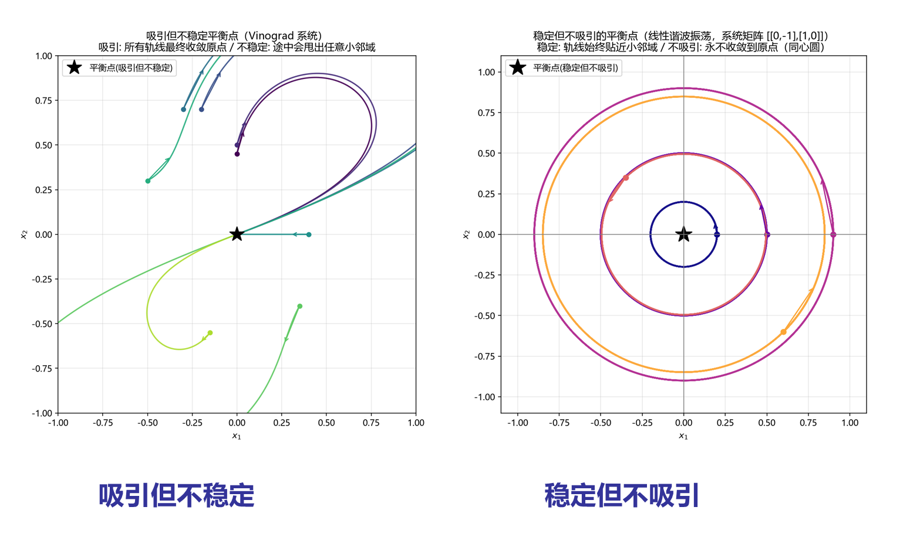

# 第四章：李雅普诺夫稳定性分析

> 来源：《现代控制理论-线性系统.-ch4.pptx》，共 **50 页**。页码指 PPT 物理页序。保留课件 4.1–4.4 的结构与术语，重点解释概念本质、公式来源、推导逻辑、物理意义及各章联系。“李亚普诺夫”和“李雅普诺夫”均指 Lyapunov，本文统一使用后者。
>
> 课件本章的部分结论仍标为 **5.4、5.5、5.6、5.9、5.22、5.23、5.24、5.28**，为方便对照，本文保留这些原编号，不将其误称为第五章内容。未编号定理按主题与页码定位。
>
> 文末收录 **6 组计算／证明题，以及 3 组反例／概念演示**。第 20 页左图没有给出微分方程，本文保留原图和它表达的逻辑，不虚构该图的系统参数。课件笔误、量词问题和适用条件均单独说明。
>
> 公式采用标准 LaTeX，使用 GitHub 支持的行内数学语法与 math 围栏块保存矩阵换行，请在 **Preview／预览** 中阅读。
>
> [50 页逐页核对索引](Chapter04_逐页核对索引.md) · [返回课程目录](../README.md)

## 阅读目录

- [本章学习主线](#本章学习主线)
- [4.1 外部稳定性和内部稳定性](#41-外部稳定性和内部稳定性)
- [4.2 李雅普诺夫意义下运动稳定性的一些基本概念](#42-李雅普诺夫意义下运动稳定性的一些基本概念)
- [4.3 李雅普诺夫第二方法的主要定理](#43-李雅普诺夫第二方法的主要定理)
- [4.4 连续时间系统的状态运动稳定性判据](#44-连续时间系统的状态运动稳定性判据)
- [本章小结与做题路线](#本章小结与做题路线)
- [课件校勘与适用条件](#课件校勘与适用条件)
- [附录：全部例题、证明及反例演示](#附录全部例题证明及反例演示)
- [参考核对材料](#参考核对材料)

## 本章学习主线

第一章建立状态空间模型，第二章求状态响应，第三章研究输入能否操纵状态、输出能否辨认状态。第四章继续追问：**初始状态有一点偏差，系统会一直保持在平衡点附近，最终回到平衡点，还是逐渐偏离？**

对线性定常系统，第二章已经给出

```math
x(t)=e^{A(t-t_0)}x_0.
```

只要理解矩阵指数的长期行为，就能判断稳定性。但非线性系统的解往往求不出来，时变系统也不能照搬定常特征值判据。李雅普诺夫第二方法改为构造一个随运动变化的标量函数，用它的大小及变化率约束状态。

可把这条主线写成四个连续的问题：

1. 看的是输入输出，还是系统内部状态？
2. 对状态而言，是要求靠近、收敛，还是要求从所有初值收敛？
3. 能否构造一个衡量“偏离程度”的函数，并证明它沿轨迹不增或下降？
4. 在线性系统中，能否把构造函数化为矩阵方程？

| 课件部分 | 页码 | 主要任务 |
| --- | --- | --- |
| 封面、目录与引言 | 1–4 | 稳定性问题与方法适用范围 |
| 4.1 外部稳定性和内部稳定性 | 5–11 | BIBO、内部渐近稳定、隐藏模态与时变反例 |
| 4.2 基本概念 | 12–23 | 平衡点、受扰运动、稳定、吸引、一致性、局部与全局 |
| 4.3 第二方法的主要定理 | 24–39 | 正定性、沿轨迹导数、全局／局部判据、半负定与不变集 |
| 4.4 连续时间系统判据 | 40–47 | LTI 特征值和代数方程；LTV 转移矩阵和微分方程 |
| 四类系统对比与结束页 | 48–50 | 梳理适用边界，不混用定理 |

记号：$`x\in\mathbb R^n`$ 为状态，$`x_e`$ 为平衡状态，$`t_0`$ 为初始时刻，$`\phi(t;t_0,x_0)`$ 为从 $`x_0`$ 出发的运动；$`V`$ 为李雅普诺夫候选函数，$`P,Q`$ 为对称矩阵，$`\Phi(t,t_0)`$ 为状态转移矩阵。$`\|\cdot\|`$ 表示欧氏范数或相容矩阵范数；定性稳定结论不依赖有限维空间中具体等价范数的选择。

讨论非线性初值问题时，默认向量场关于状态局部 Lipschitz，并具有所需的时间连续性，使解存在且唯一。全局结论还要保证解向前存在；后文的紧子水平集与下降条件正可用于排除有限时间逃逸。

## 4.1 外部稳定性和内部稳定性

### 4.1.1 外部稳定性：任何有界输入是否都产生有界输出

对应课件第 5–6 页。

课件称外部稳定性为**有界输入—有界输出稳定性**，简称 BIBO 稳定性。以零初始条件考察因果系统：

```math
\sup_{t\ge t_0}\|u(t)\|<\infty
\quad\Longrightarrow\quad
\sup_{t\ge t_0}\|y(t)\|<\infty.
```

“任何”是关键：找到一个输入使输出有界，不能证明 BIBO；找到一个有界输入导致输出无界，就能否定 BIBO。输入幅值界与输出幅值界不必相等，输出界可以依赖输入界与系统。

对连续时间线性系统，零状态输出可写成

```math
y(t)=D(t)u(t)+\int_{t_0}^{t}H(t,\tau)u(\tau)\,d\tau,
\qquad
H(t,\tau)=C(t)\Phi(t,\tau)B(\tau).
```

这里 $`H`$ 表示动态卷积核，直接项 $`D(t)u(t)`$ 单独处理。若 $`D`$ 为常矩阵，它显然把有界输入映射为有界输出；时变 $`D(t)`$ 则还须一致有界。

对固定初始时刻 $`t_0`$，在通常的线性输入输出框架下，动态部分 BIBO 的条件可逐元素写为

```math
\boxed{
\sup_{t\ge t_0}\int_{t_0}^{t}|h_{ij}(t,\tau)|\,d\tau<\infty
},
\qquad i=1,\ldots,q,\quad j=1,\ldots,p.
```

积分对每个有限 $`t`$ 存在还不够，必须有一个对所有未来 $`t`$ 都有效的有限上界。若还要求对所有起始时刻统一的输入输出界，则上界也应与 $`t_0`$ 无关。

**公式为什么合理？** 逐分量估计，

```math
|y_i(t)|
\le
\sum_{j=1}^{p}\|u_j\|_\infty
\int_{t_0}^{t}|h_{ij}(t,\tau)|\,d\tau
```

（此式先不计已单独处理的直接项）。核的绝对积分有统一上界，就不会把一个有限输入幅值累积成无限输出幅值。

对 LTI 系统 $`H(t,\tau)=H(t-\tau)`$，化为

```math
\boxed{\int_0^\infty|h_{ij}(r)|\,dr<\infty}.
```

对有限维、因果、真或严真有理传递函数矩阵，进一步等价为：**约消后的传递函数矩阵全部极点严格位于左半平面**。必须看实际传递函数极点，不能把任意非最小实现中 $`A`$ 的全部特征值都直接当作可见极点。

### 4.1.2 内部稳定性：关闭输入后，状态如何运动

对应课件第 7–8 页，原结论 5.4–5.6。

先考察零输入系统

```math
\dot x=A(t)x,\qquad
x(t)=\Phi(t,t_0)x_0.
```

课件第 4.1 节将“内部稳定”专门用作**内部渐近稳定**的简称，即所有零输入状态响应有界并趋于原点。后面的“李雅普诺夫稳定”则只有保持在附近的要求。两种口径必须区分。

按课件的用法，原结论 5.4 为

```math
\sup_{t\ge t_0}\|\Phi(t,t_0)\|<\infty,\qquad
\lim_{t\to\infty}\Phi(t,t_0)=0.
```

在连续的有限维线性系统中，对固定 $`t_0`$，矩阵趋零本身也保证其在整个未来区间有界；同时写出两条有助于分别理解“稳定”和“吸引”。

LTI 情形得到原结论 5.5、5.6：

```math
\boxed{
\lim_{t\to\infty}e^{At}=0
\quad\Longleftrightarrow\quad
\operatorname{Re}\lambda_i(A)<0\ \text{对全部 }i
}.
```

这就是第二章矩阵指数与第四章稳定性之间最直接的连接。若只要求李雅普诺夫稳定，则条件更弱，见第 4.4 节。

### 4.1.3 内部与外部稳定性的关系

对应课件第 9–10 页，原结论 5.9。

对有限维 LTI 系统，

```math
\boxed{\text{内部渐近稳定}\ \Longrightarrow\ \text{BIBO 稳定}}.
```

因为 $`A`$ 的全部特征值实部严格为负，$`Ce^{At}B`$ 的指数项及其有限次多项式因子都可绝对积分。

反过来一般不成立。第三章已经说明，一些状态模态可能无法由输入激发，或无法在输出中观测。它们可能从传递函数中消失，却仍被非零初始状态激发。

**补充说明例：**

```math
A=\begin{bmatrix}-1&0\\0&1\end{bmatrix},
\quad B=\begin{bmatrix}1\\0\end{bmatrix},
\quad C=\begin{bmatrix}1&0\end{bmatrix},
\quad D=0.
```

此时 $`G(s)=1/(s+1)`$ 是 BIBO 稳定的；但若 $`x_2(0)\ne0`$，则 $`x_2(t)=e^tx_2(0)`$ 发散，内部不渐近稳定。这是用于解释隐藏模态的补充例，不是课件另有一道数值题。

原结论 5.9 增加“完全能控且完全能观测”的条件，即最小实现，得到

```math
\boxed{
\text{完全能控且完全能观测的 LTI 系统：}
\quad\text{BIBO 稳定}\ \Longleftrightarrow\ \text{内部渐近稳定}
}.
```

**“与输入无关”应怎样理解？** 内部稳定性在所选参考输入下，考察初始状态扰动引起的自由运动；它不是根据某条外部输入的输出曲线定义的。但对非线性系统，若固定不同的恒值输入 $`\bar u`$，自治向量场 $`f(x,\bar u)`$、平衡点以及该点的线性化都可能改变，稳定性结论也可能改变。只有 LTI 仿射模型 $`\dot x=Ax+B\bar u`$ 在可平移平衡点时，扰动方程仍是同一个 $`\dot z=Az`$。

### 4.1.4 时变与非线性系统不能照搬 LTI 结论

对应课件第 10–11 页。

对时变系统，即使 $`A(t)`$ 在每个时刻的特征值实部都为负，也不能一般地判断实际状态收敛。第二章已经说明：传播由整段时间内按顺序作用的 $`A(t)`$ 决定；瞬时矩阵的特征值没有包含坐标方向变化带来的影响。

课件第 11 页的“Wu 反例”中，瞬时特征值恒为 $`-10,-1`$，但存在以 $`e^{2t}`$ 增长的实际轨迹。附录 E01 用旋转坐标变换给出精确推导，不只依赖图上曲线。

对非线性系统，零输入渐近稳定也不能直接推出任意有界输入下状态有界。例如，作为说明，

```math
\dot x=-\frac{x}{1+x^2}+u.
```

$`u=0`$ 时取 $`V=x^2/2`$，有 $`\dot V=-x^2/(1+x^2)<0`$，原点全局渐近稳定；但有界常输入 $`u=1`$ 时，由 $`x/(1+x^2)\le1/2`$ 得 $`\dot x\ge1/2`$，状态会无界增长。

课件为此介绍输入—状态稳定性 ISS：典型估计将初值效应的衰减与输入效应的上界分开，

```math
\|x(t)\|
\le \beta(\|x_0\|,t-t_0)
+\gamma\!\left(\sup_{t_0\le\tau\le t}\|u(\tau)\|\right).
```

其中 $`\beta`$ 随时间差衰减，$`\gamma`$ 随输入幅值增大。这里仅保留课件的概念联系，本章后续主要讨论零输入平衡点稳定性。

## 4.2 李雅普诺夫意义下运动稳定性的一些基本概念

### 4.2.1 第一法与第二法

对应课件第 12 页。

课件将李雅普诺夫理论的两条路线区分为：

- **第一法／间接法：** 在平衡点附近线性化，用线性化系统的特征结构判断局部性质。
- **第二法／直接法：** 构造标量函数 $`V`$，用它沿系统轨迹的变化率判断稳定性，无需显式求解状态方程。

间接法需要理解边界：对光滑自治非线性系统，如果线性化矩阵全部特征值实部为负，可判断局部渐近稳定；若存在正实部特征值，可判断不稳定；若有零实部特征值而其余实部非正，通常不能仅凭线性化下结论。附录 E06 的线性化是无阻尼旋转，实际非线性系统却全局渐近稳定。

直接法也不是“随便找一个能量表达式”：必须核对正定性、沿轨迹导数、时间一致性、定义区域及是否径向无界。

### 4.2.2 自治系统、平衡状态与平衡点平移

对应课件第 13–15 页。

**自治系统**的标准含义是向量场不显含时间：

```math
\dot x=f(x).
```

$`\dot x=f(x,t)`$ 是非自治系统，即使外部输入为零也可能非自治。自治不表示状态静止；它表示运动规律不随绝对时刻改变。

对一般时变系统，一个常向量 $`x_e`$ 是平衡状态，需要

```math
\boxed{f(x_e,t)=0\quad\text{对全部相关 }t\text{ 成立}}.
```

只在某个时刻满足 $`f(x_e,t)=0`$，不能证明它是整个系统的常值平衡状态。对自治系统，化为 $`f(x_e)=0`$。

孤立平衡点是指存在邻域，在这个邻域内没有其他平衡点。对于 LTI 系统，

```math
Ax_e=0.
```

$`A`$ 可逆时，只有 $`x_e=0`$；$`A`$ 奇异时，$`\ker A`$ 中每一点都是平衡点，原点不孤立。

非孤立平衡点仍可讨论单点的李雅普诺夫稳定性；但不可能让一个点具有吸引整个邻域的单点渐近稳定性，因为附近其他平衡点的轨迹会一直停在各自位置。也可以改为研究平衡点集合的稳定性。

若原平衡点不在原点，令

```math
z=x-x_e.
```

自治系统变为 $`\dot z=f(z+x_e)`$，且 $`z=0`$ 为平衡点。若 LTI 系统有常输入，

```math
Ax_e+B\bar u=0,\qquad \dot x=Ax+B\bar u,
```

则

```math
\boxed{\dot z=Az}.
```

因此后文把平衡点置于原点不会丢失本质，但必须先明确平衡点存在，并正确固定所考察的输入。

### 4.2.3 受扰运动与李雅普诺夫稳定

对应课件第 16–18 页。

受扰运动指初始状态偏离平衡点后产生的状态运动，记为

```math
x(t)=\phi(t;t_0,x_0),\qquad
\phi(t_0;t_0,x_0)=x_0.
```

这里的“扰动”首先是初始条件扰动，不是任意持续作用的外部扰动信号。

**李雅普诺夫稳定的精确定义：** 对固定 $`t_0`$，对任意 $`\varepsilon>0`$，存在 $`\delta(\varepsilon,t_0)>0`$，使

```math
\boxed{
\|x_0-x_e\|<\delta
\quad\Longrightarrow\quad
\|\phi(t;t_0,x_0)-x_e\|<\varepsilon
\quad\text{对全部 }t\ge t_0
}.
```

量词顺序是“先给允许偏差 $`\varepsilon`$，再选初始扰动界 $`\delta`$”。$`\delta`$ 可以小于 $`\varepsilon`$，也不要求状态范数单调下降。

几何上：给定外球 $`B_\varepsilon(x_e)`$，能找到一个内球 $`B_\delta(x_e)`$，使从内球出发的所有轨迹以后都不离开外球。

这比“某条轨迹有界”强得多。即使每条轨迹最终有限，也可能存在任意小的初值偏差先跑到很远，破坏上述统一的邻域约束。

### 4.2.4 一致稳定：初始扰动界能否不依赖起始时刻

对应课件第 17–18 页。

如果同一个

```math
\delta=\delta(\varepsilon)
```

能用于所有允许的 $`t_0`$，则称**一致稳定**。它要求系统在任何起始时刻都能接受同样尺度的初值误差。

自治系统满足 $`\phi(t;t_0,x_0)=\phi(t-t_0;0,x_0)`$，改变起始时刻只平移轨迹的时间坐标，因此在常规初值问题框架下，

```math
\boxed{\text{自治系统：稳定}\ \Longleftrightarrow\ \text{一致稳定}}.
```

对时变系统，两者必须区分。后文 $`P(t)`$ 的统一上下界正是保证一致性的关键。

### 4.2.5 吸引与渐近稳定

对应课件第 19–21 页。

**吸引性**要求：存在 $`x_e`$ 的某个邻域，使从其中出发的轨迹满足

```math
\lim_{t\to\infty}\phi(t;t_0,x_0)=x_e.
```

**渐近稳定**则同时要求

```math
\boxed{\text{渐近稳定}=\text{李雅普诺夫稳定}+\text{局部吸引}}.
```

稳定约束全过程，吸引约束长期极限。附录 E02、E03 对应第 20 页的两幅图，说明两种条件不能相互替代。

对渐近稳定的自治系统，在一个适当选取的较小闭邻域内，可以用收敛时间表述：给定目标半径 $`\mu>0`$，存在有限 $`T`$，使该邻域内所有初值的轨迹在 $`t\ge t_0+T`$ 时进入并保持在 $`B_\mu(x_e)`$。

课件第 21 页把“受扰运动有界且趋零”列为等价描述。使用时应保留前面已经要求的稳定性条件；对一般非线性系统，单凭“每条轨迹有界并最终收敛”不能代替李雅普诺夫稳定的邻域量词。

### 4.2.6 一致渐近稳定

对应课件第 21、38–39 页。

一致渐近稳定要求两方面：

1. 一致稳定，即 $`\delta(\varepsilon)`$ 不依赖 $`t_0`$。
2. 一致局部吸引：存在与 $`t_0`$ 无关的初始半径 $`r>0`$，对任给 $`\mu>0`$，存在与 $`t_0`$ 无关的收敛时间 $`T(\mu,r)`$，使

```math
\|x_0-x_e\|<r,\quad t\ge t_0+T(\mu,r)
\quad\Longrightarrow\quad
\|\phi(t;t_0,x_0)-x_e\|<\mu.
```

这意味着不只是“每次最终会到”，还可以给出不随起始时刻恶化的保证。

自治系统通常有

```math
\boxed{\text{渐近稳定}\ \Longleftrightarrow\ \text{一致渐近稳定}}.
```

但“一致”与“吸引”是两个不同的要求，不能把所有概念排成一条简单的强弱链。一致稳定未必吸引；对非自治系统，渐近稳定也未必一致稳定。

### 4.2.7 小范围、大范围、指数与有限时间

对应课件第 22、38–39、48–49 页。

**小范围／局部渐近稳定：** 稳定与吸引只要求在平衡点附近成立。

**大范围／全局渐近稳定：** 在整个指定状态空间中，所有初值对应的解向前存在并趋向该平衡点，同时平衡点稳定。若状态空间为 $`\mathbb R^n`$，就是对全部有限初值成立。

全局吸引到单个平衡点必然排除其他任何平衡点，而不只是排除其他“渐近稳定”的平衡点：从另一个平衡点出发的常值解就不可能到达目标点。

对齐次线性系统，局部渐近稳定可以通过缩放推广到全局：若 $`x(t;x_0)`$ 是解，则 $`kx(t;x_0)`$ 对应初值 $`kx_0`$。任何大初值都能先缩小到局部邻域，再由线性比例还原。因此 LTI、LTV 的局部渐近稳定均能推广到全局，保留相应的时间一致性口径。

**指数稳定**是更强的速率结论：

```math
\|x(t)\|\le M e^{-\lambda(t-t_0)}\|x_0\|,
\qquad M\ge1,\quad\lambda>0.
```

LTI 系统渐近稳定即全局指数稳定；一般非线性系统并非如此，附录 E06 给出按 $`t^{-1/2}`$ 衰减的例子。

**有限时间收敛**要求在某个有限时刻精确到达平衡点，并从此保持在那里。连续时间 LTI 系统对任意有限 $`T`$ 都有可逆矩阵 $`e^{AT}`$，所以

```math
e^{AT}x_0=0\quad\Longrightarrow\quad x_0=0.
```

因此非零初态不可能有限时间到达原点；$`A=0`$ 也不是例外，此时状态保持初值。某些非线性有限时间稳定系统会使用在原点不满足通常局部 Lipschitz 条件的向量场，应与本章默认的光滑／唯一性框架分开理解。

### 4.2.8 不稳定：稳定定义的正确否定

对应课件第 23 页。

对固定 $`t_0`$，不稳定的定义是

```math
\boxed{
\exists\varepsilon_*>0,\quad
\forall\delta>0,\quad
\exists x_0,\ \|x_0-x_e\|<\delta,\quad
\exists t\ge t_0:
\|\phi(t;t_0,x_0)-x_e\|\ge\varepsilon_*
}.
```

即存在一个固定的邻域尺度，无论初值限制得多小，总能找到某个初值及未来时刻使轨迹离开该邻域。

课件写“不管取 $`\varepsilon`$ 多么大”不是上述定义的逻辑否定；正确的是“存在一个 $`\varepsilon_*>0`$”。不稳定也不必意味着状态发散到无穷：轨迹可能远离原平衡点后进入另一个有界吸引子。

第 18 页将“李雅普诺夫稳定”等同于“临界不稳定”也不宜作为一般定义。渐近稳定本身就包含李雅普诺夫稳定；无阻尼振荡只是“稳定但不吸引”的一种边界情形。

## 4.3 李雅普诺夫第二方法的主要定理

### 4.3.1 候选函数与沿轨迹导数

对应课件第 24、29–31 页。

构造一个标量函数

```math
V(x,t),\qquad V(0,t)=0.
```

希望它能衡量状态偏离原点的程度：原点为零，离开原点为正，沿实际运动下降。它可以类似能量，但不要求等于真实机械能或电磁储能。

对 $`\dot x=f(x,t)`$，链式法则给出

```math
\boxed{
\dot V(x,t)=\frac{\partial V}{\partial t}
+\frac{\partial V}{\partial x}f(x,t)
}.
```

其中 $`\partial V/\partial x`$ 取行梯度。对自治系统、定常候选函数 $`V(x)`$，

```math
\boxed{\dot V(x)=\nabla V(x)^{\mathsf T}f(x)}.
```

$`\dot V`$ 不是任意方向的变化率，而是**沿系统给定向量场**的变化率。若 $`V`$ 显含时间，漏掉 $`\partial V/\partial t`$ 就是在判断另一种函数的变化。

### 4.3.2 正定、半正定与二次型

对应课件第 25–28 页。

在含原点的区域内：

| 性质 | 函数条件 |
| --- | --- |
| 正定 | $`V(0)=0`$，所有 $`x\ne0`$ 都有 $`V(x)>0`$ |
| 半正定 | $`V(x)\ge0`$，但允许某些非零点也为零 |
| 负定 | $`W(0)=0`$，所有 $`x\ne0`$ 都有 $`W(x)<0`$ |
| 半负定 | $`W(x)\le0`$，允许某些非零点取零 |
| 不定 | 在所讨论邻域存在正值和负值 |

最常用的候选函数是二次型

```math
V(x)=x^{\mathsf T}Px,\qquad P=P^{\mathsf T}.
```

展开时交叉项由两个对称元素合成：

```math
x^{\mathsf T}Px=\sum_i p_{ii}x_i^2
+2\sum_{i<j}p_{ij}x_ix_j.
```

因此题目若有 $`2x_1x_2`$，矩阵中 $`p_{12}=p_{21}=1`$，而不是 2。任何实矩阵的反对称部分对二次型没有贡献，

```math
x^{\mathsf T}Px
=x^{\mathsf T}\frac{P+P^{\mathsf T}}2x,
```

所以通常直接取实对称矩阵。

对实对称 $`P`$，

```math
\lambda_{\min}(P)\|x\|^2
\le x^{\mathsf T}Px
\le\lambda_{\max}(P)\|x\|^2.
```

这两个界说明：$`P>0`$ 时，$`V`$ 与状态距离平方可以相互控制；$`V`$ 的子水平面是椭球，而不必是球。

**课件的两种定号法：**

1. 正定的 Sylvester 判据：所有**顺序主子式** $`\Delta_k>0`$。
2. 特征值法：对称矩阵全部特征值正／负／非负／非正，对应正定／负定／半正定／半负定；特征值有正有负则不定。

负定对应 $`(-1)^k\Delta_k>0`$，即顺序主子式负、正、负、正交替。

**半正定不能简单地将正定判据的“$`>`$”改为“$`\ge`$”。** 半正定需要所有主子式非负，或直接检查全部特征值非负；只检查顺序主子式非负不够。例如 $`\mathrm{diag}(0,-1)`$ 的两个顺序主子式都是零，却不是半正定。课件第 26 页没有展开这一点，本文补充以免误用。

附录 E04、E05 分别完整计算课件第 27、28 页的两个二次型。

### 4.3.3 稳定性定理为什么成立

对应课件第 29、37 页；以下先说明自治情形。

若在原点附近 $`V`$ 正定，且 $`\dot V\le0`$，就可以找到一个包围原点的足够小子水平集

```math
\Omega_c=\{x:V(x)\le c\},
```

使其包含一个初始小球，并被允许偏差外球包含。沿轨迹

```math
V(x(t))\le V(x_0)\le c,
```

轨迹就不能穿越到更大的 $`V`$ 值区域。这建立了稳定定义所需的“内球—不变子水平集—外球”关系。

更具体地，给定足够小 $`\varepsilon`$，在球面上

```math
m_\varepsilon=\min_{\|x\|=\varepsilon}V(x)>0.
```

由 $`V`$ 在原点连续，可选 $`\delta`$，使 $`\|x_0\|<\delta`$ 时 $`V(x_0)<m_\varepsilon`$。如果轨迹首次越过该球面，就会要求 $`V`$ 至少升到 $`m_\varepsilon`$，与不增矛盾。

这证明

```math
\boxed{V>0,\quad \dot V\le0
\quad\Longrightarrow\quad\text{原点局部李雅普诺夫稳定}}.
```

如果进一步 $`\dot V`$ 对非零状态负定，在紧的非零环带上便存在严格的下降率下界。若轨迹永远不进入某个更小邻域，$`V`$ 就会一直以至少一个正速率下降，最终与 $`V\ge0`$ 矛盾。这给出吸引性，因而

```math
\boxed{V>0,\quad \dot V<0\ (x\ne0)
\quad\Longrightarrow\quad\text{原点局部渐近稳定}}.
```

不能只说“函数始终下降，所以一定趋零”。一个正函数完全可能下降到正数；这里还使用了 $`V`$ 对距离的控制、下降率在非零紧环带上有严格下界等条件。

### 4.3.4 自治系统的大范围渐近稳定定理

对应课件第 31 页。

设 $`\dot x=f(x)`$，$`f(0)=0`$，若存在定义在整个 $`\mathbb R^n`$ 上的 $`C^1`$ 函数 $`V`$，满足

```math
\begin{aligned}
V(0)&=0,\qquad V(x)>0\quad(x\ne0),\\
\dot V(x)&<0\quad(x\ne0),\\
V(x)&\to\infty\quad\text{当 }\|x\|\to\infty,
\end{aligned}
```

则原点全局渐近稳定。

最后一个条件称**径向无界**。它保证每个有限子水平集 $`\Omega_c`$ 都有界；结合连续性，它是紧集。轨迹因 $`V`$ 不增而被困在某个紧集内，再应用局部唯一性与延拓性质，可排除有限时间逃逸，并把局部收敛论证推广到任意初值。

**为什么单有正定不够？** 比如 $`V(x)=x^2/(1+x^2)`$ 正定，却在 $`|x|\to\infty`$ 时趋于 1；“$`V`$ 有界”并不能用来排除状态跑向无穷。径向无界保证状态很远时 $`V`$ 必然很大。

附录 E06 对课件第 32 页的非线性系统验证以上全部条件，并补出精确衰减规律。

### 4.3.5 时变系统的大范围一致渐近稳定定理

对应课件第 24 页。

对 $`\dot x=f(x,t)`$、$`f(0,t)=0`$，课件要求用与时间无关的比较函数从上下两侧约束 $`V`$，并约束下降率。以标准记号重写为

```math
\boxed{
\alpha_1(\|x\|)\le V(x,t)\le\alpha_2(\|x\|),
\qquad
\dot V(x,t)\le-\alpha_3(\|x\|)
}.
```

这里可取 $`\alpha_1,\alpha_2`$ 为 $`\mathcal K_\infty`$ 类函数，$`\alpha_3`$ 为正定比较函数，全部不依赖 $`t`$。$`\mathcal K`$ 类指连续、严格递增、零点取零的函数；$`\mathcal K_\infty`$ 还要求自变量趋于无穷时函数趋于无穷。

若这些条件在整个状态空间和所有未来时刻成立，并满足前述解的条件，得到**全局一致渐近稳定**。在原点邻域成立则得到局部一致渐近稳定。

三个比较条件分别保证：

- 下界：$`V`$ 小可以迫使状态小。
- 上界：同样小的初始状态，在不同 $`t_0`$ 时都具有统一的小初始 $`V`$ 值。
- 下降率：离原点一定距离时，下降不会随时间推迟而无限变慢。

全局结论还利用 $`\alpha_1`$ 径向无界。课件“正定且有界”中的“有界”应理解为由与时间无关的状态函数统一控制；**不是要求 $`V`$ 在整个 $`\mathbb R^n`$ 上有一个有限常数上界**，否则会与径向无界直接矛盾。

**为什么不能只检查每个时刻正定及 $`\dot V<0`$？** 用补充例

```math
\dot x=x,\qquad V(x,t)=e^{-3t}x^2.
```

每个固定时刻 $`V`$ 都正定，沿轨迹 $`\dot V=-e^{-3t}x^2<0`$，但实际 $`x(t)=e^{t-t_0}x_0`$ 发散。原因是 $`V`$ 的尺度本身随时间塌缩，缺少对状态距离的统一正定下界。

### 4.3.6 半负定导数与最大不变集

对应课件第 30、33–34、36 页。

$`\dot V\le0`$ 一般只能保证稳定，不能直接保证收敛，因为某些非零轨迹可能一直停在 $`\dot V=0`$ 的集合中。无阻尼振子就是这样的例子。

对自治系统，可以利用 **LaSalle 不变集原理**：在一个紧的正不变集合内，若 $`\dot V\le0`$，令

```math
E=\{x:\dot V(x)=0\}.
```

轨迹最终趋近 $`E`$ 中的**最大不变集** $`M`$。若 $`M=\{0\}`$，结合 $`V`$ 正定就能得到原点渐近稳定。若 $`V`$ 全局正定、径向无界，并对所有子水平集均可应用，则得到全局渐近稳定。［R1］

课件将补充条件写为

```math
\dot V(\phi(t;t_0,x_0))\ne0.
```

应按其后例题解释为：对任意非零初始状态，沿其轨迹的 $`\dot V`$ **不恒等于零**，即不允许非零轨迹一直留在零导数集合内。它不是要求“每个瞬间都不等于零”；那会退回严格负定条件，也与第 33 页零导数直线的存在冲突。

做题时必须区分：

- 某点满足 $`\dot V(x)=0`$：只说明该瞬间能量变化率为零。
- 从该点出发的整条轨迹始终满足 $`\dot V=0`$：才会妨碍上述收敛论证。

附录 E07 对两条直线 $`x_2=0`$、$`x_2=-1`$ 逐条检查是否能够承载完整轨迹，而不是只把它们列出来就结束。

标准自治 LaSalle 定理不能原封不动地套用于一般时变系统；这并不等于数学上不存在任何非自治不变性原理。本章采用课件对应的自治版本。

### 4.3.7 局部区域与吸引域估计

对应课件第 35–37 页。

若正定、负定条件只能在原点邻域 $`D`$ 内证明，就应给出局部结论。对自治系统，典型路线是选择

```math
\Omega_c=\{x:V(x)\le c\}\subset D
```

为紧子水平集，保证轨迹始终留在已经验证条件的区域内。

**不能把“导数满足符号条件的整个区域”自动称为吸引域。** 还要证明从所声称的初始集合出发，轨迹不会先离开该区域。用不变子水平集可以给出吸引域的一个内估计，不一定得到最大吸引域。［R1］

局部判据可归纳为：

| 系统与函数 | 导数条件 | 可以保证的基本结论 |
| --- | --- | --- |
| 自治，局部正定 $`V(x)`$ | $`\dot V\le0`$ | 局部李雅普诺夫稳定 |
| 自治，局部正定 $`V(x)`$ | $`\dot V<0`$，非零点严格 | 局部渐近稳定 |
| 自治，局部正定 $`V(x)`$ | $`\dot V\le0`$，零导数最大不变集仅原点 | 局部渐近稳定 |
| 时变，有统一正定上下界 $`V(x,t)`$ | $`\dot V\le0`$ | 局部一致稳定 |
| 时变，有统一正定上下界 $`V(x,t)`$ | $`\dot V\le-\alpha_3(\|x\|)`$ | 局部一致渐近稳定 |

课件第 37 页时变稳定判据的题名误写成“小范围渐近稳定性定理”，但其 $`\dot V\le0`$ 的条件与结论实际对应“一致稳定”。

### 4.3.8 关于直接法的六点理解

对应课件第 29 页的六点讨论。

1. 直接法可以覆盖多类系统，但要匹配各类系统各自的定理条件；非自治的一致性不能省去。
2. 广义能量的直觉有帮助，严密结论仍来自函数界与沿轨迹导数。
3. $`V`$ 可以不是物理能量，同一个系统往往有多个有效 $`V`$。
4. 选 $`V`$ 需要结构判断；本章的二次型是重要候选，但不是所有非线性问题都适用。
5. 某个候选函数验证失败，不等于系统不稳定；这些候选函数判据首先是充分性结论。
6. 对 LTI 系统，二次型的构造可以化为代数李雅普诺夫方程，并形成必要且充分的完整判据。

## 4.4 连续时间系统的状态运动稳定性判据

### 4.4.1 LTI 特征值判据：稳定与渐近稳定

对应课件第 40 页，原结论 5.22、5.23。

对 $`\dot x=Ax`$：

**原结论 5.22，李雅普诺夫稳定：**

```math
\boxed{
\operatorname{Re}\lambda_i(A)\le0,\quad
\text{所有零实部特征值的约当块均为一阶}
}.
```

课件表述为“零实部特征值只能为最小多项式的单根”。这不要求其代数重数为 1，而是要求它在最小多项式中的因子次数为 1，即对应模态是半单的。

**原结论 5.23，渐近稳定：**

```math
\boxed{\operatorname{Re}\lambda_i(A)<0\quad\text{对所有 }i}.
```

为什么约当结构会出现在稳定性条件中？第二章给出

```math
e^{J_r(\lambda)t}
=e^{\lambda t}\left(I+tN+\cdots+
\frac{t^{r-1}}{(r-1)!}N^{r-1}\right).
```

负实部指数最终压过有限次幂；正实部指数增长；零实部指数本身不衰减，若还乘以 $`t,t^2,\ldots`$ 就会无界。因此零实部约当块不能大于一阶。

两个简短对照：

```math
A_1=\begin{bmatrix}0&-1\\1&0\end{bmatrix}
```

产生范数不变的旋转，稳定但不渐近稳定；而

```math
A_2=\begin{bmatrix}0&1\\0&0\end{bmatrix},
\qquad e^{A_2t}=\begin{bmatrix}1&t\\0&1\end{bmatrix}
```

虽然特征值全为零，却存在随 $`t`$ 增长的状态，所以不稳定。不能只检查“特征值没有正实部”就宣布稳定。

### 4.4.2 从二次型推导代数李雅普诺夫方程

对应课件第 41–43 页，原结论 5.24。

取 $`V=x^{\mathsf T}Px`$，$`P=P^{\mathsf T}`$ 为常阵。对 $`\dot x=Ax`$，

```math
\begin{aligned}
\dot V
&=\dot x^{\mathsf T}Px+x^{\mathsf T}P\dot x\\
&=x^{\mathsf T}(A^{\mathsf T}P+PA)x.
\end{aligned}
```

希望导数成为一个明确负定的二次型，因此选取 $`Q=Q^{\mathsf T}>0`$，要求

```math
\boxed{A^{\mathsf T}P+PA=-Q}.
```

未知量是 $`P`$ 的对称元素。虽然矩阵表达中出现 $`PA`$，但 $`A,Q`$ 已知，对 $`P`$ 而言它是线性代数方程，不是需要迭代猜测的非线性方程。

**原结论 5.24：**

```math
\boxed{
A\text{ 的全部特征值实部为负}
\quad\Longleftrightarrow\quad
\forall Q=Q^{\mathsf T}>0,\ 
A^{\mathsf T}P+PA=-Q
\text{ 有唯一对称正定解 }P
}.
```

实际判断时，选一个方便的 $`Q>0`$，例如 $`Q=I`$，找到 $`P>0`$ 就足以证明 $`A`$ 稳定；一旦 $`A`$ 稳定，才进一步保证对所有 $`Q>0`$ 都成立。只有“方程有解”而未检查 $`P`$ 正定，不能得出稳定结论。

附录 E08 完整计算第 41–43 页的 $`2\times2`$ 例题，包括课件逆矩阵、解阵和正定性。

### 4.4.3 为什么该方程既充分又必要

**充分性**直接来自

```math
V=x^{\mathsf T}Px>0,\qquad
\dot V=-x^{\mathsf T}Qx<0,
```

且 $`P>0`$ 使 $`V`$ 径向无界。还可推得具体速率：

```math
\dot V
\le-\lambda_{\min}(Q)\|x\|^2
\le-\frac{\lambda_{\min}(Q)}{\lambda_{\max}(P)}V.
```

积分并结合二次型上下界，

```math
\boxed{
\|x(t)\|\le
\sqrt{\frac{\lambda_{\max}(P)}{\lambda_{\min}(P)}}
\exp\!\left[
-\frac{\lambda_{\min}(Q)}{2\lambda_{\max}(P)}(t-t_0)
\right]\|x_0\|
}.
```

这证明 LTI 渐近稳定同时是指数稳定。

**必要性**可以由第二章的传播矩阵构造：

```math
\boxed{
P=\int_0^\infty e^{A^{\mathsf T}r}Qe^{Ar}\,dr
}.
```

若 $`A`$ 稳定，指数衰减保证积分收敛。对 $`x\ne0`$，

```math
x^{\mathsf T}Px
=\int_0^\infty(e^{Ar}x)^{\mathsf T}Q(e^{Ar}x)\,dr>0.
```

对被积矩阵求导并积分，

```math
\begin{aligned}
A^{\mathsf T}P+PA
&=\int_0^\infty
\frac{d}{dr}\bigl(e^{A^{\mathsf T}r}Qe^{Ar}\bigr)\,dr\\
&=\left[e^{A^{\mathsf T}r}Qe^{Ar}\right]_{0}^{\infty}
=-Q.
\end{aligned}
```

若 $`P_1,P_2`$ 都是解，令 $`\Delta=P_1-P_2`$，则

```math
\frac{d}{dt}(e^{A^{\mathsf T}t}\Delta e^{At})=0.
```

左边括号恒等于 $`\Delta`$；当 $`t\to\infty`$ 又趋零，故 $`\Delta=0`$，解唯一。

这个积分还给出物理解释：

```math
x_0^{\mathsf T}Px_0
=\int_0^\infty x(t)^{\mathsf T}Qx(t)\,dt.
```

即 $`V(x_0)`$ 是从该初值出发的自由运动所累计的加权状态平方。

### 4.4.4 推广形式：指定稳定裕度

对应课件第 43 页。

要求所有特征值满足

```math
\operatorname{Re}\lambda_i(A)<-\sigma,\qquad \sigma\ge0,
```

等价于 $`A+\sigma I`$ 稳定。对它应用同一个方程，

```math
(A+\sigma I)^{\mathsf T}P+P(A+\sigma I)=-Q,
```

得到课件的推广形式

```math
\boxed{2\sigma P+A^{\mathsf T}P+PA=-Q}.
```

若 $`P,Q>0`$，则原系统的候选函数满足

```math
\dot V=-2\sigma V-x^{\mathsf T}Qx<-2\sigma V
\quad(x\ne0).
```

于是该方程除了判断是否收敛，还约束收敛的指数裕度。$`\sigma`$ 的量纲与 $`A`$ 的特征值相同，都是时间的倒数。

### 4.4.5 对称部分负定的充分条件

对应课件第 44 页证明题，详见附录 E09。

若

```math
A+A^{\mathsf T}<0,
```

取 $`P=I`$，$`Q=-(A+A^{\mathsf T})>0`$，立即满足代数李雅普诺夫方程，故原点全局指数稳定。

它的几何含义是：在通常欧氏距离下，任意非零状态的范数平方都即时下降。一般稳定矩阵可能先有短暂放大，只是在某个合适的椭球尺度 $`P`$ 下能保证持续下降，因此这个 $`P=I`$ 条件是充分条件，并非必要条件。附录 E09 给出明确的对照矩阵。

### 4.4.6 $`Q`$ 半正定时为什么需要能观测性

对应课件第 44 页下半部。

设

```math
Q=D^{\mathsf T}D\ge0,
\qquad
A^{\mathsf T}P+PA=-D^{\mathsf T}D.
```

注意这里的 $`D`$ 是 $`Q`$ 的因子，与状态空间输出方程中的直接传输矩阵不必相同；它的维数可以是 $`r\times n`$。课件记为“$`(A,D)`$ 能观测”，即把 $`Dx`$ 当作所考察的输出。

此时

```math
\dot V=-\|Dx\|^2\le0.
```

如果 $`(A,D)`$ 完全能观测，就不存在非零的零输入轨迹能够一直满足 $`Dx(t)=0`$。因此零导数集合中没有非零不变轨迹，半负定导数仍可结合不变集论证渐近稳定。

反方向，若 $`A`$ 稳定，

```math
P=\int_0^\infty
e^{A^{\mathsf T}r}D^{\mathsf T}De^{Ar}\,dr
```

是无限时间能观测 Gramian；完全能观测保证它正定。这正好把第三章的能观测性、Gramian 与第四章能量函数联系起来。［R2］

这里不能任意取 $`Q=0`$ 后仍声称“必有正定解并推出稳定”；所需能观测条件已经失效。

### 4.4.7 LTV 状态转移矩阵判据

对应课件第 45–46 页。

对

```math
\dot x=A(t)x,\qquad x(t)=\Phi(t,t_0)x_0,
```

**固定 $`t_0`$ 的稳定性：**

```math
\boxed{\sup_{t\ge t_0}\|\Phi(t,t_0)\|\le M(t_0)<\infty}.
```

充分性很直观：给定 $`\varepsilon`$，选 $`\delta=\varepsilon/M(t_0)`$ 即可。必要性可以利用线性缩放，把稳定定义对一个固定小球的约束变为传播算子的范数界。

**一致稳定：**

```math
\boxed{\|\Phi(t,t_0)\|\le M
\quad\text{对全部 }t\ge t_0,\text{且 }M\text{ 与 }t_0\text{ 无关}}.
```

**固定 $`t_0`$ 的渐近稳定：** 稳定并且

```math
\boxed{\lim_{t\to\infty}\|\Phi(t,t_0)\|=0}.
```

**一致渐近稳定：** 对通常连续时间线性系统，等价于存在统一常数

```math
\boxed{
\|\Phi(t,t_0)\|\le M e^{-\lambda(t-t_0)},
\qquad M\ge1,\quad\lambda>0
}.
```

为什么线性的一致吸引会升级为指数衰减？由一致稳定先得到 $`M`$；再由一致吸引，可选一个统一时长 $`T`$，使每段长度为 $`T`$ 的转移矩阵范数不超过某个 $`q<1`$。用第二章的组合性质反复相乘，

```math
\|\Phi(t,t_0)\|\le Mq^{\lfloor(t-t_0)/T\rfloor}
\le\frac{M}{q}
\exp\!\left(\frac{\ln q}{T}(t-t_0)\right).
```

这就是指数界。该结论不能推广为“一切非线性渐近稳定都指数稳定”。

### 4.4.8 LTV 微分李雅普诺夫方程

对应课件第 47 页，原结论 5.28。

取时变二次型

```math
V(x,t)=x^{\mathsf T}P(t)x,\qquad P(t)=P^{\mathsf T}(t).
```

链式法则给出

```math
\dot V
=x^{\mathsf T}\bigl[\dot P+A^{\mathsf T}(t)P+PA(t)\bigr]x.
```

所以令

```math
\boxed{
\dot P(t)+A^{\mathsf T}(t)P(t)+P(t)A(t)=-Q(t)
},
```

这与课件的 $`-\dot P=PA+A^{\mathsf T}P+Q`$ 完全相同。定常情况 $`\dot P=0`$，就退回代数方程。

课件原结论 5.28 在 $`A(t)`$ 分段连续且一致有界的条件下，给出如下必要充分判据：原点一致渐近稳定，当且仅当对任给满足

```math
0<q_1I\le Q(t)\le q_2I
```

的实对称时变矩阵，可以找到满足微分方程且

```math
\boxed{0<p_1I\le P(t)\le p_2I}
```

的实对称解。各常数与时间无关。系数分段连续时，方程按相应分段或几乎处处的微分意义理解。

**充分性的速率估计：**

```math
p_1\|x\|^2\le V\le p_2\|x\|^2,
\qquad
\dot V=-x^{\mathsf T}Qx
\le-\frac{q_1}{p_2}V,
```

```math
\boxed{
\|x(t)\|\le
\sqrt{\frac{p_2}{p_1}}
e^{-\frac{q_1}{2p_2}(t-t_0)}\|x_0\|
}.
```

必要性对应于未来状态传播的积分构造：

```math
\boxed{
P(t)=\int_t^\infty
\Phi^{\mathsf T}(\tau,t)Q(\tau)\Phi(\tau,t)\,d\tau
}.
```

一致指数衰减保证统一上界；$`A(t)`$ 一致有界使短时间传播不会瞬间把状态压成零，结合 $`Q(t)`$ 统一正定，可得到统一正定下界。

微分方程若任意指定不同初始 $`P(t_0)`$，一般会得到不同解。稳定判据要求的是具有上述**统一上下界**的解，不是声称任意微分初值都产生有效的李雅普诺夫函数。

## 本章小结与做题路线

对应课件第 38–39、48–49 页。

### 四类系统的正确对照

| 系统类型 | 常用候选与导数 | 主要判据 | 适用边界 |
| --- | --- | --- | --- |
| LTI 线性时不变 | $`V=x^{\mathsf T}Px`$；$`\dot V=x^{\mathsf T}(A^{\mathsf T}P+PA)x`$ | 特征值／约当块；代数李雅普诺夫方程 | 渐近稳定即全局指数稳定；一般稳定仍允许无衰减模态 |
| LTV 线性时变 | $`V=x^{\mathsf T}P(t)x`$；导数包含 $`\dot P`$ | 转移矩阵统一界；微分李雅普诺夫方程 | 一致性是关键；瞬时特征值全负不保证稳定 |
| NLTI 非线性时不变 | $`V(x)`$；$`\dot V=\nabla V^{\mathsf T}f`$ | 正定与下降；自治 LaSalle | 要区分局部和全局；渐近不必指数；全局判据需约束远处状态 |
| NLTV 非线性时变 | $`V(x,t)`$；$`\dot V=V_t+\nabla V^{\mathsf T}f`$ | 统一比较函数界和下降条件 | 不能漏掉 $`V_t`$；不能直接照搬自治不变集定理 |

课件第 4 页还介绍了离散、鲁棒、互联、随机系统等工具，其作用是说明稳定性方法具有适用对象：

| 对象 | 课件列出的代表工具 | 阅读边界 |
| --- | --- | --- |
| 离散／采样系统 | Schur–Cohn、Jury、离散李雅普诺夫方程 | 单位圆内对应线性渐近稳定；不能照用连续系统左半平面条件 |
| 含不确定性系统 | Kharitonov、$`\mu`$ 分析、LMI、$`H_\infty`$／小增益 | 研究在规定不确定集合内是否保持稳定 |
| 互联／大系统 | 小增益、无源性、耗散性、向量李雅普诺夫函数 | 子系统稳定不自动保证任意连接方式都稳定 |
| 随机系统 | Fokker–Planck、随机李雅普诺夫函数 | 需先明确均方、概率等具体稳定性口径 |
| 一般非线性扩展 | 相平面、描述函数、Popov／圆判据、ISS | 各有结构与适用条件；方法名称不是无条件稳定保证 |

这些是引言和对照表的背景内容，不是要求在本章逐项掌握的新判据。

### 选择判据的实际顺序

1. 确认系统与平衡点：输入如何固定，是否显含时间，原点是否已正确平移，解的定义域是什么。
2. 明确目标：BIBO、李雅普诺夫稳定、渐近、一致、全局或指数，分别要证明什么。
3. LTI 优先检查特征结构；需要构造能量证书时取 $`Q=I`$ 解代数方程并检验 $`P>0`$。
4. 自治非线性先试结构适合的 $`V`$，完整算出 $`\dot V`$；半负定时进一步求最大不变集。
5. 声称全局时核对径向无界、向前存在和全部初值；声称一致时核对所有常数及函数界不依赖 $`t_0`$。
6. 最后用反代、特征值、子水平集或独立积分复核，避免仅凭“看起来像能量”下结论。

### 应能独立回答的十个问题

1. 为什么传递函数 BIBO 稳定，还可能有内部状态发散？
2. 稳定性定义中的 $`\forall\varepsilon\,\exists\delta`$ 为什么不能交换？
3. 稳定、吸引、一致、全局分别增加了哪个要求？
4. 为什么“每个时刻 $`A(t)`$ 稳定”与实际时变系统稳定不是同一件事？
5. $`V`$ 正定与 $`\dot V`$ 负定各负责什么？
6. 为什么时变 $`V`$ 每个时刻正定仍可能无法证明稳定？
7. $`\dot V=0`$ 的一个点、一个集合与一整条轨迹有什么区别？
8. 正定矩阵的顺序主子式判据为什么不能直接用于半正定？
9. 代数李雅普诺夫方程的 $`P`$ 与第三章能观测 Gramian 有什么关系？
10. 为什么 LTI 渐近稳定必指数稳定，而课件第 32 页非线性例题不指数稳定？

## 课件校勘与适用条件

以下条目结合逐页图像、逻辑定义和独立计算整理。保留原章节结构不代表把课件错误当成定理。

| 页码 | 课件原表述或问题 | 本文处理 |
| --- | --- | --- |
| 6 | LTI 条目正文多处仍写“线性时变”；积分没有显式统一的上确界写法 | 按时间不变卷积核重写，强调对所有未来时间有统一绝对积分上界 |
| 7–9 | 将“内部稳定”直接等同“渐近稳定” | 声明这是第 4.1 节的专门口径，与一般李雅普诺夫稳定区分 |
| 8 | 原结论 5.5 的零输入讨论中混入 $`B(u)`$，并写 $`x(0)=0`$ | 稳定性应考察 $`\dot x=Ax`$ 对任意足够小／任意初始扰动的响应 |
| 9–10 | “内部稳定与输入无关”易被理解为恒值输入改变也绝不影响非线性平衡点稳定性 | 明确按参考输入考察自由扰动；非线性不同工作点可能有不同稳定性 |
| 11 | 瞬时特征值始终负，但轨迹增长 | 保留为反例，并精确导出增长指数 2 |
| 13 | 自治被描述为“静态”；不显含时间与无输入混用 | 自治只要求向量场不显含绝对时间，状态本身可运动 |
| 14、24、31 | 存在原点平衡点被直接说成“孤立”；非孤立平衡点似乎完全不能谈单点稳定 | $`f(0,t)=0`$ 只保证平衡；孤立需另检；非孤立单点可稳定但不能局部吸引整个邻域 |
| 18 | 李雅普诺夫稳定被说成“临界不稳定” | 删除一般等同，只将无阻尼振荡作为稳定但不吸引的特例 |
| 21 | “轨迹有界且趋零”被宽泛列为渐近稳定等价定义 | 保留稳定性的邻域量词；一般非线性吸引不自动蕴含稳定 |
| 22 | 全局渐近稳定仅排除其他“渐近稳定”平衡点 | 更强的必要条件是不存在其他任何平衡点 |
| 23 | 不稳定写成“不管 $`\varepsilon`$ 多么大”；又等同发散到无穷 | 改为存在固定 $`\varepsilon_*>0`$、任意小初值仍可逃出；不要求最终无界 |
| 24、35 | “正定且有界”“负定且有界”容易误解为全空间常数界 | 用与时间无关的比较函数界表述一致性，不与径向无界混淆 |
| 26 | 半正定只列名称，读者可能套用顺序主子式非负 | 补充所有主子式／全部特征值判据 |
| 29 | “能量为有限且变化率负，所以能量必趋零”理由不足 | 补充正定界、紧环带严格下降与径向无界的作用 |
| 30、33–34、36 | 条件写 $`\dot V(\phi)\ne0`$，却允许瞬时零导数 | 应理解为非零轨迹上不恒等于零，即零导数集合的最大不变集只有原点 |
| 33 | $`\dot V=-2x_2^2(1+x_2)^2`$ 后写零集为 $`x_2=0`$ 或 1 | 正确为 $`x_2=0`$ 或 $`-1`$；第 34 页已经使用 $`-1`$ |
| 34 | 对 $`x_2=-1`$ 分支仍把原点写成该分支的例外 | 原点根本不在此直线上；该分支不存在完整不变轨迹 |
| 35–37 | 将满足局部符号条件的区域直接称为“吸引区”；“时变自治”术语冲突 | 改用验证域及其内部不变子水平集；显含时间时使用非自治表述 |
| 37 | 时变稳定条目题名为“小范围渐近稳定性定理” | 按其半负定条件与实际结论标为一致稳定判据 |
| 38–39 | 线性排列“最强／最弱”，局部渐近稳定似为另一种严格弱稳定概念 | 区分时间一致性、收敛性质与初值范围三个维度 |
| 42–43 | 解阵 $`P>0`$ 未给出完整验证 | 复算全部乘积、逆矩阵、方程残差与两个顺序主子式，数值结果正确 |
| 44 | 半正定 $`Q`$ 的推广容易忽略能观测性 | 明确 $`Q=D^{\mathsf T}D`$ 与 $`(A,D)`$ 的条件及 Gramian 联系 |
| 47 | 比较界的常数记号有重用 | 统一写 $`q_1,q_2,p_1,p_2`$，各自正且与时间无关 |
| 48 | “LTI 不可能有限时间稳定（除非 $`A=0`$）” | $`A=0`$ 时状态保持初值，仍不能让非零初态有限时间到零 |
| 49 | “无 LaSalle”“自治专属”表达过强 | 本章标准自治版本不能直接用于一般非自治系统；不否认更一般的不变性结果 |

## 附录：全部例题、证明及反例演示

本课件没有按 4.1、4.2 等方式给例题连续编号，故本文使用 E01–E09 唯一定位。**E04–E09 为 6 组计算／证明题；E01–E03 为 3 组反例／概念演示。** 第 27 页虽然没有“例”字，仍完整收录。各题按课件出现顺序排列，跨页题不拆开漏掉后续计算。

| 本文编号 | 课件内容 | 页码 |
| --- | --- | --- |
| E01 | “Wu 反例”：瞬时特征值负而状态发散 | 11 |
| E02 | Vinogradov 图示：吸引但不稳定 | 20 左图 |
| E03 | 线性谐振子：稳定但不吸引 | 20 右图 |
| E04 | 三变量含交叉项二次型正定性 | 27 |
| E05 | 对角二次型不定性 | 28 |
| E06 | 严格负定导数的非线性全局渐近稳定 | 32 |
| E07 | 半负定导数与两条零导数直线 | 33–34 |
| E08 | 解代数李雅普诺夫方程判断稳定 | 41–43 |
| E09 | 证明对称部分负定足以保证全局渐近稳定 | 44 |

### E01　第 11 页：“Wu 反例”的精确分析

**课件给定**

```math
\dot x=A(t)x,\qquad c=\cos6t,\quad s=\sin6t,
```

```math
A(t)=
\begin{bmatrix}
-1-9c^2+12sc&12c^2+9sc\\
-12s^2+9sc&-1-9s^2-12sc
\end{bmatrix}.
```

课件以图说明瞬时特征值始终为 $`-10,-1`$，而有状态范数指数增长。以下计算针对该页实际矩阵；“Wu 反例”沿用课件名称，不补写课件未给出的作者文献。

**第一步：分解瞬时矩阵。**

令

```math
R(t)=\begin{bmatrix}c&s\\-s&c\end{bmatrix},
\qquad
M=\begin{bmatrix}-10&12\\0&-1\end{bmatrix}.
```

$`R^{\mathsf T}R=I`$。先乘

```math
RM=
\begin{bmatrix}
-10c&12c-s\\
10s&-12s-c
\end{bmatrix},
```

再右乘 $`R^{\mathsf T}`$，各元素为

```math
\begin{aligned}
(RMR^{\mathsf T})_{11}&=-10c^2+12cs-s^2=-1-9c^2+12cs,\\
(RMR^{\mathsf T})_{12}&=10cs+12c^2-cs=12c^2+9cs,\\
(RMR^{\mathsf T})_{21}&=10cs-12s^2-cs=-12s^2+9cs,\\
(RMR^{\mathsf T})_{22}&=-10s^2-12cs-c^2=-1-9s^2-12cs.
\end{aligned}
```

因此 $`A(t)=R(t)MR^{\mathsf T}(t)`$，每个时刻的特征值均等于三角矩阵 $`M`$ 的特征值 $`-10,-1`$。

**第二步：换到随时间旋转的坐标。**

令 $`x=R(t)z`$，则

```math
\dot x=\dot Rz+R\dot z=RMR^{\mathsf T}Rz=RMz,
```

```math
\dot z=(M-R^{\mathsf T}\dot R)z.
```

其中

```math
R^{\mathsf T}\dot R=
\begin{bmatrix}0&6\\-6&0\end{bmatrix}.
```

故真实的变换后动力学是

```math
\boxed{
\dot z=Bz,\qquad
B=\begin{bmatrix}-10&6\\6&-1\end{bmatrix}
}.
```

不能只把每个时刻的 $`A(t)`$ 对角化后忽略 $`\dot R`$；它正是时变坐标相对原坐标运动所引入的项。

**第三步：计算增长模态。**

```math
\det(\lambda I-B)
=(\lambda+10)(\lambda+1)-36
=\lambda^2+11\lambda-26
=(\lambda-2)(\lambda+13).
```

所以 $`B`$ 的特征值为 $`2,-13`$。对应 $`\lambda=2`$，

```math
\begin{bmatrix}-12&6\\6&-3\end{bmatrix}v=0
\quad\Longrightarrow\quad
v=\begin{bmatrix}1\\2\end{bmatrix}.
```

取 $`t_0=0`$、$`x_0=v`$，因 $`R(0)=I`$，得到

```math
\boxed{x(t)=R(t)e^{2t}\begin{bmatrix}1\\2\end{bmatrix}},
\qquad
\boxed{\|x(t)\|=\sqrt5\,e^{2t}}.
```

因此

```math
\log_{10}\|x(t)\|
=\log_{10}\sqrt5+\frac{2}{\ln10}t.
```

它解释了课件对数曲线近似一条上升直线。任意小的该方向初值都会增长，故原点不稳定。

完整转移矩阵为

```math
\Phi(t,t_0)=R(t)e^{B(t-t_0)}R^{\mathsf T}(t_0).
```

不是所有初值都发散：沿 $`B`$ 的稳定特征方向 $`[-2,1]^{\mathsf T}`$ 的解衰减。但判断稳定要求约束所有足够小初值，有一个增长方向已足以否定稳定性。

### E02　第 20 页左图：吸引但不稳定

该页将左图标为 **Vinogradov 系统**，以轨迹说明“最终收敛到原点”与“全过程保持在原点附近”是两个不同要求。页面没有给出该图的具体微分方程、初值数值或作图程序，因此不能从图片唯一反推向量场。原图的两种概念演示保留如下：



**按课件图示完整解释：**

1. 吸引性考察固定一条初值轨迹后，它的长期极限。左图用回归原点的轨迹表达 $`\lim_{t\to\infty}\phi(t;0,x_0)=0`$。
2. 稳定性要求先固定允许半径 $`\varepsilon`$，再找一个对内球中全部初值都有效的 $`\delta`$。
3. 吸引而不稳定的构型中，存在固定的小邻域；无论把初始扰动缩得多小，总有轨迹先离开该邻域，后来才返回。于是吸引性可以成立，稳定性却失败。

对应的逻辑分别为

```math
\text{吸引：}\quad
\lim_{t\to\infty}\phi(t;t_0,x_0)=0
\quad\text{对所讨论初值成立},
```

```math
\text{不稳定：}\quad
\exists\varepsilon_*>0,\ \forall\delta>0,\
\exists x_0,\ \|x_0\|<\delta,\
\exists t\ge t_0:\|\phi(t;t_0,x_0)\|\ge\varepsilon_*.
```

二者可以同时成立，因为“先离开再回来”没有违反极限定义。只看到一条从某个初值出发的轨迹越过一个小球，并不能完成不稳定证明；必须具备“任意小初值仍可发生”的量词。

本条保留课件原有的概念图解范围。哈佛大学课程讲义另有一个明确写出向量场的 Vinograd 系统，可作为该现象的独立延伸阅读，见 R3；它不作为这张图原始参数的替代。

### E03　第 20 页右图：线性谐振子稳定但不吸引

**课件图题给出的系统矩阵**

```math
A=\begin{bmatrix}0&-1\\1&0\end{bmatrix},
\qquad
\dot x_1=-x_2,\quad \dot x_2=x_1.
```

**第一步：求精确状态转移矩阵。**

由于 $`A^2=-I`$，将指数级数的奇、偶项分开：

```math
e^{At}=I\cos t+A\sin t
=\begin{bmatrix}\cos t&-\sin t\\\sin t&\cos t\end{bmatrix}.
```

所以

```math
x(t)=
\begin{bmatrix}
\cos(t-t_0)&-\sin(t-t_0)\\
\sin(t-t_0)&\cos(t-t_0)
\end{bmatrix}x_0.
```

**第二步：验证稳定。**

旋转矩阵正交，因此

```math
\|x(t)\|=\|x_0\|.
```

任给 $`\varepsilon>0`$，可选 $`\delta=\varepsilon`$（配合严格小于的初值条件），则 $`\|x_0\|<\delta`$ 保证所有未来时刻 $`\|x(t)\|<\varepsilon`$。$`\delta`$ 与 $`t_0`$ 无关，所以也是一致稳定。

**第三步：验证不吸引。**

若 $`x_0\ne0`$，范数始终等于一个正常数，不趋于零，因此原点不是渐近稳定。

用直接法也可复核：

```math
V=x_1^2+x_2^2,\qquad
\dot V=2x_1(-x_2)+2x_2x_1=0.
```

零导数集合就是整个平面，其中包含无穷多非零圆周轨迹，所以不能借 LaSalle 将结论提升为渐近稳定。

### E04　第 27 页：含交叉项二次型的正定性

**原题**

```math
V(x)=10x_1^2+2x_2^2+x_3^2
+2x_1x_2-4x_1x_3-2x_2x_3.
```

**第一步：写出实对称矩阵。**

由交叉项系数取半，

```math
P=
\begin{bmatrix}
10&1&-2\\
1&2&-1\\
-2&-1&1
\end{bmatrix},
\qquad V=x^{\mathsf T}Px.
```

**第二步：逐阶计算顺序主子式。**

```math
\Delta_1=10>0,
```

```math
\Delta_2=
\begin{vmatrix}10&1\\1&2\end{vmatrix}
=20-1=19>0.
```

按第一行展开三阶行列式：

```math
\begin{aligned}
\Delta_3
&=10\begin{vmatrix}2&-1\\-1&1\end{vmatrix}
-\begin{vmatrix}1&-1\\-2&1\end{vmatrix}
-2\begin{vmatrix}1&2\\-2&-1\end{vmatrix}\\
&=10(2-1)-(1-2)-2(-1+4)\\
&=10+1-6=5>0.
\end{aligned}
```

因此

```math
\boxed{P>0,\qquad V(x)\text{ 正定}}.
```

**补充独立复核：配方。**

```math
\begin{aligned}
V(x)
={}&10\left(x_1+\frac{x_2}{10}-\frac{x_3}{5}\right)^2\\
&+\frac{19}{10}\left(x_2-\frac8{19}x_3\right)^2
+\frac5{19}x_3^2.
\end{aligned}
```

三个平方项系数均为正，同时为零只能有 $`x_1=x_2=x_3=0`$。这从另一条路线确认正定性。题目没有给出系统向量场，故本题只能判断候选函数定号，不能单独据此判断某个动态系统稳定。

### E05　第 28 页：对角二次型的不定性

**原题**

```math
V(x)=x_1^2+2x_2^2-x_3^2.
```

矩阵为

```math
P=\mathrm{diag}(1,2,-1).
```

按课件特征值法：

```math
\det(\lambda I-P)
=(\lambda-1)(\lambda-2)(\lambda+1)=0,
```

```math
\lambda_1=1,\quad\lambda_2=2,\quad\lambda_3=-1.
```

既有正特征值又有负特征值，故

```math
\boxed{V(x)\text{ 不定}}.
```

也可直接取两个方向：

```math
V(a,0,0)=a^2>0,\qquad
V(0,0,a)=-a^2<0\qquad(a\ne0).
```

$`a`$ 可以任意小，说明在原点任意小邻域内都存在正值和负值。该函数不能作为本章要求的正定候选函数；这只说明候选不合适，不能据此宣布系统不稳定。

### E06　第 32 页：严格负定导数的非线性系统

**原题**

```math
\begin{cases}
\dot x_1=x_2-x_1(x_1^2+x_2^2),\\
\dot x_2=-x_1-x_2(x_1^2+x_2^2).
\end{cases}
```

**第一步：检查平衡点。**

令 $`\rho=x_1^2+x_2^2\ge0`$。平衡方程是

```math
\begin{bmatrix}
-\rho&1\\-1&-\rho
\end{bmatrix}
\begin{bmatrix}x_1\\x_2\end{bmatrix}=0.
```

该系数矩阵的行列式为 $`\rho^2+1>0`$，故只能有 $`x_1=x_2=0`$，原点为唯一平衡点。

**第二步：按课件选择候选函数。**

```math
V=x_1^2+x_2^2.
```

它在原点为零，其他点严格为正；$`\|x\|\to\infty`$ 时 $`V\to\infty`$。

**第三步：完整计算沿轨迹导数。**

```math
\begin{aligned}
\dot V
&=2x_1\dot x_1+2x_2\dot x_2\\
&=2x_1[x_2-x_1(x_1^2+x_2^2)]\\
&\quad+2x_2[-x_1-x_2(x_1^2+x_2^2)]\\
&=2x_1x_2-2x_1^2(x_1^2+x_2^2)
-2x_1x_2-2x_2^2(x_1^2+x_2^2)\\
&=\boxed{-2(x_1^2+x_2^2)^2=-2V^2}.
\end{aligned}
```

只要 $`x\ne0`$，就有 $`\dot V<0`$。由全局正定、严格负定导数和径向无界，

```math
\boxed{\text{原点全局渐近稳定}}.
```

**第四步：补充求出衰减规律。**

设 $`V(t_0)=V_0>0`$，分离变量：

```math
\frac{dV}{V^2}=-2\,dt
\quad\Longrightarrow\quad
\frac1{V(t)}=\frac1{V_0}+2(t-t_0),
```

```math
\boxed{
V(t)=\frac{V_0}{1+2V_0(t-t_0)},\qquad
\|x(t)\|=\frac{\|x_0\|}
{\sqrt{1+2\|x_0\|^2(t-t_0)}}}.
```

零初值的解保持为零，单独包含在结论中。

令 $`x_1=r\cos\theta,x_2=r\sin\theta`$，可得

```math
\dot r=-r^3,\qquad
\dot\theta=\frac{x_1\dot x_2-x_2\dot x_1}{r^2}=-1.
```

所以完整解可写为

```math
x(t)=
\frac1{\sqrt{1+2\|x_0\|^2(t-t_0)}}
\begin{bmatrix}
\cos(t-t_0)&\sin(t-t_0)\\
-\sin(t-t_0)&\cos(t-t_0)
\end{bmatrix}x_0.
```

**物理／几何解释：** 状态一边旋转一边向原点收缩；接近原点时非线性阻尼 $`r^3`$ 变得很弱，收敛呈代数速率。对固定非零初值，其衰减不能被一个统一的负指数上界控制，因此全局渐近稳定不等于指数稳定。

线性化矩阵为 $`\begin{bmatrix}0&1\\-1&0\end{bmatrix}`$，特征值 $`\pm j`$，单凭间接法不能作出本题实际收敛结论；直接法完整利用了三次阻尼项。

### E07　第 33–34 页：半负定导数与零导数集合

**原题**

```math
\begin{cases}
\dot x_1=x_2,\\
\dot x_2=-x_1-(1+x_2)^2x_2.
\end{cases}
```

**第一步：检查平衡点与候选函数。**

由 $`\dot x_1=0`$ 得 $`x_2=0`$，再由 $`\dot x_2=0`$ 得 $`x_1=0`$，所以只有原点平衡状态。

取课件的

```math
V=x_1^2+x_2^2,
```

它全局正定且径向无界。

**第二步：计算导数及其零集。**

```math
\begin{aligned}
\dot V
&=2x_1x_2+
2x_2[-x_1-(1+x_2)^2x_2]\\
&=\boxed{-2x_2^2(1+x_2)^2\le0}.
\end{aligned}
```

因此

```math
E=\{x:\dot V=0\}
=\{x_2=0\}\cup\{x_2=-1\}.
```

第 33 页文字把第二种情形写成 $`x_2=1`$，但公式及第 34 页都对应 $`-1`$。取 $`x_2=1`$ 实际有 $`\dot V=-8`$，不属于零导数集合。

**第三步：检查能否一直留在 $`x_2=0`$。**

若某条轨迹满足 $`x_2(t)\equiv0`$，则

```math
\dot x_1=0,\qquad
\dot x_2=-x_1.
```

为了始终保持 $`x_2=0`$，必须同时有 $`\dot x_2=0`$，所以 $`x_1=0`$。这条直线中只有原点可形成一直留在该直线的完整轨迹。

**第四步：检查能否一直留在 $`x_2=-1`$。**

若 $`x_2(t)\equiv-1`$，则

```math
\dot x_1=-1,\qquad
\dot x_2=-x_1.
```

要保持 $`x_2=-1`$，需要 $`x_1(t)\equiv0`$；但这又与 $`\dot x_1=-1`$ 矛盾，因此不存在一直留在这条直线的轨迹。

特别地，在点 $`(0,-1)`$，瞬间有 $`\dot x_2=0`$，但 $`\dot x_1=-1`$。继续求导，

```math
\ddot x_2
=-\dot x_1-\frac{d}{dx_2}\bigl[(1+x_2)^2x_2\bigr]\dot x_2,
```

在 $`(0,-1)`$ 得 $`\ddot x_2=1`$。即使瞬时切向速度看似沿直线，轨迹仍会离开零导数直线，不能只用一次瞬时代入判定不变性。

两条直线不相交；轨迹连续，如果一直留在它们的并集中，就必须一直留在其中一条。故 $`E`$ 的最大不变集仅为

```math
M=\{(0,0)\}.
```

**第五步：应用全局不变集论证。**

任意初值给出有限 $`c=V(x_0)`$，子水平集

```math
\Omega_c=\{x:x_1^2+x_2^2\le c\}
```

紧且正不变。多项式向量场局部 Lipschitz，状态有界使解可继续向前延拓。由 $`\dot V\le0`$ 及 $`M=\{0\}`$，所有轨迹收敛到原点；正定 $`V`$ 同时保证稳定。

```math
\boxed{\text{原点全局渐近稳定}}.
```

本题与 E03 的区别不是“是否出现 $`\dot V=0`$ 的点”，而是零导数集合里是否存在非零不变运动。

### E08　第 41–43 页：解代数李雅普诺夫方程

**原题**

```math
\dot x=Ax,\qquad
A=\begin{bmatrix}-1&1\\2&-3\end{bmatrix}.
```

课件取 $`Q=I_2`$，用

```math
A^{\mathsf T}P+PA=-I_2
```

判断稳定性。

**第一步：设对称未知矩阵并展开乘积。**

```math
P=\begin{bmatrix}p_1&p_3\\p_3&p_2\end{bmatrix}.
```

```math
A^{\mathsf T}P=
\begin{bmatrix}
-p_1+2p_3&-p_3+2p_2\\
p_1-3p_3&p_3-3p_2
\end{bmatrix},
```

```math
PA=
\begin{bmatrix}
-p_1+2p_3&p_1-3p_3\\
-p_3+2p_2&p_3-3p_2
\end{bmatrix}.
```

相加得到

```math
\begin{bmatrix}
-2p_1+4p_3&p_1+2p_2-4p_3\\
p_1+2p_2-4p_3&-6p_2+2p_3
\end{bmatrix}
=
\begin{bmatrix}-1&0\\0&-1\end{bmatrix}.
```

**第二步：解三个独立线性方程。**

```math
\begin{cases}
-2p_1+4p_3=-1,\\
-6p_2+2p_3=-1,\\
p_1+2p_2-4p_3=0.
\end{cases}
```

由前两式，

```math
p_1=\frac12+2p_3,\qquad
p_2=\frac16+\frac13p_3.
```

代入第三式：

```math
\frac12+2p_3+\frac13+\frac23p_3-4p_3=0
\quad\Longrightarrow\quad
\frac56-\frac43p_3=0,
```

故

```math
p_3=\frac58,\qquad p_1=\frac74,\qquad p_2=\frac38.
```

课件也用逆矩阵法：

```math
\begin{bmatrix}p_1\\p_2\\p_3\end{bmatrix}
=
\begin{bmatrix}-2&0&4\\0&-6&2\\1&2&-4\end{bmatrix}^{-1}
\begin{bmatrix}-1\\-1\\0\end{bmatrix},
```

其中

```math
\begin{bmatrix}-2&0&4\\0&-6&2\\1&2&-4\end{bmatrix}^{-1}
=
\begin{bmatrix}
-5/4&-1/2&-3/2\\
-1/8&-1/4&-1/4\\
-3/8&-1/4&-3/4
\end{bmatrix}.
```

右乘 $`[-1,-1,0]^{\mathsf T}`$ 也得到 $`[7/4,3/8,5/8]^{\mathsf T}`$。这些课件数值经独立复算正确。

**第三步：验证正定，不能略去。**

```math
\boxed{
P=\begin{bmatrix}7/4&5/8\\5/8&3/8\end{bmatrix}
}.
```

```math
\Delta_1=\frac74>0,\qquad
\Delta_2=\frac74\frac38-\left(\frac58\right)^2
=\frac{42-25}{64}=\frac{17}{64}>0.
```

因此 $`P>0`$。实际候选函数是

```math
V(x)=\frac74x_1^2+\frac54x_1x_2+\frac38x_2^2.
```

**第四步：反代检查导数。**

```math
A^{\mathsf T}P+PA
=\begin{bmatrix}-1&0\\0&-1\end{bmatrix},
```

```math
\dot V=-x_1^2-x_2^2<0\qquad(x\ne0).
```

$`V`$ 径向无界，因此

```math
\boxed{\text{原点全局渐近稳定，并且全局指数稳定}}.
```

**第五步：独立用特征值检查。**

```math
\det(\lambda I-A)
=(\lambda+1)(\lambda+3)-2
=\lambda^2+4\lambda+1,
```

```math
\lambda_{1,2}=-2\pm\sqrt3<0,
```

与李雅普诺夫结论一致。

若需要一个由候选函数给出的明确指数估计，

```math
\lambda_{\max,\min}(P)=\frac{17\pm\sqrt{221}}{16},
```

代入正文速率公式得

```math
\|x(t)\|\le
\sqrt{\frac{17+\sqrt{221}}{17-\sqrt{221}}}
\exp\!\left[-\frac8{17+\sqrt{221}}(t-t_0)\right]\|x_0\|.
```

这只是该 $`Q=I`$ 证书给出的可保证界，不必等于实际最慢特征模态的精确衰减率。

### E09　第 44 页：对称部分负定的证明题

**原题：** 对 $`\dot x=Ax`$，若 $`A+A^{\mathsf T}`$ 负定，证明零平衡状态大范围渐近稳定。

**按课件的李雅普诺夫方程法：**

令

```math
Q=-(A+A^{\mathsf T})>0,\qquad P=I.
```

则

```math
A^{\mathsf T}P+PA=A^{\mathsf T}+A=-Q.
```

已经找到 $`P>0`$，由原结论 5.24，$`A`$ 稳定，原点全局渐近稳定。

**等价的直接计算：**

```math
V=x^{\mathsf T}x=\|x\|^2>0,\qquad
\dot V=x^{\mathsf T}(A+A^{\mathsf T})x<0.
```

$`V`$ 径向无界，所以满足全局定理。若

```math
\eta=\lambda_{\min}\bigl(-(A+A^{\mathsf T})\bigr)>0,
```

则

```math
\dot V\le-\eta V,\qquad
\boxed{\|x(t)\|\le e^{-\eta(t-t_0)/2}\|x_0\|}.
```

这还给出了指数衰减率。

**补充：该条件不是必要条件。**

取稳定矩阵

```math
\widetilde A=\begin{bmatrix}-1&4\\0&-1\end{bmatrix},
\qquad
e^{\widetilde At}
=e^{-t}\begin{bmatrix}1&4t\\0&1\end{bmatrix}\to0.
```

但

```math
\widetilde A+\widetilde A^{\mathsf T}
=\begin{bmatrix}-2&4\\4&-2\end{bmatrix}
```

特征值为 $`2,-6`$，不是负定。因此“对称部分负定”足以证明稳定；该条件失败时应继续寻找其他 $`P>0`$，不能立即判为不稳定。

## 参考核对材料

正文以用户课件及逐项复算为主。以下大学课程材料仅用于核对补充说明的适用条件；不替代课件原题。访问核对日期：2026 年 10 月 29 日。

- **R1**：Russ Tedrake，MIT，*Underactuated Robotics — Lyapunov Analysis*。核对正不变子水平集、局部／全局区别及自治 LaSalle 定理。地址：`https://underactuated.mit.edu/lyapunov.html`。
- **R2**：Stephen Boyd，Stanford EE363，*Linear Quadratic Lyapunov Theory*。核对代数李雅普诺夫方程、$`Q\ge0`$ 的能观测推广与 Gramian 联系。地址：`https://stanford.edu/class/ee363/lectures/lq-lyap.pdf`。
- **R3**：Hank Yang，Harvard，*Optimal Control and Estimation — Stability*，例 5.2。给出一个明确写出向量场的吸引但不稳定 Vinograd 系统；作为第 20 页概念图的独立延伸材料。地址：`https://hankyang.seas.harvard.edu/OptimalControlEstimation/stability.html`。
