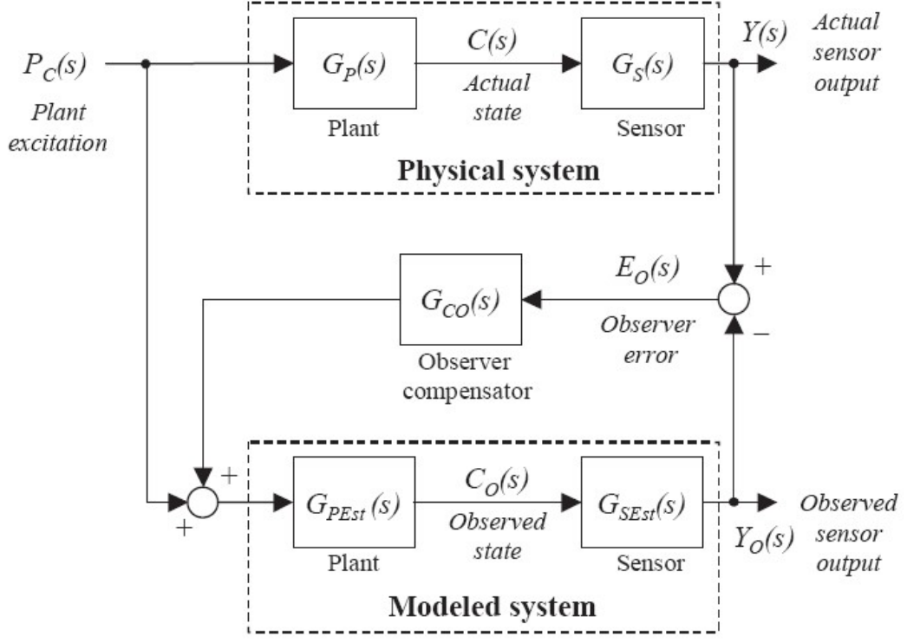
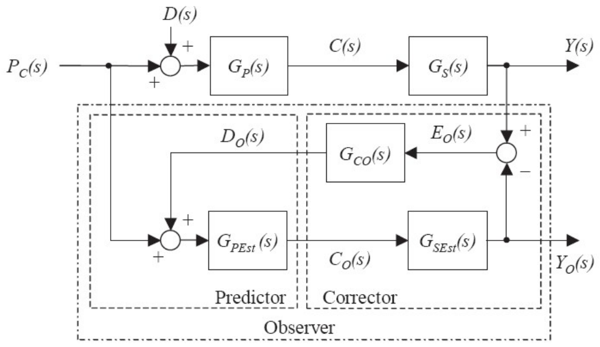
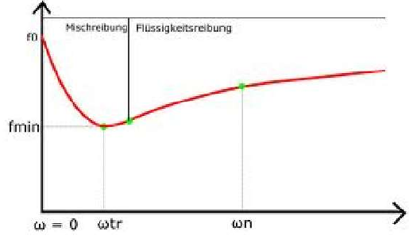
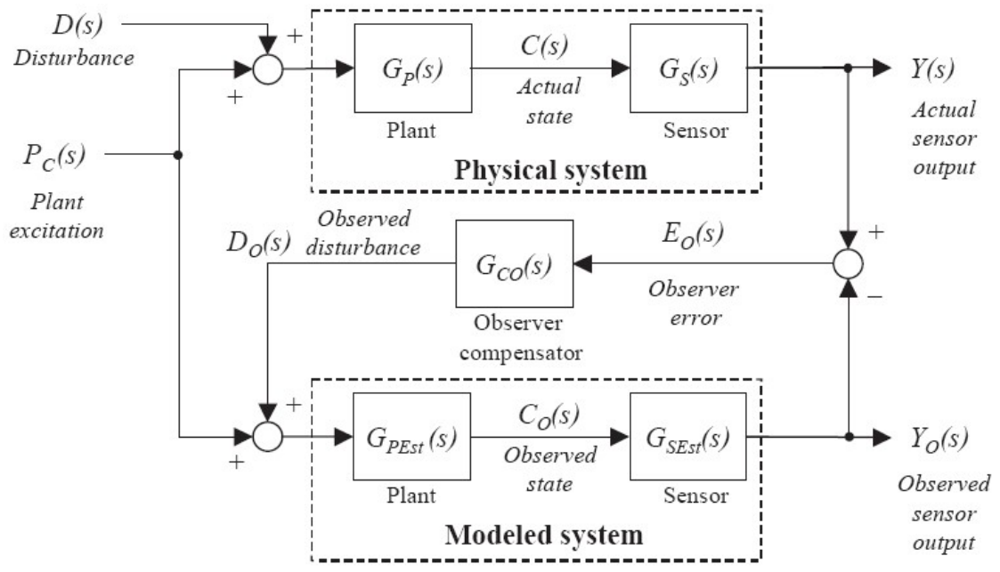
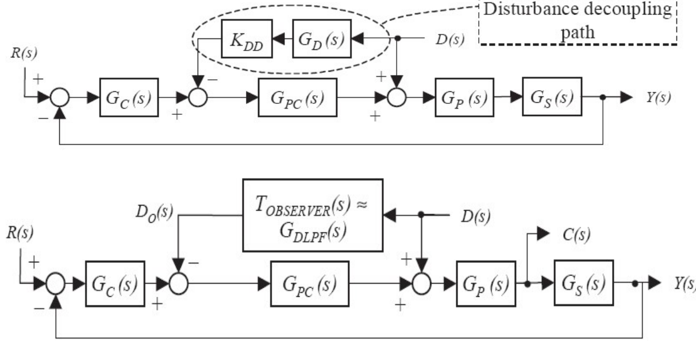
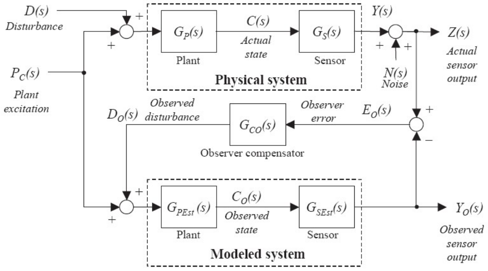
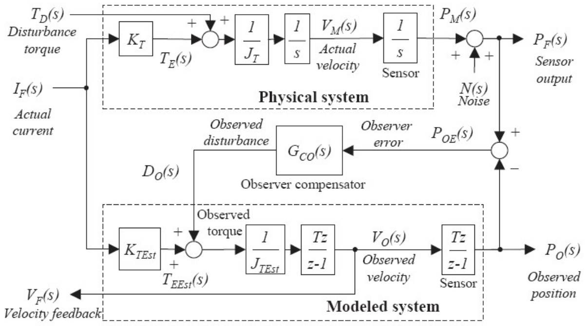

# 第五章：状态反馈、极点配置与状态观测器

来源：哈工大《现代控制理论》课件《Chp5 状态反馈-极点配置-状态观测器.pdf》，共 69 页。以下页码均为 PDF 物理页码。正文保留 Part A 的 5.1–5.3 与 Part B 的 B.1–B.7；对提纲提及但未展开的多输入配置，以及观测器状态方程、误差极点与分离原理，明确标为补充。文末收录原课件两组例题、三道作业及框图演算，并单列补充练习。

[69 页逐页核对索引](Chapter05_逐页核对索引.md) · [返回课程目录](../README.md)

前四章给了建模、求响应、判能控能观和判稳定的方法；本章反过来**设计**系统。若 $`x`$ 能得到，用反馈 $`K`$ 改变对象的闭环运动；若只知道 $`u,y`$，用模型加输出误差校正得到 $`\hat x`$，再用于反馈。两条线的核心分别是 $`A-BK`$ 与 $`A-LC`$。

| 原课件部分 | 页码 | 要掌握的任务 |
| --- | --- | --- |
| Part A 5.1–5.2 | 2–18 | 写闭环矩阵，判断反馈后哪些结构性质保留 |
| Part A 5.3 与作业 | 19–30 | 指定极点，求反馈增益，代回验证 |
| Part B 导入、B.1–B.3 | 31–53 | 读传感器与观测器框图，建立预测—校正模型并选增益 |
| Part B B.4–B.7 | 54–68 | 分析模型误差、扰动、噪声及电机应用 |

## Part A：线性系统状态反馈与极点配置

### 5.1 状态反馈与输出反馈（第 2–10 页）

以连续时间线性定常对象为例，令 $`x\in\mathbb R^n,u,v\in\mathbb R^r,y\in\mathbb R^m`$，其中 $`v`$ 对应课件的外部给定 $`V`$。被控对象为

```math
\dot x=Ax+Bu,\qquad y=Cx+Du.
```

**状态反馈。** 取 $`u=v-Kx`$，$`K\in\mathbb R^{r\times n}`$。逐项代入得

```math
\boxed{\dot x=(A-BK)x+Bv,\qquad y=(C-DK)x+Dv.}
```

第 6 页框图从积分器输出取得状态，经 $`K`$ 后在输入端相减；$`D`$ 直接接的是对象实际输入 $`u`$，所以输出矩阵要从 $`C`$ 改成 $`C-DK`$。这是静态反馈，不添积分器；从新输入 $`v`$ 看，$`B,D`$ 不变。对象原矩阵 $`A,B`$ 仍是原来的物理模型；闭环状态矩阵才是 $`A-BK`$。要判断内部稳定性，应看后者全部特征值。

**静态输出反馈。** 取 $`u=v-Hy`$，$`H\in\mathbb R^{r\times m}`$。第 9 页框图回授的是 $`y`$；若存在直通 $`D`$，就有代数环。由

```math
(I_m+DH)y=Cx+Dv,\qquad (I_r+HD)u=v-HCx
```

可知需 $`I_m+DH`$ 可逆（等价于 $`I_r+HD`$ 可逆），才能唯一决定瞬时 $`u,y`$。令 $`S=(I_m+DH)^{-1},\ T=(I_r+HD)^{-1}`$，利用 $`TH=HS`$、$`DT=SD`$，以及 $`T=I_r-HSD`$，得到

```math
\boxed{
A_{\rm cl}=A-BHSC,\quad B_{\rm cl}=BT=B-BHSD,\quad
C_{\rm cl}=SC,\quad D_{\rm cl}=SD.}
```

$`D=0`$ 时，化为 $`(A-BHC,B,C,0)`$。此时输出反馈等效于受限的状态反馈 $`K=HC`$：若 $`Cx=0`$，该瞬时状态方向无法直接产生回授量。可测输出少时，$`H`$ 通常比任意 $`K`$ 的自由度小；完全能控、完全能观也不自动保证静态输出反馈能任意配置极点。第 10 页输出反馈增益应记作 $`H`$；该页称“输出反馈矩阵由 $`B`$ 变为……”实际说的是闭环**输入矩阵**。

外部给定 $`v`$ 进入输入通道，极点配置决定自由运动，不保证给定到输出的单位稳态增益。若做单位阶跃跟踪，要再检查闭环直流增益，必要时设计给定预补偿或积分环节，并考虑可实现性。

### 5.2 状态反馈和输出反馈的能控性与能观测性（第 11–18 页）

**状态反馈保留能控性。** PBH 判别矩阵满足

```math
[\lambda I-(A-BK)\quad B]
=
[\lambda I-A\quad B]
\begin{bmatrix}I_n&0\\K&I_r\end{bmatrix}.
```

右侧第二因子可逆，所以对任意 $`\lambda`$ 秩相同。这既证明完全能控性不变，也说明不可控特征值不能被 $`K`$ 移走。另一种理解：$`A`$ 作用后再加一个落在 $`\mathrm{im}\,B`$ 内的分量，不会产生原来能达子空间以外的方向。课件第 12 页两组能控矩阵有相同列空间，不要求矩阵各元素相同。

**静态输出反馈保持能观测性。** 先看 $`D=0`$：

```math
\begin{bmatrix}\lambda I-(A-BHC)\\C\end{bmatrix}
=
\begin{bmatrix}I_n&BH\\0&I_m\end{bmatrix}
\begin{bmatrix}\lambda I-A\\C\end{bmatrix}.
```

左乘因子可逆，故秩不变，结论双向成立。$`D\ne0`$ 且反馈适定时，用 $`HS`$ 代替 $`H`$，并把最后一块左乘可逆的 $`S`$，结论相同。由于 $`A_{\rm cl}=A-B(THC)`$，而 $`B_{\rm cl}=BT`$ 只做可逆输入换基，适定静态输出反馈也保留能控性。

**状态反馈的能观测性可能改变。** 原来的判据针对 $`(A,C)`$；反馈后要检查 $`(A-BK,C-DK)`$。即使 $`D=0`$、$`C`$ 不变，模态方向仍可改变，某个新的特征向量可能正好落在 $`\ker C`$。附录 E01 用原课件第 14–17 页的二阶矩阵逐项验证，并算出极零对消。工程上输出反馈较易取得测量；全状态反馈有更多可用信息，但性能还取决于状态估计、模型、噪声和执行器。

### 5.3 状态反馈系统的极点配置（第 19–30 页）

**先规定目标，再求反馈。** 给定 $`n`$ 个期望极点（含重数），构造

```math
p_d(s)=\prod_{i=1}^n(s-\lambda_i^*)
=s^n+a_{n-1}^*s^{n-1}+\cdots+a_1^*s+a_0^*,
\qquad
\det(sI-A+BK)=p_d(s).
```

实对象若要求实 $`K`$，非实极点须成共轭对。若任务是连续时间镇定，应把闭环极点全部放在严格左半平面。实部影响指数包络、虚部影响振荡频率，重块还可能产生时间多项式；零点、模态权重、控制幅值、抗扰和鲁棒性同样影响实际性能。极点配置本身只匹配闭环特征多项式；根轨迹等古典方法也重视极点，但频域设计还约束稳定裕度和频率响应等指标。

**极点配置定理（第 21 页）。** 对实有限维 LTI 对象，能用实全状态反馈任意指定闭环特征多项式，当且仅当 $`(A,B)`$ 完全能控。若只要求稳定，允许有已经稳定的不可控模态，此时条件是可稳定性。对于不可控左特征向量 $`w^{\mathsf T}A=\lambda w^{\mathsf T},\ w^{\mathsf T}B=0`$，有 $`w^{\mathsf T}(A-BK)=\lambda w^{\mathsf T}`$，因此极点锁定。

**零点的精确定义。** 对输入 $`v`$ 到输出 $`y`$，反馈后的 Rosenbrock 矩阵为

```math
\begin{bmatrix}sI-A+BK&-B\\C-DK&D\end{bmatrix}
=
\begin{bmatrix}sI-A&-B\\C&D\end{bmatrix}
\begin{bmatrix}I_n&0\\-K&I_r\end{bmatrix}.
```

因此系统矩阵的正常秩及降秩位置不变，即不变零点保留。若新的闭环内部极点遇到这样的零点，约分后的传递函数可能隐藏模态；应区分不变零点与约简传函中的零点。**第 21 页末将这种情形写成“不能保持能控性”，应为“可能失去能观测性”**。能控性不变已由 5.2 证明。

**算法 1：换成单输入能控规范型，再比较末行（第 22 页）。** 用统一的升幂下标记 $`p_A(s)=s^n+a_{n-1}s^{n-1}+\cdots+a_0`$。构造列基 $`Q=[q_1\ \cdots\ q_n]`$，其中

```math
q_n=b,\qquad q_i=Aq_{i+1}+a_i b,\quad i=n-1,\ldots,1.
```

特别地，三阶时 $`Q=[A^2b+a_2Ab+a_1b,\ Ab+a_2b,\ b]`$，正是第三章的三角基组合。$`Q`$ 可由倒序能控矩阵乘一个单位三角阵得到，故完全能控时可逆。令 $`x=Qz`$。从 $`AQ=QA_c`$ 可读出：输入为 $`e_n`$，$`A_c`$ 的上超对角线为 $`1`$，末行为 $`[-a_0,\ldots,-a_{n-1}]`$。第一列闭合关系由 Cayley–Hamilton 定理保证。

设 $`u=v-\widetilde K z`$。$`e_n\widetilde K`$ 只改变末行，因此

```math
\boxed{\widetilde K=[a_0^*-a_0\quad\cdots\quad a_{n-1}^*-a_{n-1}],
\qquad K=\widetilde KQ^{-1}.}
```

课件把列基记为 $`Q`$，把 $`Q^{-1}`$ 记为 $`P`$，所以末步写 $`K=\widetilde KP`$；第三章有时把列基本身记为 $`P`$。先写坐标定义再用公式。第 22 页多项式与增益行混用了两种系数下标，此处统一按幂次对应；常数项差永远放在增益行首位。

**算法 2：在原坐标直接比较系数（第 23 页）。** 写 $`K=[k_1,\ldots,k_n]`$，算 $`\det(sI-A+bK)`$ 并与 $`p_d(s)`$ 逐项比较。对任意单输入列 $`b`$，有恒等式

```math
\det(sI-A+bK)=\det(sI-A)+K\,\mathrm{adj}(sI-A)b.
```

可先在 $`sI-A`$ 可逆处使用行列式引理，再用多项式恒等性推广到所有 $`s`$。因此对 $`K`$ 始终为**仿射**（与目标系数比较后得到线性方程组）；第 23 页“单输入列有多个非零元素时会产生高次未知量”的说法不正确。非零元素多时手算会更繁琐，展开中的高次项应消掉。对真正多输入的 $`BK`$ 则不能一般地假定系数线性。二、三阶直接比较通常够用，附录 H01–H03 展示不同情形。

**多输入配置（提纲第 3 页，补充）。** 原 PDF 在第 30 页作业后转入观测器，未提供独立的多输入算法或数值题。若 $`B`$ 满行秩，任选实矩阵 $`F`$ 具有目标特征多项式，取右逆 $`B_R`$，令 $`K=B_R(A-F)`$，就有 $`A-BK=F`$。一般完全能控的多输入系统不能这样直接求右逆，可用专门的极点配置算法。比如目标特征值互异时，可以构造 $`(A-\lambda_i^*I)v_i=Bw_i`$，选取独立的 $`v_i`$ 并使复向量成共轭对，然后令 $`K=[w_i][v_i]^{-1}`$，逐列验算。重复根可能需要广义特征链，不能简单要求任意重复根都能配成对角阵。软件实现也可能有算法限制，例如 MATLAB place 对指定重复次数与 $`\mathrm{rank}\,B`$ 有限制，这不等于一般极点配置定理的限制。

第 24–27 页例题题面与后续解法不一致，见 E02 的两套完整计算。第 28–30 页三道作业均在附录解出。

## Part B：状态观测器

### 导入：从传感器反馈到估计反馈（第 31–37 页）

第 31–34 页从常见反馈环起步。传感器把对象的输出送回比较点；PI 的比例项响应当前偏差，积分项积累偏差。第 32 页 PID 框图把比例、积分和带低通的微分支路并联，相加后乘共同增益 $`K_P`$；例如标准形式可写为 $`K_P[1+1/(T_i s)+T_d s/(1+T_f s)]`$。纯微分会放大高频测量噪声，加滤波可限制高频增益，但也会改变相位和响应。第 33–34 页的三类操作位置不同：**给定预滤波**改变命令进入系统的形状；**控制律**决定怎样根据误差动作；**反馈滤波**改变测量信息和闭环特征。不能把三者当成可互换的同一个低通。

第 35 页把传感器问题分成周期性误差、传感器自身动态和加性噪声：误差可能随位置周期变化；低通或延迟改变测量的幅相；加性噪声叠到信号上。第 36 页若能独立测量扰动，可通过前馈生成反向作用；抵消是否有效取决于扰动和补偿信号各自走过的通道。第 37 页列出的设计目标包括成本、可靠性、稳定性、快速响应、抑制扰动、低噪声、鲁棒性和易实现。观测器的任务是用可用的输入与测量估计所需状态，在这些要求之间取舍。

### B.1 伦伯格（Luenberger）观测器基本结构（第 38–48 页）

**定义与框图。** 观测器借助对象模型和可获得的输入、输出，估计不便直接测量的状态。第 40 页的五个要素是传感器输出 $`Y`$、对象激励 $`P_c`$、对象模型 $`G_{PEst}`$、传感器模型 $`G_{SEst}`$、PI 或 PID 观测器补偿器 $`G_{CO}`$。第 39 页框图的上支路是实际对象及实际传感器，下支路是对应的模型。实际和模型的测量信号必须在**相同量纲和同一测量位置**比较；两者之差驱动补偿器。模型内部的输出可以作为更有用的反馈量。



*课件第 39 页：伦伯格观测器结构：实际通道、模型通道和误差校正。*

| 图中环节 | 测量差从哪里来 | 读图结论 |
| --- | --- | --- |
| 第 41–42 页：理想与非理想传感器、传感器逆 | 理想时 $`G_S=1`$；真实传感器有滞后、噪声或衰减 | 反演可在一定频段补偿测量动态；纯延时的精确逆要求提前知道未来，简单低通的逆也会放大高频。 |
| 第 43–45 页：纯模型预测、实际对象和模型并联 | 初值、对象参数和扰动可能不一致 | 模型能连续预测，但同一指令只保证两个模型获得同一**已知输入**。匹配且无未知扰动时，还需初值相同，或初值误差自身会衰减。 |
| 第 46–47 页：用误差校正模型 | 对象与模型的响应不等 | 把测量残差引入模型侧，形成估计自身的闭环。残差还含噪声，校正量不能直接等同于真实扰动。 |
| 第 48 页：用估计量反馈 | 外层控制器改用模型输出 | 选用估计的速度、位置等可避免直接对噪声测量做差分，但传感器滞后、模型误差和估计动态仍影响实际性能。 |

第 42 页标题中“消除 $`G_S=1`$”与图意相反：要补偿的是 $`G_S\ne 1`$ 的非理想特性。附录 D01 演算一阶传感器逆。

### B.2 伦伯格观测器的预测器–校正器形式（第 49 页）

沿框图分别走两条路：

1. **预测：** 已知的激励进入实际对象和模型；模型按照自身动力学估计状态、生成可比较的测量预测。
2. **校正：** 用实际测量减去预测测量。补偿器处理这一差值并修正预测支路。图中的 $`D(s)`$ 是未知扰动，以下写作 $`d`$，与 Part A 的直通矩阵 $`D`$ 含义不同。



*课件第 49 页：预测器、校正器与未知扰动。*

**补充：把预测和校正写成状态方程。** 对名义连续 LTI 模型，假定已知实际输入 $`u`$ 且对象与观测器使用同一 $`A,B,C,D`$，全阶观测器可写成

```math
\hat y=C\hat x+Du,\qquad
\dot{\hat x}=A\hat x+Bu+L(y-\hat y).
```

$`A\hat x+Bu`$ 负责预测，$`L(y-\hat y)`$ 负责把测量残差分配到各状态。令 $`e=x-\hat x`$，由 $`y-\hat y=Ce`$ 得

```math
\dot e=Ax+Bu-(A\hat x+Bu+LCe)=(A-LC)e,\qquad
e(t)=e^{(A-LC)t}e(0).
```

因此估计收敛取决于 $`A-LC`$ 的全部误差极点。把第三章的对偶关系用到这里：$`(A,C)`$ 完全能观等价于 $`(A^{\mathsf T},C^{\mathsf T})`$ 完全能控，且 $`(A-LC)^{\mathsf T}=A^{\mathsf T}-C^{\mathsf T}L^{\mathsf T}`$。在对偶系统求得反馈增益 $`L^{\mathsf T}`$ 后转置回来。若只要求误差衰减，**可检测性**就够：不可观模态必须已经严格稳定。附录 S01 同时算观测器和控制器的增益。

**补充：估计状态反馈与分离原理。** 取 $`u=v-K\hat x=v-Kx+Ke`$，代入对象和误差方程：

```math
\begin{bmatrix}\dot x\\ \dot e\end{bmatrix}
=\begin{bmatrix}A-BK&BK\\0&A-LC\end{bmatrix}
\begin{bmatrix}x\\e\end{bmatrix}
+\begin{bmatrix}B\\0\end{bmatrix}v.
```

这是分块上三角矩阵，故特征多项式等于两个对角块特征多项式的乘积。在这个名义模型中，可以分别设计 $`K`$ 和 $`L`$；若两块都 Hurwitz，整体内部渐近稳定。暂态仍受 $`BK e`$ 影响；噪声、饱和、模型失配和未建模动态仍需单独检查。把观测器的极点无限往左移也不意味着估计一定更好。

### B.3 伦伯格观测器的设计（第 50–53 页）

先定义要估计的量、可用的输入和传感器输出，再确定对象、传感器和补偿器模型。静态传感器可以用标定增益表示；有明显带宽、滤波或延迟时，需要动态模型，必要时把传感器状态并入对象模型，再检查能观测性。确定对象模型时先校准低频增益、时间尺度和系统阶次，并决定哪些寄生动态可在设计频段内忽略。最后在估计速度、扰动抑制、噪声和稳定裕度之间整定补偿器。

比例校正能减小预测误差，积分校正有机会消除特定类型的稳态偏差，但需验证增广闭环稳定和扰动确实可估。对于前节的名义全阶观测器，选对 $`L`$ 就能使初始误差消失，无需额外积分器。高增益常使预测误差响应更快，同时可能把噪声、传感器相滞和未建模模态带进有效频带；第 53 页的整定要结合这些约束判断。

### B.4 模型的不精确（第 54 页）

课件以机械摩擦为例：静止附近存在静摩擦，启动后转入动摩擦，低速可能出现 Stribeck 下落段，速度更高时黏性分量可能主导。线性名义模型的惯量、阻尼、增益等是设计频带内的集总近似。模型预测与实际不同，不代表每个非线性机理都能从残差中单独辨认。可以在一定工作范围把摩擦和参数误差折成等效扰动；辨识时还要考虑它们是否通过同一个可见通道。若单个集总参数模型覆盖范围不足，可以按工况分段建模；传感器模型至少应覆盖观测器实际使用的频段。



*课件第 54 页：静摩擦到动摩擦的示意曲线。*

### B.5 扰动对观测器的影响（第 55–58 页）

第 55–56 页把未知作用加在对象输入端，并让补偿器输出一个同量纲的估计量进入模型输入。记已知激励 $`P_c`$、真实扰动 $`d`$、估计扰动 $`d_o`$，实际通道 $`G=G_PG_S`$、估计通道 $`G_m=G_{PEst}G_{SEst}`$、补偿器 $`F=G_{CO}`$。第 57 页式子的来源只是三条信号关系：

```math
Y=G(P_c+d),\qquad Y_o=G_m(P_c+d_o),\qquad d_o=F(Y-Y_o).
```

把第三式右边含 $`d_o`$ 的项移到左边，可见

```math
\boxed{d_o=\frac{F}{1+FG_m}\big[(G-G_m)P_c+Gd\big].}
```



*课件第 56 页：对象端扰动和模型端估计扰动的注入点。*

因此即使 $`d=0`$，模型不匹配时仍可能得到非零的扰动估计。匹配时，$`d_o/d=FG/(1+FG)`$；如果补偿和扰动加在同一位置且符号与尺度已对齐，未抵消的部分是 $`d/(1+FG)`$。第 58 页的“扰动解耦”应沿注入点核对：若补偿先经过电流环 $`G_{PC}`$，残余一般应写为 $`d-G_{PC}K_{DD}d_o`$。只有在设计频段内有合适的估计精度、补偿通道匹配和稳定裕度，才可以说实际扰动影响被削弱。补偿器含积分时，若校正环内部稳定、低频环路增益发散且没有消掉积分作用，模型匹配情形下可消除常值扰动的估计偏差。附录 D02 完整演算。



*课件第 58 页：扰动解耦补偿在执行通道中的位置。*

### B.6 噪声的影响（第 59–61 页）

必须区分对象端扰动与测量端噪声。对象端扰动先通过对象与传感器，测量噪声在测量端叠加。课件第 59–60 页还列出白噪声、有色噪声、A/D 量化噪声、指令噪声、计算噪声、传感器噪声。白／有色说明频谱性质，指令／计算／传感器说明注入点；同一种噪声可同时按两类方式描述。将第 61 页的总测量记作 $`Y=G(P_c+d)+N`$（原图将其记作 $`Z`$），$`N`$ 到 $`d_o`$ 的通道为 $`F/(1+FG_m)`$，不是扰动通道 $`FG/(1+FG_m)`$。盲目增加校正带宽会让模型把传感器噪声当作真实动态。若对象端扰动进入状态方程的系数为 $`E`$，用全阶观测器可得到相应的时域式：

```math
\dot x=Ax+Bu+Ew,\quad y=Cx+Du+n
\quad\Longrightarrow\quad
\dot e=(A-LC)e+Ew-Ln .
```

于是把误差极点放得更快时，还必须检查 $`L`$ 与噪声通道的响应。实际整定可先限定有效频带，再根据对象模型准确度、传感器噪声和延迟选取补偿增益。对象扰动不能只凭测量误差大就认定，尤其当给定快速变化、参数不准或传感器失真时。



*课件第 61 页：扰动与测量噪声的注入位置。*

### B.7 观测器用于运动控制（第 62–68 页）

| 页码 | 框图 | 要能沿图解释的因果关系 |
| --- | --- | --- |
| 62 | 位置、速度、电流级联和前馈 | 外环位置误差生成速度要求，中环速度误差生成电流要求，内环电流产生转矩；速度或加速度前馈由给定轨迹提供预计需求。 |
| 63 | 位置 PID 加前馈 | 位置控制律可合并到一个外环；前馈承担名义运动需求，反馈处理偏差。速度测量或估计的质量仍会影响微分相关作用。 |
| 64 | 由实际电流预测位置和速度 | 使用已通过内环的实际电流计算名义转矩，模型积分得速度、位置，再用位置测量做校正。 |
| 65 | 旋转变压器与估计模型细节 | 旋变提供位置测量，估计模型含惯量、转矩常数和离散积分；反馈处的量纲、采样周期和符号都须对齐。 |
| 66 | 估计扰动并解耦 | 补偿器残差可以换算成等效电流，用反向补偿抑制匹配扰动；检查实际注入位置与电流环带宽。 |
| 67 | 理想加速度反馈 | 从真实加速度得到等效电流回授，形成附加内环。课件框图可以计算等效电流通道。 |
| 68 | 观测器实现加速度反馈 | 将估计的加速度用于同一回路，图中另有给定增益。估计动态存在时必须重新分析闭环。 |



*课件第 64 页：实际电流驱动的速度与位置观测器。*

用课件有符号的负载扰动 $`T_D`$ 写机械对象：

```math
J_T\dot\omega=K_T i+T_D,\qquad \dot\theta=\omega.
```

电流 $`i`$ 经过转矩常数 $`K_T`$ 得转矩，再除以总惯量 $`J_T`$ 得角加速度，积分得到速度和位置。课件中的后向差分 $`(z-1)/(Tz)`$ 对应 $`[\omega[k]-\omega[k-1]]/T`$；后向欧拉积分 $`Tz/(z-1)`$ 对应 $`\theta[k]=\theta[k-1]+T\omega[k]`$。直接差分测得的位置或速度会强化高频噪声；模型内部可先用转矩平衡得到加速度，再用位置残差校正。

乘 $`J_{\rm est}/K_{T{\rm Est}}`$ 可把估计加速度换成电流等效量；它一般同时含已知输入的影响和扰动影响。**由 B.5 得到的扰动估计**用于抵消未知量；**加速度估计**用于改变内环动态，二者不能直接替换。第 67–68 页的名义等效通道和前置增益在附录 D03 计算。第 69 页为结束页。

其余运动控制原图：[第 62 页：位置、速度、电流级联及速度与加速度前馈](images/ch05/62-cascaded-control.png)；[第 63 页：位置 PID 与给定轨迹前馈](images/ch05/63-position-pid.png)；[第 65 页：旋转变压器和离散观测模型](images/ch05/65-resolver-model.png)；[第 66 页：运动控制的扰动估计与解耦支路](images/ch05/66-motion-decoupling.png)；[第 67 页：理想加速度反馈](images/ch05/67-ideal-acceleration-feedback.png)；[第 68 页：观测加速度回授及给定增益](images/ch05/68-observed-acceleration-feedback.png)。

## 附录：原课件全部例题、作业与框图演算

以下按首次出现的物理页码编号。E01、E02 是原课件的两组数值例题，H01–H03 是三道作业；D01–D03 把 Part B 中有实质运算的原图拆开计算；S01 是额外练习。

### E01｜状态反馈为何可能丧失能观测性（第 14–17 页）

题给

```math
A=\begin{bmatrix}1&2\\3&1\end{bmatrix},\quad b=\begin{bmatrix}0\\1\end{bmatrix},\quad
c=\begin{bmatrix}1&2\end{bmatrix},\quad K=\begin{bmatrix}3&1\end{bmatrix}.
```

**反馈前。** 先算 $`Ab=[2,1]^{\mathsf T}`$ 和 $`cA=[7,4]`$，所以

```math
Q_c=[b\ \ Ab]=\begin{bmatrix}0&2\\1&1\end{bmatrix},\quad \det Q_c=-2;\qquad
Q_o=\begin{bmatrix}c\\cA\end{bmatrix}=\begin{bmatrix}1&2\\7&4\end{bmatrix},\quad \det Q_o=-10.
```

二者满秩，故完全能控、完全能观。第 15 页能控矩阵括号中印成 $`[A\ \ Ab]`$；第一列应为 $`b`$。

**反馈后。** $`bK`$ 的第二行是 $`[3,1]`$，第一行是零。于是

```math
A_f=A-bK=\begin{bmatrix}1&2\\0&0\end{bmatrix},\quad A_f b=\begin{bmatrix}2\\0\end{bmatrix},\quad cA_f=[1,2].
```

```math
Q_{cf}=\begin{bmatrix}0&2\\1&0\end{bmatrix},\quad \det Q_{cf}=-2;\qquad
Q_{of}=\begin{bmatrix}1&2\\1&2\end{bmatrix},\quad \mathrm{rank}\,Q_{of}=1.
```

因此仍完全能控，却不再完全能观。具体地，$`r=[-2,1]^{\mathsf T}`$ 满足 $`A_fr=0`$ 和 $`cr=0`$。若零输入初始状态沿此方向，状态保留在该方向，输出却始终是零。

**用传递函数复核。** 开环的 $`(sI-A)^{-1}b`$ 的分子列为 $`[2,s-1]^{\mathsf T}`$；乘 $`c`$ 后分子为 $`2+2(s-1)=2s`$。闭环分子也为 $`2s`$，分母则变成 $`s(s-1)`$：

```math
G(s)=\frac{2s}{s^2-2s-5},\qquad
G_f(s)=\frac{2s}{s(s-1)}=\frac{2}{s-1}.
```

约分藏起的是内部的零特征值，$`+1`$ 极点仍在；这个例子是在说明结构性质，并没有把闭环镇定。

### E02｜同一题的 +2 与 −2 两种配置（第 24–27 页）

给定 $`G(s)=10/[s(s+1)(s+2)]`$，用课件选定的能控规范型：

```math
A=\begin{bmatrix}0&1&0\\0&0&1\\0&-2&-3\end{bmatrix},\quad
b=\begin{bmatrix}0\\0\\1\end{bmatrix},\quad c=[10,0,0].
```

从 $`(sI-A)z=b`$ 可读出 $`z_2=sz_1,\ z_3=s^2z_1`$，最后一行给 $`(s^3+3s^2+2s)z_1=1`$；乘 $`c`$ 得原传递函数。又有

```math
Q_c=[b\ \ Ab\ \ A^2b]=\begin{bmatrix}0&0&1\\0&1&-3\\1&-3&7\end{bmatrix},
\qquad \det Q_c=-1.
```

所以**所选实现**完全能控；仅凭传递函数没有显式对消，不能断言任何未知的非最小实现都能控。取 $`u=v-Kx`$、$`K=[k_1,k_2,k_3]`$。闭环末行为 $`[-k_1,-(2+k_2),-(3+k_3)]`$，从而

```math
\det(sI-A+bK)=s^3+(3+k_3)s^2+(2+k_2)s+k_1.
```

**按第 24 页字面题面**：目标为 $`2,\ -1+j,\ -1-j`$。成对根相乘得 $`s^2+2s+2`$，再乘 $`(s-2)`$：

```math
p_d(s)=s^3-2s-4,\quad
k_1=-4,\quad 2+k_2=-2,\quad 3+k_3=0,\quad K=[-4,-4,-3].
```

代回末行得 $`[4,2,0]`$，重新展开即 $`s^3-2s-4`$。含右半平面极点 $`+2`$，闭环不稳定。

**按第 27 页实际解答**：目标为 $`-2,\ -1+j,\ -1-j`$。把同一二次式乘 $`(s+2)`$：

```math
p_d(s)=s^3+4s^2+6s+4,\quad
k_1=4,\quad 2+k_2=6,\quad 3+k_3=4,\quad K=[4,4,1].
```

闭环末行为 $`[-4,-6,-4]`$；全部极点严格位于左半平面。第 27 页的 $`3+k_3=1`$ 是笔误：比较的是 $`s^2`$ 的目标系数 $`4`$，解出的 $`k_3`$ 才是 $`1`$。

两套增益都使用此处同一组状态坐标。换了实现坐标后，应按 5.3 的换基关系转换反馈增益。

### H01｜作业 1：对角型、输入列有两个非零元素（第 28 页）

题给 $`A=\mathrm{diag}(1,-2)`$、$`b=[1,-1]^{\mathsf T}`$，要求 $`-0.5\pm j`$。$`Ab=[1,2]^{\mathsf T}`$，故 $`Q_c=\begin{bmatrix}1&1\\-1&2\end{bmatrix}`$ 的行列式为 $`3`$。

```math
sI-A+bK=\begin{bmatrix}s-1+k_1&k_2\\-k_1&s+2-k_2\end{bmatrix}.
```

行列式是 $`(s-1+k_1)(s+2-k_2)+k_1k_2`$。二次未知量 $`-k_1k_2`$ 与 $`+k_1k_2`$ 抵消，正好验证 5.3 的秩一结论。展开、比较：

```math
\begin{aligned}
p_f(s)&=s^2+(1+k_1-k_2)s-2+2k_1+k_2,\\
p_d(s)&=(s+1/2)^2+1=s^2+s+5/4.
\end{aligned}
```

一次项给 $`k_1=k_2`$；常数项给 $`3k_1=13/4`$。所以 $`K=[13/12,13/12]`$。代入得到一次项系数 $`1`$，常数项 $`-2+39/12=5/4`$。

**再用 5.3 的规范型法核对。** 原多项式为 $`s^2+s-2`$，所以 $`q_2=b`$、$`q_1=Ab+b=[2,1]^{\mathsf T}`$。在 $`x=Qz`$ 的坐标定义下，

```math
Q=\begin{bmatrix}2&1\\1&-1\end{bmatrix},\quad
Q^{-1}=\frac{1}{3}\begin{bmatrix}1&1\\1&-2\end{bmatrix},\quad
Q^{-1}AQ=\begin{bmatrix}0&1\\2&-1\end{bmatrix},\quad
Q^{-1}b=e_2.
```

常数项由 $`-2`$ 变为 $`5/4`$，一次项保持为 $`1`$，所以 $`\widetilde K=[13/4,0]`$。再算 $`K=\widetilde KQ^{-1}=[13/12,13/12]`$，与直接比较系数一致。

### H02｜作业 2：二阶耦合系统（第 29 页）

题给 $`A=\begin{bmatrix}1&3\\3&1\end{bmatrix}`$、$`b=[1,0]^{\mathsf T}`$，要求 $`-1\pm2j`$。$`Ab=[1,3]^{\mathsf T}`$，能控矩阵 $`Q_c=\begin{bmatrix}1&1\\0&3\end{bmatrix}`$ 的行列式为 $`3`$。

```math
\begin{aligned}
\det(sI-A+bK)&=(s-1+k_1)(s-1)+3(k_2-3)\\
&=s^2+(k_1-2)s-8-k_1+3k_2,\\
p_d(s)&=(s+1)^2+4=s^2+2s+5.
\end{aligned}
```

比较一次项得 $`k_1=4`$；再由 $`-8-4+3k_2=5`$ 得 $`k_2=17/3`$。故 $`K=[4,17/3]`$。闭环 $`A-bK=\begin{bmatrix}-3&-8/3\\3&1\end{bmatrix}`$，迹为 $`-2`$、行列式为 $`5`$，验证特征多项式。

### H03｜作业 3：三阶能控规范型（第 30 页）

题给

```math
A=\begin{bmatrix}0&1&0\\0&0&1\\-1&-5&-6\end{bmatrix},\quad
b=e_3,\quad \{\lambda_i^*\}=\{-2+4j,\,-2-4j,\,-10\}.
```

$`b=[0,0,1]^{\mathsf T}`$、$`Ab=[0,1,-6]^{\mathsf T}`$、$`A^2b=[1,-6,31]^{\mathsf T}`$，能控矩阵行列式为 $`-1`$。目标多项式为

```math
p_d(s)=(s+10)[(s+2)^2+16]=(s+10)(s^2+4s+20)=s^3+14s^2+60s+200.
```

原多项式为 $`s^3+6s^2+5s+1`$。因 $`b=e_3`$，只改末行；按常数、一次、二次顺序相减：

```math
K=[200-1,\ 60-5,\ 14-6]=[199,55,8].
```

代回末行得到 $`[-200,-60,-14]`$，重新写出的多项式恰为 $`p_d`$。

### D01｜传感器反演为何不能直接消除一切误差（第 41–42 页）

课件用传感器逆说明一种直接设想。以一阶低通为演算模型，设传感器测量 $`Y_m=G_SY+N`$，取 $`G_S=1/(1+\tau s)`$ 且 $`\tau>0`$。理想相消要求

```math
G_S^{-1}Y_m=(1+\tau s)\left[\frac{Y}{1+\tau s}+N\right]
=Y+(1+\tau s)N .
```

所以确定性信号在理想模型中可恢复，但噪声在高频被放大，且这个逆是非真有理传递函数，含理想微分。若传感器模型中还含延时 $`e^{-\theta s}`$，精确逆为超前 $`e^{+\theta s}`$，实时实现需要未来信号。设计时通常只在目标频段做近似补偿。第 42 页标题应理解为补偿 $`G_S\ne1`$ 的偏差。

### D02｜扰动估计、噪声和解耦通道（第 56–61 页）

把实际测量写成 $`Y=G(P_c+d)+N`$，预测写成 $`Y_o=G_m(P_c+d_o)`$。补偿器输入为 $`Y-Y_o`$，逐项展开：

```math
\begin{aligned}
d_o &= F\{G P_c+Gd+N-G_mP_c-G_m d_o\},\\
(1+FG_m)d_o &= F\{(G-G_m)P_c+Gd+N\},\\
d_o &= \frac{F(G-G_m)}{1+FG_m}P_c+\frac{FG}{1+FG_m}d+\frac{F}{1+FG_m}N .
\end{aligned}
```

令 $`N=0`$ 就是第 57 页；保留第三项对应第 61 页。依次把三个输入单独置为非零，得到**指令失配、真实扰动和测量噪声**三条通道。匹配时第一项消失；同位置、单位增益减掉 $`d_o`$ 后，剩余

```math
d-d_o=\frac{1}{1+FG}d-\frac{F}{1+FG}N\qquad(G_m=G).
```

即使理想匹配，减小第一项也不能忽略第二项。若实际补偿先过电流环，沿第 58、66 页的箭头把 $`d_o`$ 换成 $`G_{PC}K_{DD}d_o`$ 再求残余。上述比值是在校正环内部稳定、通道可实现的前提下用来分析频率响应的。

### D03｜理想与估计加速度反馈（第 64–68 页）

先看第 67 页的理想归一化图：设 $`i^*`$ 为输入电流要求，实际电流为 $`i`$，电流环是 $`G_{PC}`$。忽略负载扰动并按 $`J_T/K_T`$ 归一化时，回授的加速度等效于电流 $`i`$。于是

```math
i=G_{PC}(i^*-K_{AFB}i),\qquad
\frac{i}{i^*}=\frac{G_{PC}}{1+K_{AFB}G_{PC}}.
```

若 $`G_{PC}(0)=1`$，直流增益变成 $`1/(1+K_{AFB})`$。第 68 页把估计加速度换算为电流等效量 $`\hat i_a`$，并加给定因子 $`1+K_{AFB}`$。在估计精确的名义条件 $`\hat i_a=i`$ 下，通道变为

```math
\frac{i}{i^*}=\frac{(1+K_{AFB})G_{PC}}{1+K_{AFB}G_{PC}},
```

所以能恢复单位直流增益（需分母在零频非零）。如果名义无扰动时估计通道为 $`\hat i_a=H_a i`$，分母就变成 $`1+K_{AFB}G_{PC}H_a`$。由此看出估计滞后会参与闭环特征，不能沿用理想图来断言稳定或无噪声。

### S01｜补充：同一对象配置控制极点和观测器极点

复用 H02 的 $`A,b,K`$，另设可测输出 $`c=[1,0]`$、$`D=0`$。能观测矩阵为 $`Q_o=\begin{bmatrix}1&0\\1&3\end{bmatrix}`$，行列式为 $`3`$。要求估计误差极点 $`-4,-5`$，目标多项式为 $`s^2+9s+20`$。令 $`L=[\ell_1,\ell_2]^{\mathsf T}`$：

```math
\begin{aligned}
A-Lc&=\begin{bmatrix}1-\ell_1&3\\3-\ell_2&1\end{bmatrix},\\
\det(sI-A+Lc)&=(s-1+\ell_1)(s-1)+3(\ell_2-3)\\
&=s^2+(\ell_1-2)s-8-\ell_1+3\ell_2.
\end{aligned}
```

由 $`\ell_1-2=9`$、$`-8-11+3\ell_2=20`$，得 $`L=[11,13]^{\mathsf T}`$。代回 $`A-Lc=\begin{bmatrix}-10&3\\-10&1\end{bmatrix}`$，迹 $`-9`$、行列式 $`20`$。组合特征多项式为 $`(s^2+2s+5)(s^2+9s+20)`$。其中 $`-1\pm2j`$ 由 $`K`$ 决定，$`-4,-5`$ 由 $`L`$ 决定，初始估计误差会暂时通过 $`bKe`$ 影响实际状态。

## 复习时应能独立完成的事

1. 从控制律代回对象，区分 $`A-BK`$、$`A-BHC`$ 和 $`A-LC`$ 的用途；有直通时先处理输出反馈的代数环。
2. 用 PBH 或能控／能观矩阵解释反馈后的结构变化。牢记传递函数约分可能隐藏内部极点，稳定性仍按完整状态模型判断。
3. 把目标极点写成多项式，用规范型末行差值或原坐标行列式求 $`K`$，最后代回核对。使用换基时，先确定哪个矩阵将新坐标映回原坐标。
4. 从模型预测和测量残差推出误差动力学；会用对偶方法配置 $`L`$，会从分块矩阵解释分离原理。
5. 读工程框图时标出已知激励、实际扰动、测量噪声和补偿注入点，再写每条通道。根据模型有效频带、执行器和传感器约束选估计速度。

[逐页核对与勘误汇总](Chapter05_逐页核对索引.md)
