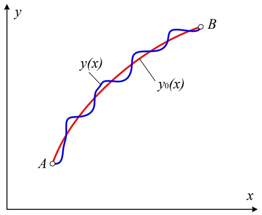
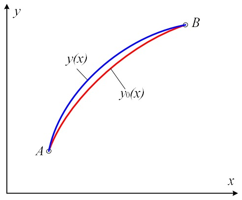
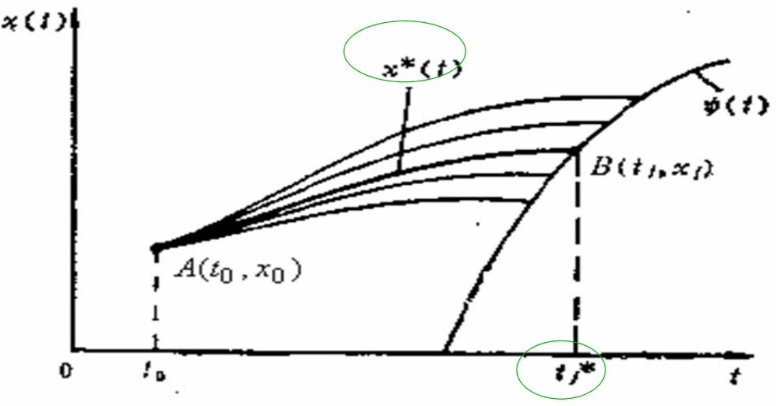
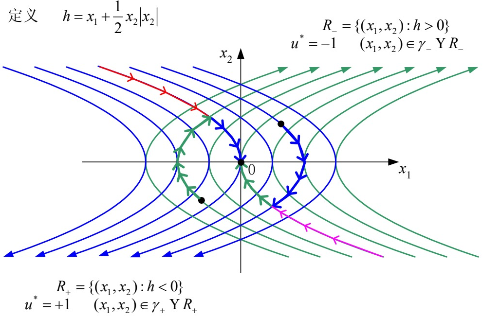
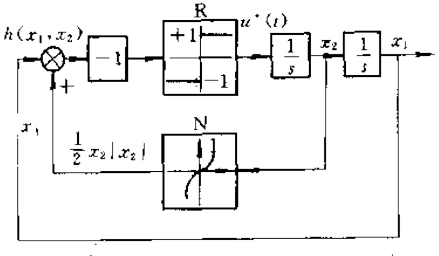
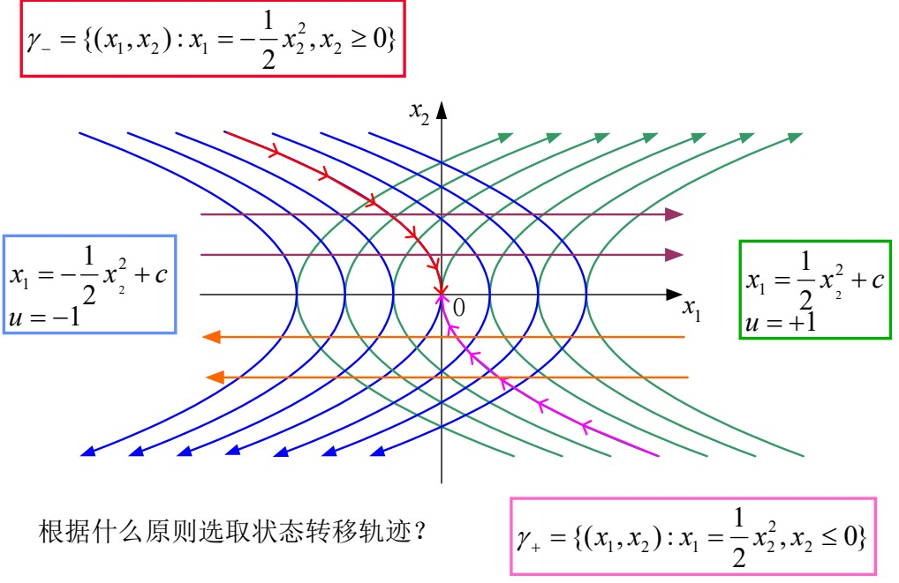
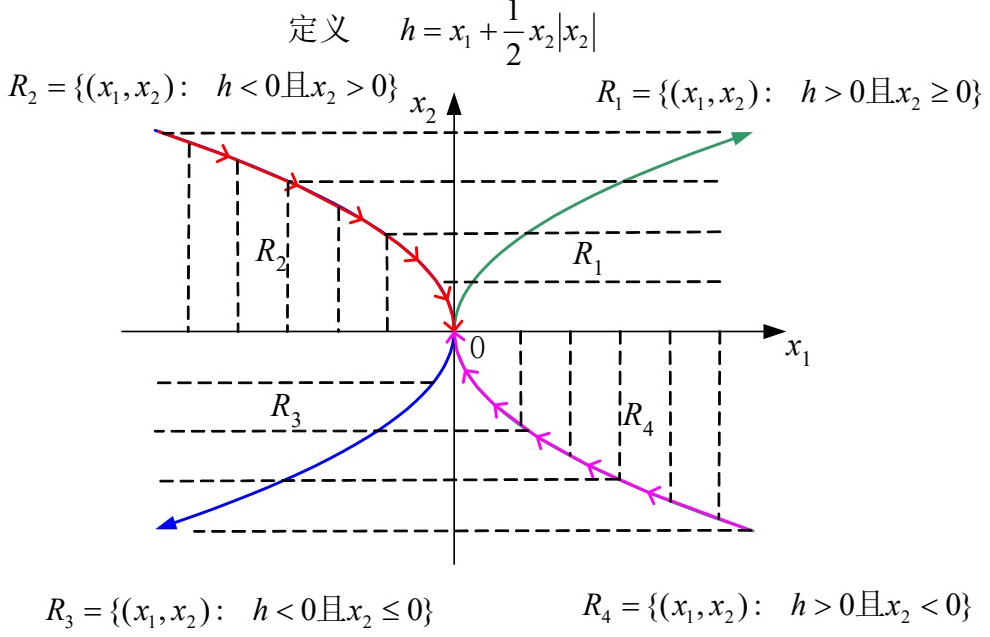
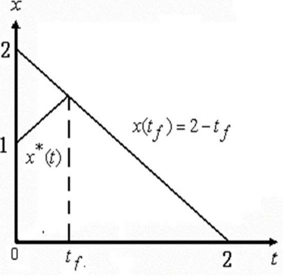
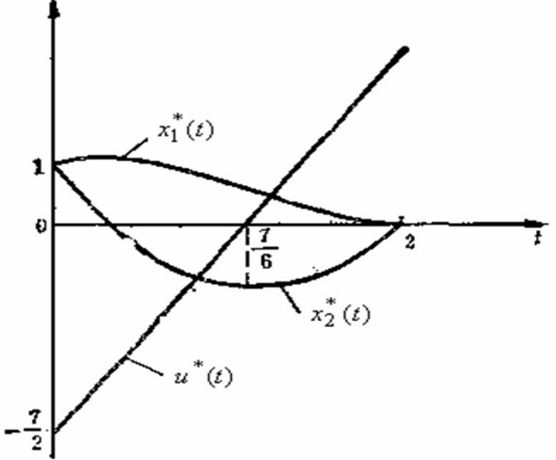
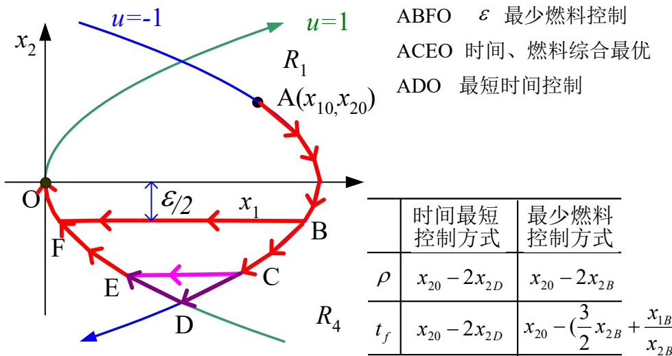

# 第六章：最优控制

来源：哈尔滨工业大学陈宏钧《现代控制理论》第六章课件《第6章  最优控制-1a.pdf》，共 118 页。页码均指 PDF 物理页序。正文保留原课件 6.1–6.9 及其术语；数学条件的补全、课件勘误和附加演算均单独标明。

[118 页逐页核对索引与勘误](Chapter06_逐页核对索引.md) · [返回课程目录](../README.md)

第五章问「怎样用反馈改变系统运动」；第六章进一步问「在动力学、输入上限和端点要求都给定以后，哪一条控制曲线最合算？」**同样的双积分对象可以得到三种完全不同的控制**：固定时间最小化平方输入，得到一条斜线；输入受限并要求最快到达，得到饱和切换；改成最少燃料后，还可能出现滑行、多个最优解，甚至只有下确界。先确定代价和约束，再谈“最优”。

## 6.1 什么是最优控制？（第 4–10 页）

在全部**可行**控制中，用明确指标比较优劣。软着陆不止要“到地面”，还要求接地速度为零，并尽量保留燃料。课件另用平面相遇问题说明：端点可以只限制相对位置，代价也可以同时计入耗时和燃料。两题的完整数学建模见附录 E01、E02；原课件没有指定足够参数来计算唯一数值轨迹。

## 6.2 最优控制问题的数学描述（第 11–18 页）

必须同时写下四件事：**系统模型、初末边界、性能指标、容许控制集**。常用形式为

```math
\dot x=f(x,u,t),\quad y=g(x,u,t),\quad x(t_0)=x_0,\quad x(t_f)\in S(t_f),\quad u(t)\in\Omega.
```

从初态出发，控制函数 $`u(\cdot)`$ 决定一条状态轨线。$`u(t)\in\Omega`$ 只保证瞬时输入合法；它还必须使轨线满足边界、路径等要求。第三章的能控性提供结构判断，但存在幅值或时间上限时，要检查目标在相应约束下是否可达。$`t_f`$ 固定与否、$`x(t_f)`$ 是固定点、自由量还是目标集上的点，是彼此独立的条件。

```math
J[u]=\underbrace{\Phi(x(t_f),t_f)}_{\text{末值代价}}
+\underbrace{\int_{t_0}^{t_f}L(x(t),u(t),t)\,dt}_{\text{过程代价}} .
```

仅有积分项称积分型；仅有末值项称末值型；两项都有称综合型或 Bolza 型。$`L=1`$ 计总时长，$`L=|u|`$ 计控制幅值的累积，$`L=u^2/2`$ 对大输入的惩罚更重。两种输入代价并不等价，也不一定就是设备真实的燃料或电能模型。课件把“价值函数”列为性能指标的别称；在动态规划中宜区分：$`J[u]`$ 评估一条给定控制，$`V(t,x)=\inf_u J_{t,x}[u]`$ 表示从某时刻和某状态出发的最优代价值。

## 6.3 最优控制问题的分类（第 19–20 页）

- **无约束 / 有约束**：等式约束如状态方程和目标点；不等式约束如推力上限、状态安全区。即使说“控制无约束”，状态方程和端点条件仍可能存在。
- **线性 / 非线性**：线性规划要求目标和约束均为仿射表达；线性动力学加二次代价并不等于线性规划。对非线性作局部线性化，仅在近似有效范围内有意义。
- **静态 / 动态**：静态问题选参数，动态问题要选随时间的控制过程并满足系统演化。优化结果恰好是常数并不改变问题属于动态优化。

## 6.4 最优化问题的求解方法（第 21–23 页）

解析法先求必要条件，再用充分条件、凸性或直接比较确认；数值法通过直接搜索或把时间、状态、控制离散为有限维变量进行迭代，需核对网格、边界误差与约束；梯度法使用一阶或高阶信息。课件列出最速下降、牛顿与拟牛顿、高斯–牛顿最小二乘、变尺度和共轭梯度。必要条件只能缩小候选集，数值收敛也不能自动保证找到了全局最优。

## 6.5 最优控制的发展（第 24–25 页）

课件以贝尔曼动态规划、庞特里亚金最大值原理为主线，也提到库恩–塔克条件及卡尔曼滤波。动态规划从“剩余问题仍须最优”出发，在多阶段问题逐步递推价值函数；最小值原理沿一条候选轨线同时求状态与协态，并逐时优化哈密尔顿量。最大值和最小值写法可由符号约定转换，本章统一用**最小化**的 $`H=L+\lambda^{\mathsf T}f`$。课件在后文只用最小值原理计算，未推导动态规划递推式。

## 6.6 最优控制中的变分法（第 26–60 页）

### 6.6.1 变分法的基本概念（第 27–44 页）

**泛函把整条函数映射为一个数。** 附录 E03 对两条曲线计算同一积分。$`J`$ 是线性泛函，当且仅当它同时满足叠加性和齐次性。第 32、34 页分别示意零阶和一阶接近：零阶只要求整条曲线的位置差小；一阶还要求斜率差小；一般 $`k`$ 阶要求到第 $`k`$ 阶导数都一致接近。强局部极小按零阶邻域比较，弱局部极小按一阶邻域比较。强局部极小一定也是弱局部极小，反向不能自动推出。



*课件第 32 页：零阶接近：曲线位置相近，斜率仍可差很多。*



*课件第 34 页：一阶接近：曲线和斜率都接近。*

沿任意允许的方向 $`\eta`$ 写成 $`x_\alpha=x+\alpha\eta`$，其中 $`\alpha`$ 是小实数。于是

```math
\delta J[x;\eta]=\left.\frac{d}{d\alpha}J[x+\alpha\eta]\right|_{\alpha=0}.
```

它是 $`\Delta J`$ 中关于摄动的一阶主部（在相应可微条件下）；高阶变分用更高阶导数，多元情形同时摄动各分量。课件第 39 页“泛函存在”应读为**相应变分存在并可按所述公式求导**。对允许正负两向摄动的可微局部极值，$`\delta J=0`$ 只是必要条件。附录 E04 展开增量与二阶变分，E05 演算含导数的泛函。

**变分学基本引理。** 若 $`\int_{t_0}^{t_f}\eta^{\mathsf T}M\,dt=0`$ 对任意内部光滑试探函数成立，且 $`M`$ 连续，则 $`M\equiv0`$。证明思路：若某个分量在某点为正，连续性使它在附近仍为正；只在该小区间放入一个非负的试探函数，其余分量置零，积分就会大于零。负值同理。第 44 页向量式必须写成内积，连续二阶可微也不是这一引理所需的最低条件。

### 6.6.2 无约束条件下的变分问题（第 45–57 页）

对 $`J[x]=\int L(x,\dot x,t)\,dt`$，分部积分把 $`\dot\eta`$ 上的导数移到 $`L_{\dot x}`$：

```math
\delta J=[L_{\dot x}^{\mathsf T}\eta]_{t_0}^{t_f}
+\int_{t_0}^{t_f}\left(L_x-\frac{d}{dt}L_{\dot x}\right)^{\mathsf T}\eta\,dt .
```

**固定端点**时 $`\eta(t_0)=\eta(t_f)=0`$。由基本引理得到欧拉方程 $`L_x-\frac{d}{dt}L_{\dot x}=0`$。第 47 页的“等价于”应改为必要条件；反过来须再判定极小、极大或驻值。若 $`L`$ 不显含 $`x`$，则 $`L_{\dot x}`$ 为常量；若 $`L`$ 不显含 $`t`$，沿光滑极值曲线 $`L-\dot x^{\mathsf T}L_{\dot x}`$ 为常量。附录 E06 说明如何解常数并证明全局最小。

**变动端点**时，要区分同一时刻的变分 $`\eta(t_f)`$ 和终点真正的位移 $`\Delta x_f`$：

```math
\Delta x_f=\eta(t_f)+\dot x_f\,\Delta t_f,\qquad
\delta J_{\text{端}}=L_{\dot x}^{\mathsf T}\Delta x_f+
 (L-\dot x^{\mathsf T}L_{\dot x})\Delta t_f .
```

这来自上限变化带来的 $`L(t_f)\Delta t_f`$ 加上分部积分边界项。起点若也可变，同式以相反符号在 $`t_0`$ 取值。若标量终点沿靶线 $`x_f=\varphi(t_f)`$ 滑动，则 $`\Delta x_f=\dot\varphi\,\Delta t_f`$，因此

```math
\left[L+(\dot\varphi-\dot x)L_{\dot x}\right]_{t_f}=0 .
```

靶线水平：终态固定、终时自由，故 $`L-\dot x L_{\dot x}=0`$；靶线垂直：终时固定、终态可变，故 $`L_{\dot x}=0`$。用“$`\Delta t_f=0`$”处理垂直靶线比把斜率写成无穷大清楚。课件第 50 页的多条轨迹既有不同形状，也有不同的终点时刻。附录 E07 把横截条件算成直线垂直关系。



*课件第 50 页：固定起点、终点沿靶线移动。*

### 6.6.3 等约束条件下的变分问题（第 58–60 页）

过程约束覆盖整个时间区间，包括微分、积分、控制等式、轨线等式及混合等式；点式约束只在始端、终端或内点成立。积分约束 $`\int g\,dt=c`$ 可引入 $`\dot z=g`$、$`z(t_0)=0`$、$`z(t_f)=c`$，化为微分约束加端点约束。纯代数约束需要另外处理可微性和可解性，不能一概直接微分。第 58 页中 $`x`$ 与 $`u`$ 由状态方程相连，不能彼此独立随意改变；第 6.7 节用乘子把这种关系写进增广泛函。原课件未给该标量例题完整边界，附录 E08 给出条件式结果，并明确标注补充边界。

## 6.7 拉格朗日问题（第 61–74 页）

原课件首先采用固定初始状态、固定时间区间、终态自由且无末值代价的拉格朗日型问题，再给出固定终态的例题。加入协态乘子 $`\lambda(t)`$，得到

```math
H(x,u,\lambda,t)=L(x,u,t)+\lambda^{\mathsf T}f(x,u,t),\qquad
J_a=\int_{t_0}^{t_f}\left(H-\lambda^{\mathsf T}\dot x\right)dt.
```

在可行轨线上，乘子项为零，$`J_a`$ 等于原代价。分部积分：

```math
-\int_{t_0}^{t_f}\lambda^{\mathsf T}\dot x\,dt
=-[\lambda^{\mathsf T}x]_{t_0}^{t_f}
+\int_{t_0}^{t_f}\dot\lambda^{\mathsf T}x\,dt .
```

**第 63 页最后一行的积分内应为正号**。分别对 $`\lambda,x,u`$ 变分：

```math
\delta J_a=-[\lambda^{\mathsf T}\delta x]_{t_0}^{t_f}
+\int_{t_0}^{t_f}
\left[(H_\lambda-\dot x)^{\mathsf T}\delta\lambda
+(H_x+\dot\lambda)^{\mathsf T}\delta x+H_u^{\mathsf T}\delta u\right]dt .
```

所以 $`\dot x=H_\lambda=f`$、$`\dot\lambda=-H_x`$；无输入约束、且 $`H`$ 在控制变量上可微并取内部极值时，$`H_u=0`$。协态将未来代价和端点要求传回当前时刻；例如在可微的常规问题中，其分量可解释为最优剩余代价对当前状态的边际敏感度。

**边界看各自允许的变分**：固定初态使 $`\delta x(t_0)=0`$，无须额外规定 $`\lambda(t_0)`$；固定终态使 $`\delta x(t_f)=0`$，无须规定 $`\lambda(t_f)`$；固定终时且终态完全自由、无末值项时才有 $`\lambda(t_f)=0`$。第 65–66 页用两端符号写边界条件不能理解为两端协态相等。求解步骤是写 $`H`$、解内部最优控制、联立正则方程解两点边值、回代并验算端点与最优性。第 68–74 页完整演算见 E09。

## 6.8 波尔札问题（第 75–77 页）

课件亦用“波尔扎”；英文 Bolza。目标集由 $`N(x_f,t_f)=0`$ 定义，末值项为 $`\Phi(x_f,t_f)`$。在正则端点约束下引入常量乘子 $`\mu`$，令 $`\Psi=\Phi+\mu^{\mathsf T}N`$。增广泛函为 $`\Psi+\int(H-\lambda^{\mathsf T}\dot x)\,dt`$。沿满足状态方程的候选，末端变分合并为

```math
(\Psi_x-\lambda(t_f))^{\mathsf T}\Delta x_f+
(H(t_f)+\Psi_t)\Delta t_f .
```

因此课件第 77 页的**固定终时**写法为 $`\lambda(t_f)=\Phi_x+N_x^{\mathsf T}\mu`$，连同 $`N=0`$。若终时也是可自由变化的内部解，还需 $`H(t_f)+\Phi_t+\mu^{\mathsf T}N_t=0`$。若终时落在不等式边界，应使用相应可行方向条件。只有目标流形无末值代价时，协态与目标面的切向量正交；端点完全固定时，不能误加 $`\lambda(t_f)=0`$。

## 6.9 最短时间和最少燃料控制（第 78–118 页）

### 1. 非线性系统的最短时间控制问题（第 79–82 页）

课件的“非线性”指对状态可以非线性，而输入以仿射形式出现：$`\dot x=f(x,t)+B(x,t)u`$，且每个通道各自满足 $`|u_j|\le1`$。最短时间令 $`L=1`$；正常情形取 $`H=1+\lambda^{\mathsf T}(f+Bu)`$，令 $`q_j=b_j^{\mathsf T}\lambda`$，其中 $`b_j`$ 是 $`B`$ 第 $`j`$ 列。沿候选最优状态及协态，逐时在许可区间最小化 $`q_j u_j`$：

```math
u_j^*=\begin{cases}+1,&q_j<0,\\-1,&q_j>0,\\\text{仅凭逐点极小无法确定},&q_j=0.\end{cases}
```

一阶驻值条件 $`H_u=0`$ 不能代替有界极小化；最优值往往在边界，称砰–砰（bang–bang）控制。开关函数孤立过零通常只改变切换时刻，单点值不影响轨迹；若在整个区间都为零，出现奇异弧，需要更多条件。全形式的最小值原理还允许目标乘子 $`\lambda_0=0`$ 的异常情形，并要求乘子不全为零；这里的 $`H=1+\cdots`$ 是 $`\lambda_0=1`$ 的正常约定。盒状约束使通道能逐个比较；若改成 $`\|u\|_2\le1`$，一般不能分别饱和。

### 2. 线性时不变系统的最短时间控制问题（第 83–84 页）

$`\dot\lambda=-A^{\mathsf T}\lambda`$，故 $`q_j(t)=\lambda(t)^{\mathsf T}b_j`$。若每个单通道能控矩阵 $`G_j=[b_j,Ab_j,\ldots,A^{n-1}b_j]`$ 都满秩，则 $`q_j`$ 不能在区间恒零：对它依次求导可得 $`q_j^{(k)}=(-1)^k\lambda^{\mathsf T}A^kb_j`$，若前 $`n`$ 项全零就迫使 $`\lambda=0`$。这比整体 $`(A,B)`$ 完全能控要求更强，是课件所谓“平凡（正常）”结构；它不等同于目标乘子是否非零的术语。对于这个有界输入的线性问题，若非零初态的最短时间解存在，正常结构保证控制几乎处处唯一。

第 84 页的两句需要限定：

- **存在性**：对完全能控的 LTI、对称有界且原点在内部的控制集，$`A`$ 的特征值实部全非正保证可从任意初态有限时间转移至原点。不能脱离能控条件单用谱判断；若有右半平面模态，也不能推断所有给定初态都不可达。例如 $`\dot x=x+u`$、$`|u|\le1`$，当 $`0<x_0<1`$ 时取 $`u=-1`$ 可达原点，而 $`x_0\ge1`$ 时不行。
- **至多 $`n-1`$ 次切换**：需要实谱等能保证开关函数零点数有界的条件。实谱时开关函数是实指数乘多项式的线性组合，按特征根及其重数计维数至多 $`n`$；利用除以一个正指数后求导并用 Rolle 定理逐阶消去，可得非零函数至多 $`n-1`$ 个零点（按重数计）。有复特征值时可产生正弦项，不能按第 84 页原句无条件套用。双积分的开关函数本来就是仿射函数，可直接证明至多一次切换。

### 3. 双积分模型的最短时间控制问题（第 85–96 页）

无阻力质量块 $`m\ddot y=f`$，令 $`x_1=y,\ x_2=\dot y,\ u=f/m`$；由力到位移的传递函数为 $`1/(ms^2)`$。规范化条件为 $`|u|\le1`$、终点 $`(0,0)`$。能控矩阵 $`[B,AB]=\begin{bmatrix}0&1\\1&0\end{bmatrix}`$。由 $`H=1+\lambda_1x_2+\lambda_2u`$，得 $`\lambda_1`$ 为常量、$`\lambda_2`$ 为时间的仿射函数，所以候选只有 $`\{-1\},\{+1\},\{-1,+1\},\{+1,-1\}`$，零状态可立即结束。恒定 $`u=\pm1`$ 时，积分 $`dx_1/dx_2=x_2/u`$，得相平面抛物线。

若先只做最大刹车 $`u=-\mathrm{sgn}(x_2)`$，停车位置为 $`h=x_1+x_2|x_2|/2`$。因此能一步刹到原点的状态是 $`h=0`$；$`h>0`$ 时先取 $`-1`$，$`h<0`$ 先取 $`+1`$；到达开关曲线后按刹车方向继续。原点处停住，取 $`u=0`$。第 91 页框图中的非线性块计算 $`x_2|x_2|/2`$，与 $`x_1`$ 相加后通过符号切换作用生成控制；仅写 $`-\mathrm{sgn}(h)`$ 会漏掉曲线上的刹车分支。附录 E10/H01 推出全部分段时间和换向点，H02 则演示目标从一个点换成一条线后为何不用先加速。



*课件第 90 页：最短时间：抛物线、开关曲线和反馈分区。*



*课件第 91 页：时间最优控制的闭环实现。*

### 4. 非线性系统的最少燃料控制问题（第 97–100 页）

把时间代价改为 $`L=\sum_j C_j|u_j|`$，假定 $`C_j>0`$。逐时最小化 $`C_j|u_j|+q_j u_j`$。固定幅值 $`r=|u_j|`$，取与 $`q_j`$ 相反的符号后，剩下 $`(C_j-|q_j|)r`$。它对 $`r\in[0,1]`$ 是一次函数，于是得到课件的**离合控制**（死区、bang–off–bang）：

```math
u_j^*\in\begin{cases}
\{1\},&q_j<-C_j,\\
[0,1],&q_j=-C_j,\\
\{0\},&|q_j|<C_j,\\
[-1,0],&q_j=C_j,\\
\{-1\},&q_j>C_j .
\end{cases}
```

阈值处允许整段取值：只有当开关函数在一个区间停在阈值，才可能形成奇异弧。不要把公式中的 $`|q_j|=C_j`$ 与最短时间的 $`q_j=0`$ 混为一谈。第 97 页一般提法令 $`t_f`$ 自由，第 101 页 LTI 小节明确给定时间，第 103 页双积分例子又改回自由时间，三处不能混用。

### 5. 线性时不变系统的最少燃料控制问题（第 101–102 页）

课件第 101 页先讨论固定 $`t_f`$、初终点给定的线性问题，单位权重下用 $`J=\int\sum_j|u_j|\,dt`$。第 102 页判据为 $`\det(G_j^{\mathsf T}A^{\mathsf T})\ne0`$（每个输入通道）；开头的“最短时间”是误写。由于 $`G_j^{\mathsf T}A^{\mathsf T}=(AG_j)^{\mathsf T}`$，可从 $`q_j',\ldots,q_j^{(n)}`$ 的零值看出：若它满秩，非零协态不允许 $`q_j`$ 在阈值恒定。矩阵退化提示结构上可能奇异，具体轨线仍要检验是否真的进入奇异弧。在固定时域、可行且极小化器几乎处处单值的线性凸问题中，最优控制几乎处处唯一：若有两个不同最优解，其中点也可行且最优，其协态只由线性伴随方程决定。对任一同端点的可行控制，协态项的积分差由分部积分化为零，所以原代价差等于逐点哈密尔顿量差的积分。另一最优解也必须逐点取极小，从而在非阈值处取同一值。自由终时的存在性与唯一性须另证。

### 6. 双积分模型的最少燃料控制问题（第 103–118 页）

令 $`t_f`$ 自由、$`J=\int_0^{t_f}|u|\,dt`$。虽然 $`G_1`$ 满秩，$`A`$ 本身奇异，课件的燃料判据不满足。$`\lambda_2(t)`$ 仍是仿射函数，非恒定时最多依次越过两个阈值；第 106 页的九种候选是三个单段 $`\{0\},\{+1\},\{-1\}`$、四个两段 $`\{0,+1\},\{0,-1\},\{+1,0\},\{-1,0\}`$、两个三段 $`\{-1,0,+1\},\{+1,0,-1\}`$。若 $`\lambda_2\equiv\pm1`$，第 105 页画出了阈值区间，幅值一般允许 $`0\le r\le1`$，不是必须严格处于 $`(0,1)`$。零输入段速度不变，在相平面是水平线。



*课件第 108 页：最少燃料：相平面增加零输入滑行段。*

最重要的判断来自速度积分：

```math
J=\int_0^{t_f}|u|dt\ge
\left|\int_0^{t_f}u\,dt\right|=|x_{20}|.
```

取等意味着 $`u`$ 几乎处处同号（或为零）。它等于制动所必需的最小总速度改变量；这里的归一化燃料代价不是物理机械能。再用 $`h=x_1+x_2|x_2|/2`$ 分类：

| 区域（课件符号） | 初态条件 | 自由终时下的结果 |
| --- | --- | --- |
| 刹车曲线，两支含义不同 | $`h=0,\ x_2\ne0`$ | 全力刹车，唯一的运动段达到下界 |
| $`R_4`$ 或 $`R_2`$ | $`h>0,x_2<0`$ 或 $`h<0,x_2>0`$ | 已朝目标运动，先滑行再刹车可达到下界，且是**同等最省燃料中最快**的一种；还有其他最省解 |
| $`R_1`$ 或 $`R_3`$ | $`h>0,x_2\ge0`$ 或 $`h<0,x_2\le0`$ | 停车点在目标错误一侧，必须反向再刹车；下界可逼近但不可达到 |
| 原点 | $`x_1=x_2=0`$ | 立即结束，成本为零 |



*课件第 110 页：自由终时最少燃料的四区和两支刹车曲线。*

附录 E11 逐区证明何时能达到下界，并给出时间；附录 E12 用第 118 页的 ADO、ABFO、ACEO 三条路径计算时间–燃料权衡。第 117 页“滑行不消耗能量”在此应理解为 $`u=0`$ 时**模型的推进燃料代价**为零，不意味着任何实际设备都没有能耗。第 118 页末句“最少时间控制”依上下文应为“最少燃料控制”。

## 附录：原课件的例题、演算和作业

E01–E02 为原课件的建模例题；E03–E09 为变分和边值演算（含第 58 页的引入例）；E10–E12 是 6.9 节贯穿的双积分算例与对比图；H01–H02 为原作业。原课件未指定的数据或边界均明确说明。

### E01｜例 1：飞船软着陆（第 5–7 页）

取向上为正，状态为高度 $`h`$、竖直速度 $`v`$、当前质量 $`m`$。统一课件交替使用的推力 $`f,u`$，记作 $`u`$；$`M`$ 是干质量，$`F`$ 是初始燃料质量，$`k>0`$ 是质量消耗比例系数：

```math
\dot h=v,\quad \dot v=\frac{u}{m}-g,\quad \dot m=-ku,\qquad
(h,v,m)(0)=(h_0,v_0,M+F).
```

约束为 $`h(t_f)=v(t_f)=0,\ 0\le u\le f_{\max}`$，还应保留 $`m\ge M`$；若要求首次接地，另检查之前的高度非负。对质量方程积分：

```math
m(t_f)=M+F-k\int_0^{t_f}u(t)\,dt .
```

所以第 7 页的 $`J=m(t)`$ 应明确取末值 $`m(t_f)`$；最大化它等价于最小化消耗质量。将速度方程积分并用 $`u/m=-(\dot m/m)/k`$，再积分高度，可以写出两条软着陆约束：

```math
0=v_0-gt_f+\frac1k\log\frac{M+F}{m(t_f)},\qquad
0=h_0+v_0t_f-\frac{g t_f^2}{2}
+\frac1k\int_0^{t_f}\log\frac{M+F}{m(t)}\,dt.
```

第一条说明在给定终时和末速度时末质量已受限制；第二条仍取决于**整段**质量历史，不能仅凭末质量判断可行。原题是建模示例，未给足参数和工况条件，无法给出唯一数值推力轨迹。

### E02｜例 2：平面相遇问题的数学建模（第 8–10 页）

按课件，$`x,v`$ 是平面相对位置和速度，$`\alpha(x,v,t)`$ 是气动和引力等造成的相对加速度，$`m`$ 为质量，$`F`$ 为推力幅值，$`u`$ 为单位方向，$`C`$ 为有效喷气速度常数。第 9 页把已定义为加速度的 $`\alpha`$ 印成 $`\dot\alpha`$；按定义和量纲，状态方程应为

```math
\dot x=v,\qquad \dot v=\alpha(x,v,t)+\frac{F}{m}u,\qquad
\dot m=-\frac{F}{C}.
```

初态为 $`(x_0,v_0,m_0)`$；终点只要求 $`x(t_f)=0`$，**没有**像软着陆那样要求 $`v(t_f)=0`$。幅值受 $`0\le F\le F_{\max}`$ 约束，平面内 $`u_x^2+u_y^2=1`$（课件写通用三维单位向量，平面题取 $`u_z=0`$）。对质量方程积分，终点 $`m(t_f)\ge m_e`$ 等价于

```math
\int_{t_0}^{t_f}F(t)\,dt\le C(m_0-m_e).
```

原指标为 $`J=\int_{t_0}^{t_f}[C_1+F(t)]\,dt`$。若 $`C_1`$ 是正的常权重，则 $`J=C_1(t_f-t_0)+C[m_0-m(t_f)]`$，第一项惩罚时间，第二项与燃料成正比；若 $`C_1`$ 随时间变，则保留积分。课件未指定 $`\alpha`$、权重和边界参数的数值，只要求完成数学建模，不能据此计算确定的相遇轨迹。

### E03｜泛函的两个输入（第 29 页）

给定 $`J[x]=\int_0^1 x(t)\,dt`$。代入 $`x=t`$ 得 $`[t^2/2]_0^1=1/2`$，代入 $`x=\cos t`$ 得 $`[\sin t]_0^1=\sin 1`$。每一条整曲线对应一个数；$`J`$ 的宗量是 $`x(\cdot)`$ 而不是某个时刻的 $`x(t)`$。

### E04｜平方积分的一阶变分（第 38–39 页）

对 $`J[x]=\int_0^1 x^2\,dt`$，令 $`x_\alpha=x+\alpha\eta`$：

```math
J[x_\alpha]-J[x]=2\alpha\int_0^1 x\eta\,dt+\alpha^2\int_0^1\eta^2\,dt,\qquad
\delta J=2\int_0^1 x\eta\,dt,\qquad
\delta^2 J=2\int_0^1\eta^2\,dt.
```

后一项在增量中的系数是二阶变分除以 $`2!`$。把实际摄动记作 $`\delta x=\alpha\eta`$ 时，增量的线性主部就是 $`2\int x\,\delta x\,dt`$，两种写法说的是同一阶。

### E05｜含轨线导数的泛函变分（第 41 页）

课件求 $`J[x]=\int_{t_0}^{t_1}L(t,x,\dot x)\,dt`$ 的变分。摄动后 $`\dot x_\alpha=\dot x+\alpha\dot\eta`$，由链式法则，

```math
\left.\frac{d}{d\alpha}J[x+\alpha\eta]\right|_0
=\int_{t_0}^{t_1}(L_x\eta+L_{\dot x}\dot\eta)\,dt
=[L_{\dot x}\eta]_{t_0}^{t_1}+
\int_{t_0}^{t_1}\left(L_x-\frac{d}{dt}L_{\dot x}\right)\eta\,dt .
```

当两端固定，边界项为零。任意内部方向都要使该式为零，这正是正文欧拉方程的来源；自由端点不能先删边界项。

### E06｜固定端点求极值轨线（第 48 页）

求 $`\int_1^2(\dot x+t^2\dot x^2)\,dt`$ 在 $`x(1)=1,\ x(2)=2`$ 下的极值。因为 $`L_x=0`$，有 $`1+2t^2\dot x=K`$，故 $`\dot x=A/t^2`$、$`x=-A/t+B`$。联立 $`-A+B=1`$、$`-A/2+B=2`$ 得

```math
A=2,\quad B=3,\qquad x^*(t)=3-\frac2t,\qquad
J[x^*]=1+4\int_1^2t^{-2}dt=3.
```

验最小：对任何满足两端条件的 $`x=x^*+\eta`$，代价差的一阶项是 $`\int(1+2t^2\dot x^*)\dot\eta\,dt=5[\eta]_1^2=0`$，剩下 $`\int t^2\dot\eta^2\,dt\ge0`$。只有 $`\dot\eta\equiv0`$ 且 $`\eta(1)=0`$ 才取等，故是唯一全局最小。

### E07｜变动端点：点到靶线最短距离（第 55–57 页）

从 $`(0,1)`$ 到 $`x=2-t`$，令 $`L=\sqrt{1+\dot x^2}`$。欧拉方程给 $`\dot x/\sqrt{1+\dot x^2}`$ 为常数，左边对 $`\dot x`$ 严格单调，故斜率固定。若常数写成 $`c`$，原方程给 $`\dot x=c/\sqrt{1-c^2}`$，课件第 57 页的“$`\pm`$”在已经给定 $`c`$ 的符号后无需保留。由初点知 $`x=1+a t`$，靶线斜率 $`\dot\varphi=-1`$。横截条件为

```math
\sqrt{1+a^2}+(-1-a)\frac{a}{\sqrt{1+a^2}}
=\frac{1-a}{\sqrt{1+a^2}}=0 .
```

因此 $`a=1`$，和斜率 $`-1`$ 的靶线垂直。联立 $`1+t_f=2-t_f`$ 得 $`t_f=1/2,\ x_f=3/2`$，全长为 $`\sqrt{2}/2`$。对任意固定靶点，曲线长度不小于连线长度；而该连线是到整条靶线的垂线，故为全局最短。



*课件第 55 页：点到移动靶线的最短距离。*

### E08｜有微分约束的标量引入例（第 58 页）

原式为 $`\dot x=ax+u`$ 和 $`J=\tfrac12\int_{t_0}^{t_f}(x^2+cu^2)\,dt`$，原页未给初末边界，也未明确 $`c`$ 的条件。以常用的 $`c>0`$ 为补充假设，写

```math
H=\tfrac12(x^2+cu^2)+\lambda(ax+u),\qquad
u=-\lambda/c,\qquad \dot\lambda=-x-a\lambda .
```

代入 $`\lambda=c(ax-\dot x)`$ 得 $`\ddot x=(a^2+1/c)x`$。设 $`\omega=\sqrt{a^2+1/c}`$，则 $`x=Ae^{\omega(t-t_0)}+Be^{-\omega(t-t_0)}`$，$`u=\dot x-ax`$；两常数要靠边界确定。作为**补充示范**，若固定初态 $`x_0`$、固定 $`t_f`$ 且终态自由，则 $`\lambda(t_f)=0`$ 即 $`\dot x(t_f)=ax(t_f)`$。令

```math
g(t)=\cosh[\omega(t_f-t)]-\frac a\omega\sinh[\omega(t_f-t)],
\qquad x^*(t)=x_0\,\frac{g(t)}{g(t_0)},\qquad u^*=\dot x^*-ax^* .
```

它满足初态和自由末端条件，且 $`|a/\omega|<1`$ 保证分母非零。代价严格凸、动力学和初态约束为仿射，故该驻值是唯一最小。若终态被固定，则应用给定的末值，不能再加 $`\lambda(t_f)=0`$。

### E09｜双积分：固定时间最小平方控制（第 68–74 页）

题目：$`\dot x_1=x_2,\ \dot x_2=u`$，$`(x_1,x_2)(0)=(1,1)`$，$`(x_1,x_2)(2)=(0,0)`$，使 $`J=\tfrac12\int_0^2u^2\,dt`$ 最小；**没有**后续最短时间题的输入幅值上限。

```math
H=\tfrac12u^2+\lambda_1x_2+\lambda_2u,\quad
u=-\lambda_2,\quad \dot\lambda_1=0,\quad \dot\lambda_2=-\lambda_1.
```

令 $`\lambda_1=c_1,\ \lambda_2=-c_1t+c_2`$，依次积分得到

```math
u=c_1t-c_2,\quad
x_2=\tfrac12c_1t^2-c_2t+c_3,\quad
x_1=\tfrac16c_1t^3-\tfrac12c_2t^2+c_3t+c_4 .
```

初态给 $`c_3=c_4=1`$；末态给 $`2c_1-2c_2+1=0,\ \tfrac43c_1-2c_2+3=0`$。解得 $`c_1=3,\ c_2=7/2`$：

```math
u^*=3t-\tfrac72,\qquad
x_1^*=\tfrac12t^3-\tfrac74t^2+t+1,\qquad
x_2^*=\tfrac32t^2-\tfrac72t+1 .
```

代回四个端点均满足。$`u^*`$ 在 $`t=7/6`$ 过零，$`x_2^*`$ 在 $`t=1/3`$ 与 $`2`$ 为零，分别解释原图的加速度换号和位置极值。积分得 $`J^*=\tfrac12[3t^3-\tfrac{21}{2}t^2+\tfrac{49}{4}t]_0^2=13/4`$。若另一可行输入是 $`u^*+w`$，两个固定终点给 $`\int_0^2 w\,dt=0`$、$`\int_0^2(2-t)w\,dt=0`$，故 $`\int_0^2 u^*w\,dt=0`$，代价差为 $`\tfrac12\int_0^2w^2\,dt`$，证得唯一最小。



*课件第 74 页：固定时间二次指标：位置、速度和输入曲线。*

### E10 / H01｜双积分最短时间与作业 1（第 85–95 页）

记初态 $`(p,v)=(x_{10},x_{20})`$，开关量 $`h=p+\tfrac12 v|v|`$。对 $`h>0`$，先取 $`u=-1`$，时长 $`t_1`$。到开关点 $`B`$ 时，

```math
v_B=v-t_1,\qquad p_B=p+vt_1-\tfrac12t_1^2=p+\tfrac12v^2-\tfrac12v_B^2 .
```

随后取 $`u=+1`$ 制动，需 $`v_B<0`$、$`t_2=-v_B`$，且末位置为 $`0=p_B+v_Bt_2+t_2^2/2=p_B-v_B^2/2`$。于是

```math
v_B=-\sqrt{p+v^2/2},\quad
t_1=v+\sqrt{p+v^2/2},\quad t_2=\sqrt{p+v^2/2}.
```

在 $`h>0`$ 区两段时长都为正。$`h<0`$ 时对 $`(p,v,u)`$ 同时取反：先 $`+1`$ 后 $`-1`$，$`t_1=-v+\sqrt{-p+v^2/2},\ t_2=\sqrt{-p+v^2/2}`$。$`h=0`$ 已在刹车曲线上，单段 $`u=-\mathrm{sgn}(v)`$，耗时 $`|v|`$。汇总就是作业 1 要证明的式子：

```math
T^*(p,v)=
\begin{cases}
v+\sqrt{4p+2v^2},&h>0,\\
-v+\sqrt{-4p+2v^2},&h<0,\\
|v|,&h=0.
\end{cases}
```

为什么没有漏掉更快方案？上述轨迹表明任意初态都能有限时到原点；固定幅值下，取一列逼近最短时长的轨线并在到达后用零输入延拓，速度等度连续、位置由速度积分，极限仍满足动力学和幅值约束，因此最短时长可达到。最小值原理的非零仿射开关函数至多换号一次，故只需比较课件的四种序列；反号的两段序列只在另一区域有非负时长，单段仅在开关曲线上可行。除无关的单点取值和到达后的停留外，运动段唯一。

### H02｜作业 2：到达任意零速度状态（第 96 页）

动力学与限制同 H01，目标集改为 $`S=\{(x_1,x_2):x_2=0\}`$，位置不限。积分得到

```math
|v|=\left|\int_0^T u(t)\,dt\right|\le\int_0^T|u(t)|dt\le T .
```

取 $`u^*=-\mathrm{sgn}(v)`$ 到速度变成零，达到 $`T^*=|v|`$，停在 $`(p+v|v|/2,0)`$；$`v=0`$ 时已在目标集，时间为零。不需要再调位置，因为目标是一整条线。也可用横截条件复核：$`x_1(T)`$ 自由且无末值代价，所以 $`\lambda_1(T)=0`$；$`\dot\lambda_1=0`$ 使 $`\lambda_2`$ 为常量，控制没有中途换向。

### E11｜双积分自由终时最少燃料：各区逐一计算（第 103–116 页）

仍用初态 $`(p,v)`$、$`h=p+v|v|/2`$。燃料下界为 $`|v|`$，取等要求 $`u`$ 不变号。原点立即结束。其余可按图的对称性只算下侧刹车曲线 $`\gamma^+`$、$`R_4`$ 和 $`R_1`$。

**① $`\gamma^+`$（第 111 页）。** 写 $`v=-a<0`$，则 $`p=a^2/2`$。取 $`u=+1`$，有 $`x_2=-a+t`$、$`x_1=p-at+t^2/2`$；$`t=a`$ 到原点，燃料为 $`a`$。若另一控制也要达到燃料下界，必有 $`u\ge0`$，而最大刹车本身已给最小停车距离 $`a^2/2`$，任何在非零速度段的减弱制动都会增大距离，故运动段唯一。$`\gamma^-`$ 反号同理。

**② $`R_4`$（第 112–113 页）。** 仍记 $`v=-a<0`$，此时 $`p>a^2/2`$。先用 $`u=0`$，以速度 $`-a`$ 滑行到 $`p_B=a^2/2`$，再以 $`u=+1`$ 制动：

```math
t_{\text{滑}}=\frac{p-a^2/2}{a},\quad
t_{\text{刹}}=a,\qquad T_{\text{等油最快}}=\frac{p}{a}+\frac a2,\quad J^*=a .
```

这也由课件的积分 $`\int_p^{a^2/2} dx_1/(-a)+\int_{-a}^0 dx_2`$ 得到。任何同样节油的控制都有 $`u\ge0`$，故在终时 $`T`$ 前向左的速度大小不超过 $`\min(a,T-t)`$；积分得 $`p\le aT-a^2/2`$，恰由先滑行后满制动达到。因此“最快”仅指**等油方案之间**，整体时间最优方案可以更快且用油更多。最省燃料不唯一：对任意 $`r\in[a^2/(2p),1]`$，先滑行 $`(p-a^2/(2r))/a`$，再以常值 $`u=r`$ 刹停，也恰用燃料 $`a`$。$`R_2`$ 把 $`(p,v,u)`$ 同时取反即可。

**③ $`R_1`$（第 114 页）。** 此时 $`v\ge0,\ H=p+v^2/2>0`$。若燃料恰为 $`v`$，须 $`u\le0`$；要以速度零结束，整个运动的速度就非负，而且由最大减速度限值得停车位移至少 $`v^2/2`$。所以停下的位置至少是 $`H>0`$，达不到原点。若 $`v=0`$，零燃料直接意味着始终不动，结论相同。可构造任意接近的方案：先用 $`-1`$ 降到 $`v_B=-w`$，用 $`0`$ 以该速度滑行到刹车曲线，再用 $`+1`$ 停在原点：

```math
\begin{aligned}
&0<w\le\sqrt H,\quad p_B=H-\tfrac12w^2,\quad p_C=\tfrac12w^2,\\
&t_{AB}=v+w,\quad t_{BC}=(H-w^2)/w,\quad t_{CO}=w,\\
&J(w)=v+2w,\qquad T(w)=v+w+H/w .
\end{aligned}
```

按第 114 页图取 $`w=\varepsilon/2`$，**有符号纵坐标**为 $`-\varepsilon/2`$；课件写 $`\varepsilon/2`$ 是图中的距离大小。燃料为 $`v+\varepsilon`$，当 $`\varepsilon\to0^+`$ 时耗时趋于无穷。故可行轨迹存在，燃料下确界为 $`v`$，但没有能取到它的有限时控制；这就是本页“无解”的准确含义。$`R_3`$ 为对称情形，下确界为 $`|v|`$。第 115 页汇总框在两条刹车曲线之外，给的是等油最快的一条代表策略及无最小解区，并非穷尽全部控制。

### E12｜第 118 页：ADO、ABFO 和 ACEO 的时间–燃料比较（第 117–118 页）



*课件第 118 页：时间、燃料与综合指标下的三条轨迹。*

原图从 $`R_1`$ 的同一初态 $`A`$ 出发。使用 E11 的 $`w`$：

- **ADO，最短时间。** 不滑行，$`w_D=\sqrt H`$；$`T=v+2\sqrt H`$，因为全程 $`|u|=1`$，燃料也等于 $`v+2\sqrt H`$。用图中坐标就是 $`v-2x_{2D}`$。
- **ABFO，$`\varepsilon`$ 近似最省燃料。** 取 $`w_B=\varepsilon/2`$，燃料为 $`v-2x_{2B}`$。将 $`p_B=H-w_B^2/2`$、$`x_{2B}=-w_B`$ 代回，可得图中时间 $`v-(3x_{2B}/2+p_B/x_{2B})=v+w_B+H/w_B`$。表头“最少燃料方式”在 $`R_1`$ 指近似方案，不能理解为下界已达到。
- **ACEO，时间和燃料综合最优。** 原图只给了路径，未给时间权重。以下是按第 117 页 $`J_K=KT+\int|u|dt`$、$`K>0`$ 补充推导：沿上述轨迹族，$`J_K(w)=(K+1)v+(K+2)w+KH/w`$。令导数为零，得 $`w_C=\sqrt{KH/(K+2)}`$；二阶导数 $`2KH/w^3>0`$，且 $`0<w_C<\sqrt H`$，所以中间确实有滑行段。

还可验证这个综合解在 $`R_1`$ 的全局性。对任一有限时间可行轨线，令其最低速度为 $`-w<0`$；必须先从 $`v`$ 下降到 $`-w`$ 再回到零，所以 $`\int|u|dt\ge v+2w`$、$`T\ge v+2w`$。幅值约束还给出逐时下界 $`x_2(t)\ge\max(v-t,-w,t-T)`$。把右端按“下降、水平、上升”三段积分得 $`-p=\int_0^T x_2dt\ge v^2/2+w^2-w(T-v)`$，即 $`T\ge v+w+H/w`$。当 $`w\le\sqrt H`$，E11 的三段控制同时达到两项下界；当 $`w>\sqrt H`$，仅 $`T\ge v+2w`$ 和燃料下界就表明它被最短时间方案支配。因此求 $`w_C`$ 就给出了这张图所示初态区域的综合最优解。

例如取补充初态 $`p=7/2,\ v=1`$，则 $`H=4`$。最快方案 $`w=2`$，时间和燃料均为 $`5`$；若取 $`w=1/4`$ 近似省油，燃料降为 $`3/2`$，时间变为 $`69/4`$；若取 $`K=2/3`$，折中解 $`w=1`$，时间为 $`6`$、燃料为 $`3`$。

## 复习时应能独立完成的事

1. 从题面写出动力学、初终态、固定或自由终时、容许输入、性能指标；判断给定目标是否可达。
2. 用分部积分推出欧拉方程，分辨固定端点、水平或垂直靶线及一般横截条件。
3. 写 $`H`$、解状态与协态的边值问题；知道何时用 $`H_u=0`$、何时要在允许区间直接最小化，最后检查是否真能取到最小。
4. 从 $`q_j u_j`$ 解释砰–砰控制，从 $`C_j|u_j|+q_j u_j`$ 解释零输入死区和奇异弧。
5. 能手画双积分抛物线、写刹车曲线、算两段时间；换成最少燃料时，用 $`|x_{20}|`$ 的下界和相平面说明何时唯一、何时多解、何时只有下确界。
