# 第七章：自适应控制专题

来源：哈尔滨工业大学陈宏钧《现代控制理论》课件《第7章  自适应控制专题.pdf》，共 69 页。页码均为 PDF 物理页码。正文按课件顺序保留四部分：概述、数学基础、模型参考自适应控制（MRAC）、自校正控制。附录包含课件中的计算题、框图演算和响应图对照，并标明勘误与补充。

[69 页逐页核对与勘误](Chapter07_逐页核对索引.md) · [返回课程目录](../README.md)

第五章在给定对象模型后求反馈增益；第七章问：**对象参数未知或运行中发生变化，怎样用新测到的数据更新控制器？** 两条路线要分清：MRAC 常用参考模型的**跟踪误差**直接更新控制器；自校正控制先用**预测误差**辨识对象，再按第五、六章的极点配置或性能指标重新计算控制器。

## 一、概述（第 2–15 页）

### 为什么提出自适应控制？（第 2–4 页）

课件列举了未建模动态、未知或时变参数、不可测扰动、工况变化。固定反馈可在设计范围内抑制扰动；当对象变化超出设计范围时，原控制参数可能不再适用。自适应控制在原有输入输出回路之外，加入**测量与判断、产生调节规律、更新可调环节**三项功能。即使对象是线性定常的，控制器的增益随信号更新，增益与状态相乘，整个闭环一般也不是线性定常系统。

### 传统反馈与自适应反馈（第 5–11 页）

第 5 页上图中，对象模型与期望性能用来**设计**控制器；运行时，控制器参数固定，反馈的是过程变量。下图增加在线的自适应机构：测得的输入、输出或状态提供实际性能信息，机构据此修改参数或辅助输入。第 6 页表格将普通回路的被控量、测量、给定、比较、控制器，类比为自适应回路的性能指标、指标测量、期望性能、比较判定、调节机构。第 7 页框图进一步把“测量性能—对比目标—修改控制作用”分开；测量可直接取误差，也可间接借助辨识。性能准则和参数更新律不同于常规的状态反馈或输出反馈。

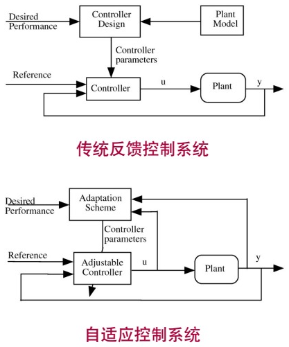

*课件第 5 页：传统反馈与自适应控制框图。*

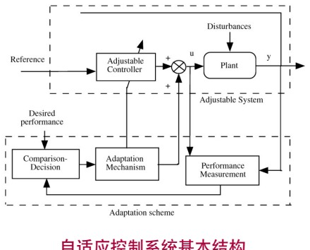

*课件第 7 页：自适应系统的性能反馈回路。*

第 8–10 页以 **150 秒时对象参数发生变化** 为背景，比较固定、鲁棒、自适应及组合设计，读图见 E01。鲁棒控制可用固定设计覆盖一组不确定对象，自适应控制会在线更新参数，二者可以结合。图中表现只对应给定仿真，不能推出任意参数变化都能被消除，也不代表算法自动实现全局最优。

### 分类与三种结构（第 12–15 页）

课件按对象分确定性和随机自适应；按功能分参数／非参数、性能、结构自适应；按工程结构分为以下几类：

| 结构 | 参数怎么得到 | 图中关键区别 |
| --- | --- | --- |
| 增益调度（课件称“开环自适应”） | 根据可测工况及预先标定的关系选择增益 | 工况到参数的支路通常不靠性能误差闭环修正；主控制回路仍可以有反馈 |
| 直接自适应 | 由参考模型误差等在线直接更新控制器增益，例如状态和参考输入的两个增益 | 不必先给出独立的对象参数估计 |
| 间接自适应／自校正 | 实测输出和预测输出比较，先辨识对象，再按当前估计重算控制器 | 有单独的估计与控制器设计步骤 |

这里“直接／间接”指在线更新的**对象**：控制器参数还是被控对象参数。MRAC 也可以有间接实现；课件第 14 页画的是直接方案，第 15 页画的是间接方案。

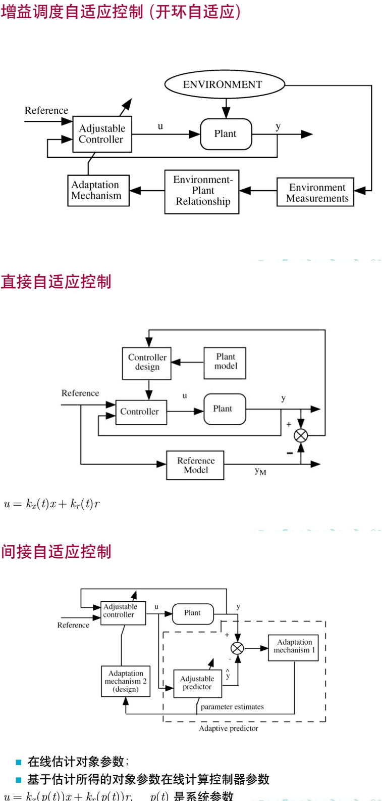

*课件第 13–15 页：增益调度、直接自适应与间接自适应。*

## 二、数学基础：正实性与无源性（第 16–23 页）

### 输入输出供给与三种严格性（第 16 页）

课件用离散和式，记区间能量 $`\|u\|_{2,T}^2=\sum_{t=0}^{T}u(t)^{\mathsf T}u(t)`$，并令

```math
\eta(0,T)=\sum_{t=0}^{T}y(t)^{\mathsf T}u(t).
```

若存在与时长无关的有限初始能量界 $`\gamma^2`$，使任意 $`T`$ 和允许输入都满足 $`\eta\ge-\gamma^2`$，则满足课件的无源不等式（该页称“正实系统”）。直观上，系统可返还初始储能，却不能无限对外供能；电路中可将电流、电压的乘积看作功率。若右端还分别含 $`\kappa\|u\|_{2,T}^2`$、$`\delta\|y\|_{2,T}^2`$、或同时含两项（常数均正），则对应输入严格、输出严格或强严格。离散和式的空间通常记为 $`\ell_2`$；连续时间对应积分与 $`L_2`$。这些**时域严格性**和后面的传递函数 SPR 定义不宜直接混同。

### 矩阵正定与互联（第 17–19 页）

实对称矩阵 $`P`$ 正定意味着 $`x^{\mathsf T}Px>0`$ 对所有非零 $`x`$ 成立；半正定允许等于零。复矩阵的 Hermitian 条件是 $`H=H^{\mathrm H}`$，只能推出对角元和特征值为实、$`x^{\mathrm H}Hx`$ 为实，**不能推出它们为正**。例如 $`\mathrm{diag}(1,-1)`$ 就是 Hermitian，却不正定。第 17 页的函数条件 $`H(z)=H^{\mathsf T}(\bar z)`$ 是跨复变量共轭点的对称式，不能直接当成每个 $`z`$ 上的正定性；对传递矩阵应检查相应频点的 Hermitian 部分 $`(H+H^{\mathrm H})/2`$。第 18–19 页的并联和负反馈可直接用供给率证明，见 E02。

### 连续传递函数的正实性（第 20–23 页）

实有理标量 $`h(s)`$ 为正实（PR），要求它对实 $`s`$ 取实值（在有定义处）、在右半平面解析，且 $`\mathrm{Re}\,h(s)\ge0`$ 对 $`\mathrm{Re}\,s>0`$ 成立。一个常用的严格正实（SPR）定义是：存在 $`\epsilon>0`$ 使 $`h(s-\epsilon)`$ 仍是 PR。课件第 20 页用“虚轴上每个有限频率实部严格为正”说明判据；应同时检查无闭右半平面极点，且在采用移轴定义时，单有有限频率严格为正还不总是充分，可能需要高频条件。E03 对课件的两个例子直接计算并用移轴验证。

第 23 页引理保留了一个强假设：$`h=M/N`$ 中，$`M,N`$ 是互质实 Hurwitz 多项式、相对阶的绝对值不超过 1，且 $`1/h`$ 已知是 PR。由于
```math
\mathrm{Re}\,\frac1{h(s)}=\frac{\mathrm{Re}\,h(s)}{|h(s)|^2},
```
在没有零点和极点的右半平面，两者实部同号。最后一条不能删；仅凭稳定零极点与阶次，不能断言 PR。正实性用于保证互联端口不持续注入能量，和第四章仅看极点的稳定性判别不同。

## 三、模型参考自适应控制（MRAC，第 24–44 页）

### 参考模型、控制器、自适应律（第 24–28 页）

参考模型把同一命令 $`r`$ 变成理想轨迹；对象通过可调控制器产生实际轨迹；两者的误差更新参数。参考模型一般选稳定且物理上可跟踪的线性定常系统。课件的二阶示意为
```math
\ddot y_m+2\zeta_m\omega_m\dot y_m+\omega_m^2y_m=\omega_m^2r .
```
$`\zeta_m`$ 定阻尼，$`\omega_m`$ 定时间尺度，右端系数使直流增益为 1。模型过快可能导致输入饱和、噪声放大或激发未建模动态。第 25 页框图的参考模型给的是**期望状态／输出**，第五章观测器给的是**实际对象状态的估计**，这两种“模型”在闭环中作用不同。

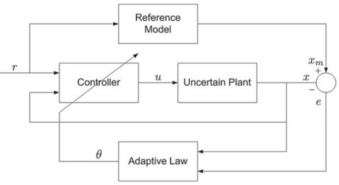

*课件第 25 页：参考模型、实际对象与自适应律。*

### 数学描述与设计原则（第 29–34 页）

课件用同一外部输入写两条动态，以下记作 $`r`$，避免和实际对象的控制作用混淆：
```math
\dot x_m=A_m x_m+B_mr,\qquad
\dot x_s=A_s(t)x_s+B_s(t)r,\qquad e=x_m-x_s.
```
第 29 页第二式的左端 $`\dot x_t`$ 应为 $`\dot x_s`$。记 $`\tilde A=A_m-A_s,\ \tilde B=B_m-B_s`$，相减得
```math
\dot e=A_m e+\tilde A x_s+\tilde B r.
```
第一项是名义误差动态，后两项是模型不匹配造成的驱动。第 30 页称“完全渐近适应”，同时要求 $`e\to0`$、$`A_s\to A_m`$、$`B_s\to B_m`$，并列举二次性能指标
```math
J=\int_{t_0}^{\infty}\big[e^{\mathsf T}Pe+
\mathrm{tr}(\tilde A^{\mathsf T}\Gamma_1^{-1}\tilde A)+
\mathrm{tr}(\tilde B^{\mathsf T}\Gamma_2^{-1}\tilde B)\big]\,dt.
```
迹项是矩阵各列误差的加权平方和。课件的设计思路是先找稳定结构，再选参数改善性能。**误差跟踪、参数收敛、积分指标最小是三件不同的事。** 例如 $`r\equiv0`$ 且两个初态都为零，轨线可以一直重合，但数据无法辨别输入增益。若要求参数真值收敛，通常还要可辨识性和足够激励。常见充分激励形式是：存在 $`T,\alpha>0`$，对所有 $`t`$ 都有 $`\int_t^{t+T}\varphi(\tau)\varphi(\tau)^{\mathsf T}d\tau\succeq\alpha I`$；它要求回归信号在每个窗口都照顾到所有参数方向。

第 32–33 页把参数或辅助输入的调节写成“初值＋历史积分＋瞬时项”。例如 $`\Delta A_s=\int_0^tF_1(v(\tau),\tau)d\tau+F_2(v(t),t)`$，$`\Delta B_s`$ 和 $`u_a`$ 类似，其中 $`v=De`$。积分记住了以往积累的修正，即使此刻误差小，已形成的增益也不必回到初值；瞬时项利用当前误差。$`D`$ 是用于满足相应设计条件的线性补偿器，PI 形态本身并不自动保证稳定。课件积分把积分变量和上限同时写作 $`t`$，这里用哑变量 $`\tau`$。第 34 页给出两种辅助信号取点，详算见 E04。

### 由李雅普诺夫函数推导自适应律（第 35–39 页）

课件二阶例的非线性写成已知基函数与未知常向量的乘积，且与输入共用作用方向：
```math
\dot x=Ax+b\,b_0[u+\Theta^{*\mathsf T}\Phi(x)],\qquad
b_0=\begin{bmatrix}0\\1\end{bmatrix},\qquad
u=K_xx+k_rr-\hat\Theta^{\mathsf T}\Phi(x).
```
理想参数满足 $`A+b\,b_0 K_x^*=A_m`$、$`b\,b_0k_r^*=B_m`$。这叫**模型匹配条件**：它要求矩阵差可由输入方向产生。不能只算左伪逆就断言所有差都能匹配，须代回验证。

以下推导补全了课件第 36–37 页。令参数误差为“理想值减当前值”，取 $`A_m^{\mathsf T}P+PA_m=-Q`$（$`Q\succ0`$），记 $`\bar P=Pb_0`$、$`\chi=e^{\mathsf T}\bar P`$。误差式为
```math
\dot e=A_m e+b\,b_0(\tilde K_xx+\tilde k_r r-\tilde\Theta^{\mathsf T}\Phi).
```
选正定学习增益 $`\Gamma_x,\Gamma_\Theta`$ 和 $`\gamma_r>0`$，构造
```math
V=e^{\mathsf T}Pe+|b|\big(\tilde K_x\Gamma_x^{-1}\tilde K_x^{\mathsf T}
+\tilde k_r^2/\gamma_r+\tilde\Theta^{\mathsf T}\Gamma_\Theta^{-1}\tilde\Theta\big).
```
其中参数误差的导数等于负的估计值导数。让 $`\dot V`$ 中的三个交叉项逐项抵消，得到
```math
\dot K_x^{\mathsf T}=\Gamma_x x\,\chi\,\mathrm{sgn}(b),\qquad
\dot k_r=\gamma_r r\,\chi\,\mathrm{sgn}(b),\qquad
\dot{\hat\Theta}=-\Gamma_\Theta\Phi\,\chi\,\mathrm{sgn}(b).
```
于是 $`\dot V=-e^{\mathsf T}Qe\le0`$。在该理想模型、常参数、控制方向符号已知、状态可用、参考有界等条件下，$`V`$ 给出误差和参数估计有界、$`e\in L_2`$；由模型响应有界和误差方程可得 $`\dot e`$ 有界，应用 Barbalat 引理得到 $`e\to0`$。这不保证每个参数误差趋零，也不自动保证有噪声、未知动态或饱和时的结论。E05 给出原数值例全部计算。

第 40–44 页另外对照两个对象的响应：二阶例比较无自适应、原辅助信号、修正辅助信号；三阶例比较后两者。E06、E07 分别计算准确极点、直流增益和理想模型匹配，并说明原图中能读到什么。

## 四、自校正控制（第 45–69 页）

### 从在线辨识到重新设计（第 45–47 页）

对象结构通常已知，系数未知或变化较慢；从闭环采样数据估计对象，用当前估计代替真实参数重新求控制量，称为**确定性等价**。课件分成最小方差调节、最小方差跟踪，以及极点配置调节和跟踪。这里的“先估计、再设计”是计算分工，不意味着估计误差和闭环稳定性可以无条件分离。第 48 页将最小方差自校正调节器归于 Åström 与 Wittenmark 的经典工作。

### 最小方差自校正调节器（第 48–56 页）

用离散步数 $`t`$，令 $`\xi=q^{-1}`$、$`\xi y(t)=y(t-1)`$，$`d\ge1`$ 为纯延迟，$`b_0=B(0)\ne0`$。课件模型为
```math
A(\xi)y(t)=\xi^dB(\xi)u(t)+C(\xi)\varepsilon(t).
```
$`A,B,C`$ 分别描述对象分母、输入作用和创新的着色通道。取 $`A(0)=C(0)=1`$；第 48 页先保留 $`c_0`$，第 51 页的 $`F(0)=1`$ 已隐含 $`c_0=1`$。若 $`c_0\ne0`$，可把它并入创新及其方差。以下用过去的输入和当前及过去的测量作决策；假设未来创新对这批信息条件均值为零，且方差为 $`\sigma^2`$、彼此不相关。单说“白”不足以保证对任意非线性决策也正交。

**为什么要预测 $`d`$ 步？** $`u(t)`$ 最早作用到 $`y(t+d)`$。第 49 页的 $`y(t+d)`$ 是未来实际输出，预测值另记 $`\hat y(t+d\mid t)`$。目标是令 $`E[y(t+d)^2]`$ 最小，这是二阶矩；在最优零均值调节下等于输出方差。先假定参数已知推导控制律，再在自校正实现中代入估计。

**把不可预测项和可控制项分开。** 截取 $`C/A`$ 的前 $`d`$ 个幂级数系数，令
```math
C=AF+\xi^dG,\qquad
F=1+f_1\xi+\cdots+f_{d-1}\xi^{d-1}.
```
可从常数项到 $`\xi^{d-1}`$ 逐项配出 $`F`$，再算 $`G=(C-AF)/\xi^d`$；若 $`\deg C\le n_a+d-1`$，则 $`\deg G\le n_a-1`$。课件第 51 页把阶次写作等号，最高项也可能为零。把对象方程向前移 $`d`$ 步，用上式与 $`C\varepsilon=Ay-\xi^dBu`$ 消去当前和过去的创新，得到
```math
y(t+d)=
\underbrace{F\varepsilon(t+d)}_{\text{未来创新}}
+\underbrace{\frac{BF}{C}u(t)+\frac GC y(t)}_{\hat y(t+d\mid t)} .
```
第一项只包含 $`\varepsilon(t+1)`$ 到 $`\varepsilon(t+d)`$。第 54 页把测量历史写成 $`y(t),y(t+1),\ldots`$，应为 $`y(t),y(t-1),\ldots`$；不能把未来测量也假定与未来创新无关。未来创新和可预测部分交叉项为零，故
```math
E[y(t+d)^2]=\sigma^2\sum_{i=0}^{d-1}f_i^2+E[\hat y(t+d\mid t)^2],
\qquad f_0=1 .
```
能把预测项压为零时，就达到不可消除的噪声下界。因此
```math
BFu(t)=-Gy(t),\qquad J_{\min}=\sigma^2\sum_{i=0}^{d-1}f_i^2 .
```
这是一条差分控制律，$`B(0)F(0)=b_0`$ 使当前 $`u(t)`$ 可以解出。实现还须检查内部稳定性：$`C`$ 可稳定地求逆来重建创新；严格最小方差律会消去或反演对象零点，若 $`B`$ 在通常 $`z`$ 平面有单位圆外零点，闭环内部通道可能不稳定。$`F`$ 是预测截断多项式，单独的 $`1/(BF)`$ 稳定性和整个反馈互联的内部稳定性不是同一问题。E08 完整复算课件公式，并补一个两步数值演算。

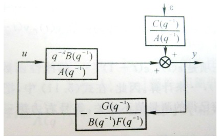

*课件第 56 页：最小方差自校正调节器。*

### 最小方差自校正控制器：跟踪和控制惩罚（第 57–58 页）

课件把零给定调节推广为参考跟踪，代价为
```math
J=E\big\{[\Gamma(\xi)y(t+d)-\Psi(\xi)y_r(t)]^2+[\Lambda'(\xi)u(t)]^2\big\},
\qquad \Gamma(0)=1 .
```
$`\Gamma`$ 塑造输出误差，$`\Psi`$ 塑造参考，$`\Lambda'`$ 对控制量加软惩罚。这里的撇号是课件给权重多项式起的记号，不是求导。设 $`\ell_0=\Lambda'(0)`$；当前 $`u(t)`$ 在预测误差中的系数为 $`b_0`$，在惩罚项中的系数为 $`\ell_0`$。未来创新不影响求导，故一阶条件为
```math
b_0\left[\frac{\Gamma BF}{C}u+\frac{\Gamma G}{C}y-\Psi y_r\right]
+\ell_0\Lambda' u=0.
```
令 $`\Lambda=(\ell_0/b_0)\Lambda'`$，乘 $`C/b_0`$ 并移项，得到第 58 页的形式
```math
u=\frac{C\Psi y_r-\Gamma G y}{C\Lambda+\Gamma BF}.
```
这样也解释了从第 57 页的 $`\Lambda'`$ 到第 58 页 $`\Lambda`$ 的换记号。二次系数 $`b_0^2+\ell_0^2>0`$ 保证本步极小唯一；整体仍需核对闭环多项式、执行器约束和跟踪性能。加权平方项是软惩罚，不等同于对输入加硬上限。E09 逐式推导并演算一个最小标量例。

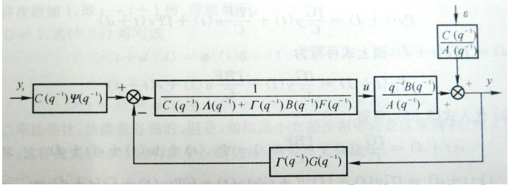

*课件第 58 页：带参考和控制惩罚的最小方差控制器。*

### 极点配置自校正调节器（第 59–63 页）

课件换用反馈 $`Fu=-Gy`$。本节的 $`F,G`$ 是**新求的反馈多项式**，不要与上一节截断预测得到的 $`F,G`$ 混用。代入对象得
```math
D_{\mathrm{cl}}y=CF\varepsilon,\qquad
D_{\mathrm{cl}}=AF+\xi^d BG .
```
取期望全闭环多项式 $`CT`$，其中 $`T=\prod_i(1-t_i\xi)`$；则 $`y=(F/T)\varepsilon`$。稳定要求在通常的 $`z`$ 平面 $`|t_i|<1`$；在 $`\xi=z^{-1}`$ 平面看的是倒数根，故它在单位圆外。约掉噪声通道的 $`C`$ 仅使某个传递函数变简单；若 $`C`$ 是闭环因子，仍须保证其稳定。

当 $`A`$ 与 $`\xi^dB`$ 互质时，一种唯一的系数配置是 $`\deg G\le n_a-1,\ \deg F\le n_b+d-1`$，且 $`\deg(CT)\le n_a+n_b+d-1`$。理由：让 $`\xi^d BG\equiv CT\pmod A`$，因互质，可在模 $`A`$ 下取唯一低阶余式 $`G`$；再由 $`F=(CT-\xi^dBG)/A`$ 得 $`F`$。$`CT`$ 首项为 1 时得到 $`F(0)=1`$。第 61 页只写 $`n_t`$ 并用严格小于，不能替代对 $`\deg(CT)`$ 与互质性的检查。只配置闭环分母不需要反演非最小相位零点；零点不能由此随意移动。E10 完整解原题第 62 页并复核系数。

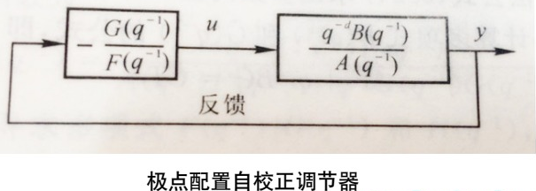

*课件第 60 页：极点配置自校正调节器。*

第 63 页算法可以读成：给初始估计、定目标 $`T`$ → 读取 $`y(t)`$ 和历史输入 → 在线辨识 $`\hat A,\hat B,\hat C`$ → 解 $`\hat A\hat F+\xi^d\hat B\hat G=\hat C T`$ → 计算并实际施加 $`u(t)`$ → 下一拍重复。该页控制式中的 $`q-1`$ 应为 $`q^{-1}`$。若直接用普通递推最小二乘，回归量应能由已知数据构造且满足所需噪声条件；未知 $`C`$ 的 ARMAX 模型含未测的过去创新，不能把它们当成已知量。可考虑扩展最小二乘或预测误差辨识，但估计与闭环稳定仍需分别验证。E11 用一个 ARX 步进示例解释在线更新。

### 极点配置自校正控制器（第 64–69 页）

加入参考前馈 $`Fu=Hy_r-Gy`$，代入无噪声模型得
```math
\frac{y}{y_r}=\frac{\xi^d HB}{AF+\xi^d BG},\qquad
G_m(\xi)=\frac{\xi^dB_m}{A_m}.
```
$`F,G`$ 决定反馈分母，$`H`$ 可塑造从给定到输出的分子。为避免在传递函数的约分中隐藏不稳定或阻尼差的模态，课件把 $`B=B^+B^-`$ 分开：$`B^+`$ 是选择约掉的、阻尼良好的稳定零点因子，归一化为 $`B^+(0)=1`$；$`B^-`$ 含不能约掉或不希望约掉的零点。参考模型必须保留后者，即 $`B_m=B_{m1}B^-`$。如果不选择约掉某个稳定零点，也可把它保留在 $`B^-`$。这里只讲课件所选的结构，不是任意目标模型都可实现。

当选择约掉 $`B^+`$ 且 $`A,B`$ 互质，为使分母也包含 $`B^+`$，由 $`AF+\xi^d BG`$ 必含 $`B^+`$ 可知 $`F=F_1B^+`$。于是模型匹配等式约去共同因子后可由以下设计实现：
```math
AF_1+\xi^dB^-G=A_mA_0,\qquad H=B_{m1}A_0,\qquad F=F_1B^+ .
```
$`A_0`$ 配置未显示在给定到输出传函中的辅助闭环模态，通常选稳定；有噪声时 $`A_0=C`$ 是满足阶次与稳定条件时的选择，不是恒等规定。内部闭环特征为 $`B^+A_mA_0`$；约分后仅在该给定通道见到 $`A_m`$。第 69 页阶次宜读成上界：$`\deg G\le\deg A-1`$、$`\deg F_1\le\deg B^-+d-1`$、$`\deg(A_mA_0)\le\deg A+\deg B^-+d-1`$，并核对互质性。第 67 页“降阶必须消去因子”针对图中选择的较低阶精确匹配；不必为了降低可见阶数去消去不稳定因子。E12 用课件例题的对象演示一次跟踪设计。

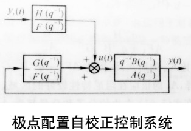

*课件第 65 页：有参考前馈的极点配置自校正控制器。*

## 附录：课件例题、框图演算与响应对照

E01–E10 包括所有原课件有题目、演算或结果图的内容；E11、E12 是对课件只给算法而未给独立数值题的两项补充。第 48–58 页主要给一般推导，E08、E09 中的数值均明确标为补充。原 PDF 未另列作业。

### E01｜参数在 150 秒变化：固定反馈、鲁棒与自适应（第 8–10 页）

第 8 页，上图固定控制在参数改变后每次跳变都再次振荡；下图自适应控制在变化后有一段重新调整的过渡，之后的方波跟踪较平滑。第 9 页的鲁棒控制下图在多次阶跃仍有过冲或欠冲，但没有上图那种参数突变后持续多次振荡的表现。第 10 页保留课件对三种方案的标注：(a) 自适应＋常规，(b) 鲁棒＋常规，(c) 自适应＋鲁棒。看变化时的峰值、以后的振荡与跟踪偏差，而不是只盯一次过冲。图未给完整对象、增益、输入和初值，不能从图片反推出唯一控制律或精确指标。

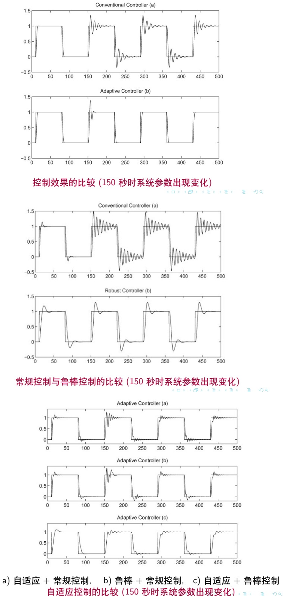

*课件第 8–10 页：参数变化时的三组控制效果对照。*

### E02｜两种互联为什么保持无源性？（第 18–19 页）

并联时 $`u_1=u_2=u`$，$`y=y_1+y_2`$，所以每时刻有 $`u^{\mathsf T}y=u_1^{\mathsf T}y_1+u_2^{\mathsf T}y_2`$。负反馈图给出 $`u_1=u-y_2,\ u_2=y_1,\ y=y_1`$，于是
```math
u_1^{\mathsf T}y_1+u_2^{\mathsf T}y_2
=(u-y_2)^{\mathsf T}y_1+y_1^{\mathsf T}y_2=u^{\mathsf T}y .
```
若两个块各自的供给率累计不低于 $`-\gamma_1^2,-\gamma_2^2`$，互联的累计也不低于 $`-(\gamma_1^2+\gamma_2^2)`$。互联须适定；此推导只证明合成系统保留无源不等式。

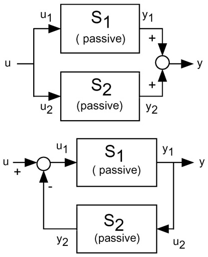

*课件第 18–19 页：两个无源方块的并联与负反馈。*

### E03｜两条传递函数的正实性（第 20–23 页）

**第一题：** $`W=1/(s+a),\ a>0`$。对 $`s=\sigma+j\omega`$，
```math
\mathrm{Re}\,W(s)=\frac{\sigma+a}{(\sigma+a)^2+\omega^2}.
```
在右半平面为正；取任意 $`0<\epsilon<a`$ 后，$`W(s-\epsilon)`$ 仍满足同一判据，故为 SPR。

**第二题：** $`W=1/(s^2+a_1s+a_0)`$，$`a_0,a_1>0`$。极点在开左半平面，但令 $`s=j\omega`$ 并乘分母的共轭，正确式子是
```math
W(j\omega)=
\frac{a_0-\omega^2-ja_1\omega}{(a_0-\omega^2)^2+(a_1\omega)^2}.
```
第 22 页第一行分式中的 $`b_0^2`$、$`a_1`$ 和末项均有排印错误；下方的实部式正确。当 $`\omega^2>a_0`$ 时实部为负，且函数在该频点连续，右移一点到开右半平面仍为负，故连 PR 都不满足。**稳定不等于正实。** 第 23 页引理需要假设 $`1/h`$ 已为 PR；例如 $`h=(s+1)^2/(s+10)^2`$ 零极点均稳定、同阶，但在 $`\omega=\sqrt{10}`$ 的实部是 $`(400-810)/12100<0`$，可见不能删掉该假设。

### E04｜二阶对象与原／修正辅助信号（第 34 页）

图的对象内部 $`x_{p1}=y_p`$、$`x_{p2}=\dot y_p`$，第一加法节点减去 $`x_{p1}+a_1x_{p2}`$ 后除以 $`a_2`$，再两次积分。因此 $`a_2\ddot y_p+a_1\dot y_p+y_p=u`$。右侧辅助发生器满足
```math
\dot y_{pf}=\alpha(y_p-y_{pf}),\qquad
\frac{Y_{pf}}{Y_p}=\frac{\alpha}{s+\alpha},\qquad
\frac{\mathcal{L}\{\dot y_{pf}\}}{Y_p}=\frac{\alpha s}{s+\alpha},
```
最后一个比值是时域 $`\dot y_{pf}`$ 的拉普拉斯像与 $`Y_p`$ 的比，上式按零初值。原取法 (a) 用积分器后的低通量 $`y_{pf}`$，修正取法 (b) 用积分器前的 $`\dot y_{pf}`$，两种都保留直接信号 $`y_p`$。后者对直流为零，高频增益趋于 $`\alpha`$；它是带限的变化率信号。第 40–44 页用响应图比较两种取点，未给全套仿真参数。

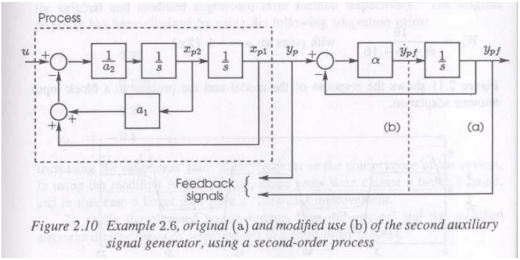

*课件第 34 页：对象及两种辅助信号的取点。*

### E05｜非线性二阶 MRAC：匹配、李雅普诺夫方程与更新律（第 35–39 页）

课件给定 $`\omega_n=1,\ \zeta=-0.5,\ b=1,\ \Theta^{*\mathsf T}=[0.5,-0.1]`$，且 $`\Phi=[1,y^2]^{\mathsf T}`$。前文写 $`\zeta>0`$，本例实际取负阻尼；按题中数值计算。令 $`x=[y,\dot y]^{\mathsf T}`$。参考取 $`\zeta_m=0.5,\omega_m=2,b_m=4,r=\sin2t`$，于是
```math
A=\begin{bmatrix}0&1\\-1&1\end{bmatrix},\quad
A_m=\begin{bmatrix}0&1\\-4&-2\end{bmatrix},\quad
B=\begin{bmatrix}0\\1\end{bmatrix},\quad B_m=\begin{bmatrix}0\\4\end{bmatrix}.
```
$`A`$ 的特征多项式 $`s^2-s+1`$ 的根是 $`(1\pm j\sqrt3)/2`$；课件漏了 $`j`$。它们是名义线性矩阵的特征值，实部正。非线性对象在 $`u=0`$ 时原点还受常偏置驱动，不宜把这些值当成非线性原点的特征值。由 $`A_m-A=BK_x^*`$ 直接比第二行，得 $`K_x^*=[-3,-3]`$；由 $`Bk_r^*=B_m`$ 得 $`k_r^*=4`$。代回可复原参考模型。

设 $`P=\begin{bmatrix}p_{11}&p_{12}\\p_{12}&p_{22}\end{bmatrix}`$，用 $`Q=I`$。比较 $`A_m^{\mathsf T}P+PA_m=-I`$ 的三个独立元素：
```math
-8p_{12}=-1,\qquad
p_{11}-2p_{12}-4p_{22}=0,\qquad 2p_{12}-4p_{22}=-1.
```
因此
```math
P=\begin{bmatrix}3/2&1/8\\1/8&5/16\end{bmatrix},\quad
\det P=29/64>0,\quad
\bar P=PB=\begin{bmatrix}1/8\\5/16\end{bmatrix}.
```
令 $`\chi=e_1/8+5e_2/16`$，应用正文的交叉项抵消律且 $`\mathrm{sgn}(b)=1`$：
```math
\dot K_x^{\mathsf T}=\chi\begin{bmatrix}\gamma_{x1}x_1\\\gamma_{x2}x_2\end{bmatrix},
\qquad \dot k_r=\gamma_r r\chi,\qquad
\dot{\hat\Theta}=-\chi\begin{bmatrix}\gamma_{\theta1}\\\gamma_{\theta2}x_1^2\end{bmatrix}.
```
控制律中非线性估计项是减号，这就是它的更新号与两个反馈增益不同的来源。第 38 页图中误差减小、状态曲线逐渐贴近；第 39 页的估计曲线不能单凭有限时间图认定与各真值相等。参考模型对 $`\sin2t`$ 的稳态输出为 $`-\cos2t`$，其稳态速度为 $`2\sin2t=2r`$，说明仅靠这两个稳态信号不能独立区分对应增益。原课件未列全学习增益及初值，图仅作对照。

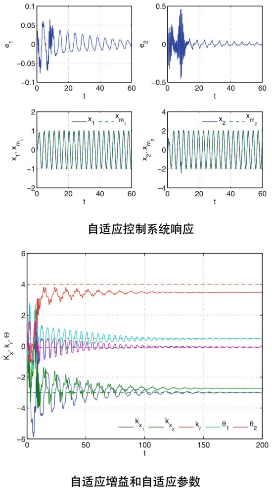

*课件第 38–39 页：非线性二阶例的误差、状态及参数曲线。*

### E06｜二阶 MRAC 响应对照（第 40–42 页）

原题 $`W_p=12/(s^2+2s+8)`$、$`W_m=16/(s^2+8s+16)`$。配方得到 $`(s+1)^2+7`$ 与 $`(s+4)^2`$；因此对象极点 $`-1\pm j\sqrt7`$，参考模型为 $`-4`$ 二重极点，直流增益分别为 $`12/8=1.5`$ 与 $`16/16=1`$。同样的单位阶跃下，零初值响应可直接算为
```math
y_p(t)=\tfrac32\left[1-e^{-t}\left(\cos(\sqrt7t)+\frac{\sin(\sqrt7t)}{\sqrt7}\right)\right],
\qquad y_m(t)=1-(1+4t)e^{-4t}.
```
这解释第 40 页无自适应曲线的振荡和稳态差。第 41 页采用原辅助信号，第 42 页采用修正辅助信号；后者在图示反复切换中输出贴得更紧，仍可看见输入尖峰。课件没有给这组图的所有自适应增益、初值和输入发生器参数，不能把理想匹配计算当作原图的仿真设置。

作为补充验算，在 $`x=[y,\dot y]^{\mathsf T}`$ 可用、对象已知的理想情形，取 $`u=(-8y-6\dot y+16r)/12`$，代回 $`\ddot y+2\dot y+8y=12u`$，即得 $`\ddot y+8\dot y+16y=16r`$。这说明跟踪参考模型具体意味着改哪些系数。

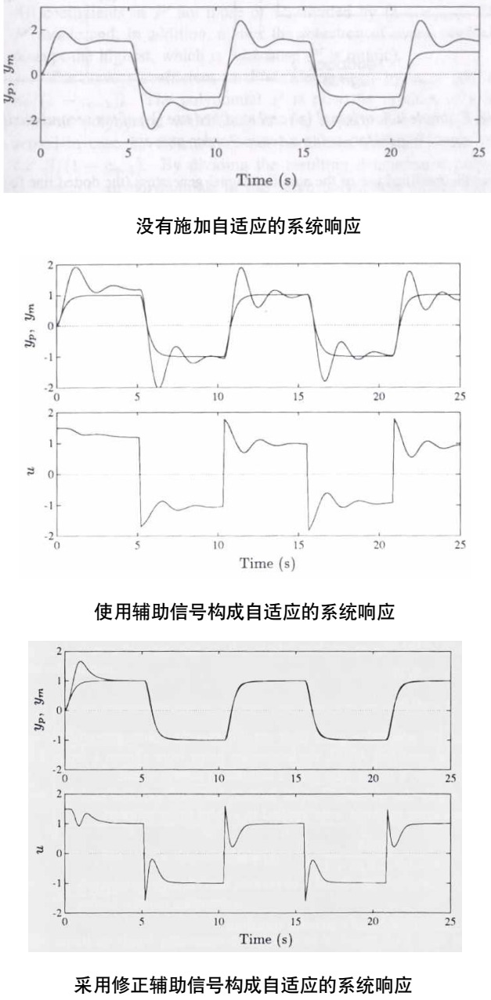

*课件第 40–42 页：二阶例：无自适应、原辅助信号、修正辅助信号。*

### E07｜三阶 MRAC 响应对照（第 43–44 页）

以课件印出的多项式为准：
```math
\begin{aligned}
s^3+4s^2+7.5s+13.5&=(s+3)(s^2+s+4.5),\\
s^3+16s^2+80s+128&=(s+4)^2(s+8).
\end{aligned}
```
故对象极点是 $`-3`$ 和 $`-\tfrac12\pm j\tfrac{\sqrt{17}}2`$（约 $`\pm2.062j`$，不是精确 $`\pm2j`$）；参考模型是 $`-4`$ 二重、$`-8`$ 单重。原页“两个极点”只能理解为两个不同位置。直流增益分别为 $`20.25/13.5=1.5`$ 和 $`128/128=1`$。第 43 页原辅助信号的输出和控制量振荡更明显；第 44 页修正信号后的重复过渡更贴近参考，图中仍有输入瞬态。补充理想匹配验算：若 $`y,\dot y,\ddot y`$ 都可用，取 $`20.25u=128r-12\ddot y-72.5\dot y-114.5y`$，代入对象微分方程即可得到目标分母。它并非课件曲线所用控制器的反向辨识结果。

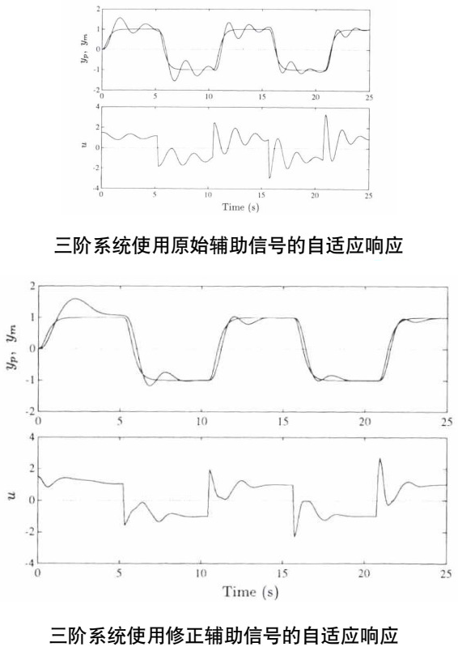

*课件第 43–44 页：三阶例：原辅助信号与修正辅助信号。*

### E08｜最小方差调节器：完整消元与数值演算（第 48–56 页）

先把模型写为 $`y(t+d)=(B/A)u(t)+(C/A)\varepsilon(t+d)`$。用 $`C/A=F+\xi^dG/A`$，过去创新项是 $`(G/A)\varepsilon(t)`$。再代入 $`\varepsilon(t)=(A/C)y(t)-(\xi^dB/C)u(t)`$：
```math
\frac BA-\frac{\xi^dBG}{AC}
=\frac{B(C-\xi^dG)}{AC}=\frac{BF}{C}.
```
所以未来不可预测项为 $`F\varepsilon(t+d)`$，剩下的是 $`(BFu+Gy)/C`$。令后者为零；对未来创新的 $`d`$ 项平方求期望，交叉项为零，得到 $`\sigma^2(1+f_1^2+\cdots+f_{d-1}^2)`$。

**补充数值演算：** $`A=1-\xi/2,\ B=C=1,\ d=2`$。比较常数和一次项得 $`F=1+\xi/2`$，于是 $`AF=1-\xi^2/4`$、$`G=1/4`$。控制律和闭环为
```math
u(t)=-\tfrac12u(t-1)-\tfrac14y(t),\qquad
y(t+2)=\varepsilon(t+2)+\tfrac12\varepsilon(t+1),\qquad J_{\min}=\tfrac54\sigma^2 .
```
用原模型向前推两拍也会得到同一结果：$`y(t+2)=\tfrac14 y(t)+\tfrac12u(t-1)+u(t)+\tfrac12\varepsilon(t+1)+\varepsilon(t+2)`$，前三项被控制律恰好抵消。

### E09｜最小方差跟踪：控制惩罚怎么进入分母？（第 57–58 页）

令当前输入为决策变量，过去输入与已知测量固定。写两个可预知的量为 $`b_0u(t)+a_t`$ 和 $`\ell_0u(t)+c_t`$，其中 $`a_t,c_t`$ 汇集历史与参考。去掉与输入无关的未来创新方差后，代价就是两项平方和，导数为 $`2b_0(b_0u+a_t)+2\ell_0(\ell_0u+c_t)`$。令其为零，即得正文的 $`C\Lambda+\Gamma BF`$，不能把 $`\Lambda'`$ 在求导后直接当作同一个多项式。

**补充数值演算：** 取 $`A=1-\xi/2,\ B=C=1,\ d=1`$，$`\Gamma=\Psi=\Lambda'=1`$。此时 $`F=1,\ G=1/2`$，预测输出为 $`u(t)+y(t)/2`$。给定当前参考 $`y_r`$，最小化 $`(u+y/2-y_r)^2+u^2`$，解得 $`u=y_r/2-y/4`$。若去掉控制惩罚，得到 $`u=y_r-y/2`$。这展示了惩罚如何减小本拍校正的幅度。

### E10｜第 62 页原题：逆不稳定对象的极点配置调节

题给 $`A=1-\xi,\ B=0.5+\xi,\ C=1+0.4\xi,\ d=2`$。对象极点 $`z=1`$ 在单位圆上，因此不是渐近稳定的；其有限零点 $`z=-2`$ 在单位圆外，所以逆不稳定。题设在 $`\xi`$ 平面要求根为 $`2`$，即 $`z=0.5`$，取 $`T=1-\xi/2`$。设 $`F=1+f_1\xi+f_2\xi^2,\ G=g_0`$，比较 $`AF+\xi^2BG=CT`$：
```math
1+(f_1-1)\xi+(f_2-f_1+g_0/2)\xi^2+(g_0-f_2)\xi^3
=1-\tfrac1{10}\xi-\tfrac15\xi^2.
```
得到 $`f_1=9/10,\ g_0=f_2=7/15`$，课件的 $`0.47`$ 是近似值。代回有
```math
u(t)=-\frac{7/15}{1+\frac9{10}\xi+\frac7{15}\xi^2}y(t),\qquad
y(t)=\frac{1+\frac9{10}\xi+\frac7{15}\xi^2}{1-\frac12\xi}\,\varepsilon(t).
```
**课件最后一行有两个笔误：不应有负号，右端输入是 $`\varepsilon(t)`$，不是 $`y(t)`$。** 这由 $`CTy=CF\varepsilon`$ 直接验证。逐拍实现是
```math
\begin{aligned}
u(t)&=-\tfrac9{10}u(t-1)-\tfrac7{15}u(t-2)-\tfrac7{15}y(t),\\
y(t)-\tfrac12y(t-1)&=\varepsilon(t)+\tfrac9{10}\varepsilon(t-1)+\tfrac7{15}\varepsilon(t-2).
\end{aligned}
```
取单位创新脉冲、零历史，闭环前两点应为 $`y(0)=1,\ y(1)=1.4`$；从原对象方程也得到 $`y(1)=y(0)+0.4=1.4`$。不稳定逆零点没有被约掉。

### E11｜补充：递推最小二乘怎样用一拍数据更新？（对应第 63 页）

对可测回归 $`y(t)=\varphi(t)^{\mathsf T}\theta+\varepsilon(t)`$，无遗忘递推可写为
```math
L_t=\frac{P_{t-1}\varphi(t)}{1+\varphi(t)^{\mathsf T}P_{t-1}\varphi(t)},\quad
\hat\theta_t=\hat\theta_{t-1}+L_t[y(t)-\varphi(t)^{\mathsf T}\hat\theta_{t-1}],\quad
P_t=P_{t-1}-L_t\varphi(t)^{\mathsf T}P_{t-1}.
```
例如 $`y(t)=b\,u(t-1)+\varepsilon(t)`$，若上一步 $`\hat b=0.5,P=1`$，本次 $`u(t-1)=2,\ y(t)=3`$，预测为 $`1`$，残差为 $`2`$，增益为 $`2/(1+4)=0.4`$，更新得 $`\hat b=1.3,\ P=0.2`$。下一步用新系数重算控制器。此例只说明一拍更新，不意味着一次观测就能确定真值。

### E12｜补充：保留不稳定零点的极点配置跟踪（对应第 64–69 页）

借用 E10 的对象确定部分，令 $`B^+=1,\ B^-=0.5+\xi`$，取 $`A_m=1-\xi/2`$、$`A_0=1+0.4\xi`$。为了单位直流增益，令 $`B_{m1}=A_m(1)/B^-(1)=1/3`$。此时 $`AF_1+\xi^2B^-G=A_mA_0`$ 与 E10 完全一样，故 $`F=F_1=1+0.9\xi+(7/15)\xi^2,\ G=7/15`$，只新增
```math
H=\tfrac13(1+0.4\xi),\qquad
\frac{y}{y_r}=\frac{\xi^2(0.5+\xi)}{3(1-\xi/2)} .
```
代入 $`\xi=1`$ 得 1；代入 $`\xi=-0.5`$ 得分子零，说明 $`z=-2`$ 的非最小相位零点仍在。这里 $`A_0`$ 在输入到输出的公式里约掉，但在全闭环多项式里仍有对应的稳定模态。

## 复习时应能独立完成的事

1. 对照课件框图说出哪一个误差在更新什么：MRAC 的跟踪误差与自校正辨识的预测残差。
2. 用输入输出乘积证明两个无源互联，能复算两条传递函数在虚轴上的实部。
3. 从模型匹配写出 $`K_x^*,k_r^*`$，由 $`\dot V`$ 的交叉项推导更新律，并区分跟踪与参数辨识。
4. 从 $`C=AF+\xi^dG`$ 分解未来噪声与可预测输出；能分清最小方差调节、带控制惩罚跟踪。
5. 手算 $`AF+\xi^dBG=CT`$，辨认 $`z`$ 与 $`q^{-1}`$ 的倒数根；做跟踪时能说明为什么必须保留某些零点。
