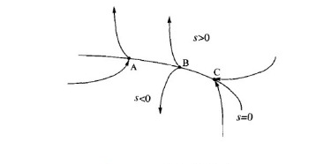
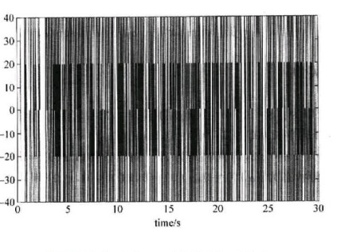
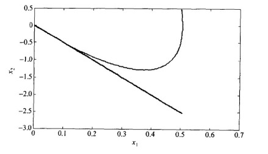

# 第八章：变结构控制专题（滑模控制）

> 来源：《第8章 变结构控制.pdf》，79 页。页码均为 PDF 的物理页序。配套：[逐页核对索引](Chapter08_逐页核对索引.md)。

**本章解决的问题：** 先设计一条希望状态沿着走的面，再设计控制使状态到达这条面。读题时分别问：**面外能不能到、到面后能不能留、沿面走会不会收敛？** 三个问题对应三种计算，不能只检查 $`s\dot s<0`$ 就说全状态稳定。

## 一、概述（第 1–10 页）

变结构控制根据当前状态切换控制规律，闭环向量场因此可以不连续。滑模控制（SMC）是其中一种：先把开关两侧的运动方向设计成朝向切换面，再用切换面本身规定滑动阶段的动力学。若状态有 $`n`$ 维，$`m`$ 个独立切换函数 $`s_i(x)=0`$ 在正则点定义 $`n-m`$ 维滑动流形，至于能否独立控制这 $`m`$ 个横向分量，还要检查输入方向。控制器不必在线辨识所有参数；课件所说的抗扰不变性特指理想滑动且扰动匹配的情形。第 5 页按二阶研究、高阶 SISO、线性空间不变性、多维滑模叙述发展；第 7–8 页介绍时滞、自适应滑模、终端滑模、全鲁棒滑模、滑模观测器及电机、机器人、伺服等应用。

**抖振**是实际开关、采样、延迟、测量噪声或未建模动态使状态在面附近反复穿越的现象。第 9–10 页列出边界层、趋近律、滤波、观测器和动态滑模等处理思路。边界层以内把跳变改为连续反馈，会改变误差精度和抗扰性；滤波引入的相位滞后需要一并考虑；动态滑模把不连续项转移到控制量的导数，仍需相应阶次与模型假设。第 10 页的指数趋近是 $`\dot s=-\epsilon\operatorname{sgn}s-ks`$。

## 二、变结构基础（第 11–18 页）

以标量切换函数 $`s(x)`$ 为例，$`s>0`$ 用 $`u^+`$、$`s<0`$ 用 $`u^-`$。先在两侧分别检查向量场，再看面上如何解释运动；两侧各自满足 Lipschitz 并不使跨越切换时的右端连续。对于理想继电控制，可在面上用两侧向量场的凸组合描述滑动：若 $`\dot s^+<0<\dot s^-`$，令 $`\theta=\dot s^-/(\dot s^--\dot s^+)`$，则 $`\theta\dot s^++(1-\theta)\dot s^-=0`$，这就是相切所需的平均作用。课件的“非单值性”还涉及控制器设计方案可以不唯一；它与某个固定闭环在不连续面上的解定义是两个问题。

第 13 页的三种点可直接判读：两侧的 $`\dot s`$ 同号，轨迹穿越，称**常点 A**；$`\dot s^+>0>\dot s^-`$，两侧均离开，称**起始点 B**；$`\dot s^+<0<\dot s^-`$，两侧都靠近，称**终止点 C**。滑动区对应第三种；若一侧导数为零，需进一步分析，不能仅凭画法判断。第 14 页还要求全程可达、滑动稳定和满足动态品质。第 15–18 页四个实例见附录 E01–E04。



## 三、连续系统变结构控制理论（第 19–53 页）

### 1. 存在、到达和稳定分别检验（第 19–24 页）

对于 $`\dot x=Ax+Bu,\ s=Cx`$，$`\dot s=CAx+CBu`$。$`CB`$ 非奇异表示输入能指定横向速度；对当前状态可解任意所需的 $`\dot s`$（输入不受限时）。这不是对受限控制器的任意状态可达性的单独保证。若 $`s=s(x,t)`$，应使用全导数 $`\dot s=s_x\dot x+s_t`$；第 22 页应按链式法则读。相图第 23 页先看从初始点弯向切换线的趋近段，再看贴线趋向平衡点的滑动段。

标量时取 $`V=s^2/2`$，$`\dot V=s\dot s`$。$`s\dot s<0`$ 表示向面靠近，但 $`\dot s=-ks`$ 反例说明严格负也可能只是指数趋近。若 $`s\dot s\le-\delta`$（在所考察的面外区域）则 $`t_r\le s(0)^2/(2\delta)`$；该形式在接近零时可能需要无界 $`\dot s`$。常用有限时间条件 $`s\dot s\le-\eta|s|`$ 等价于 $`d|s|/dt\le-\eta`$，只需有限横向速度，且 $`t_r\le |s(0)|/\eta`$。这些条件保证的是到面；$`V`$ 在面上处处为零，不能代替用于证明全状态稳定的 Lyapunov 函数。

### 2. 等效控制、降维与匹配条件（第 22–26 页）

理想滑动时 $`s=0,\dot s=0`$，由第二式解出维持第一式的输入：

```math
u_{\rm eq}=-(CB)^{-1}CAx,\qquad \dot x=\Pi Ax,\qquad \Pi=I-B(CB)^{-1}C.
```

$`C\Pi=0,\ \Pi B=0,\ \Pi^2=\Pi`$，所以 $`\Pi`$ 沿输入方向把速度投影到面内。$`u_{\rm eq}`$ 是理想滑动中开关的等效平均，不会把面外的状态主动拉回来；要在 $`\ker C`$ 上检查降维系统的稳定性，不能把全阶投影矩阵的零特征值当成滑动模态不稳定。第 24 页用稳定多项式选 $`C`$ 的理由见 E05，成立于相应积分链坐标。

若 $`\dot x=Ax+Bu+\Delta A x+Df`$，约束仍用 $`\dot s=0`$，滑动速度为 $`\Pi(Ax+\Delta Ax+Df)`$。于是 $`\operatorname{rank}[B,D]=\operatorname{rank}B`$ 等价于 $`D=B\tilde D`$，使 $`\Pi D=0`$；同理 $`\Delta A=B\widetilde A`$ 时摄动被投影消除。此秩判据保证**整个扰动方向**都匹配；只要求某条轨迹上残差消失时不必推出同一个全矩阵条件。第 25 页总方程重复印了 $`Bu`$，按一个输入通道理解。抗扰结论依赖状态处在理想滑动且控制有余量；趋近段、边界层内和非匹配扰动不能直接套用。不变性与第七章通过在线更新来补偿未知量的机制不同。

### 3. 切换控制律与趋近律（第 26–51 页）

课件列出常值切换、函数切换（等效控制加切换项）、比例切换（按 $`x_i s`$ 的符号选择 $`\alpha_i,\beta_i`$）。对 $`CB>0`$ 的标量情形，若 $`|CAx|\le M`$，常值律 $`u=-K\operatorname{sgn}s`$ 取 $`CB\,K>M`$ 才能在这一范围内压过漂移。若用 $`u_{\rm eq}`$ 抵消漂移，切换增益主要为扰动和误差留余量。若 $`CB<0`$，开关方向相反。时变二阶系统与倒立摆见 E06–E07。

趋近律先规定 $`\dot s=\ell(s)`$，再代入 $`CAx+CBu=\ell(s)`$ 求 $`u=(CB)^{-1}[\ell(s)-CAx]`$。下面的到达时间取无扰、无限幅、增益常数，$`w_0=|s(0)|`$。

| 趋近律 | 到达时间从哪里来 | 作用 |
| --- | --- | --- |
| 等速 $`-\epsilon\operatorname{sgn}s`$ | $`\dot w=-\epsilon`$，$`t_r=w_0/\epsilon`$ | 全程同一横向速度，增益越大开关越强 |
| 指数 $`-\epsilon\operatorname{sgn}s-ks`$ | $`w=(w_0+\epsilon/k)e^{-kt}-\epsilon/k`$ 至首次为零，$`t_r=k^{-1}\ln(1+kw_0/\epsilon)`$ | 远处由 $`ks`$ 加速，近处由 $`\epsilon`$ 保证有限时间 |
| 幂次 $`-k\lvert s\rvert^\alpha\operatorname{sgn}s`$ | $`d(w^{1-\alpha})/dt=-(1-\alpha)k`$，$`t_r=w_0^{1-\alpha}/[(1-\alpha)k]`$，$`0<\alpha<1`$ | 近零速度趋零，仍可有限时间到达 |
| 一般 $`-\epsilon\operatorname{sgn}s-f(s)`$ | 若 $`sf(s)\ge0`$，则 $`\dot w\le-\epsilon`$ | $`f`$ 用来塑造趋近，不能任取后断言可达 |

注意指数趋近律里 $`\epsilon=0`$ 仅渐近到面，不等于“面上的理想运动不可能存在”。普通滑模面上的降维运动也不自动有限时间收敛到原点。连续仿真曲线见 E08。

### 4. 电气系统的应用（第 52–53 页）

课件分别画了变换器电压外环与滑模电流内环、直流电机转速外环与电流内环，以及带观测器的结构。外环由电压或转速误差产生电流指令，内环较快，依据实际或估计量驱动开关。观测误差、开关频率、占空比限制都可能影响滑模品质；图不是每种拓扑都能直接套用的增益公式。对应框图信号见 E09。

## 四、离散时间滑模控制的特性（第 54–61 页）

采样时刻才更新控制，状态往往一步跨过 $`s=0`$ 而进入**切换带** $`S_\Delta=\{x:|Cx|<\Delta\}`$。课件第 57–58 页区分趋近、准滑动和平稳状态，区分正好到面并保持的理想准滑动与带内交替穿越。切换带描述的是 $`s`$ 的幅值，不能单凭 $`|s|`$ 小推出每个状态都小。连续时间用 $`\dot s=0`$；离散时间允许用模型计算 $`s_{k+1}=s_k=0`$ 来保持采样点在面上，但一般没有连续开关的等效平均机制。

对 $`V_k=s_k^2/2`$，

```math
\Delta V_k=\tfrac12(s_{k+1}^2-s_k^2)=\tfrac12(s_{k+1}-s_k)(s_{k+1}+s_k).
```

第 59–60 页的 $`\Delta V_k`$ 漏了 $`1/2`$，不改变符号判据。两条乘 $`\operatorname{sgn}s_k`$ 的不等式合起来等价于 $`-|s_k|<s_{k+1}<|s_k|`$（$`s_k\ne0`$）；仅第一条不够，如 $`s_k=1,s_{k+1}=-2`$。要由严格下降推出趋零，还要有面不变性及适当的一致衰减条件，例如 $`|s_{k+1}|\le\rho|s_k|,\rho<1`$；一般有界严格下降序列也可能趋于正数。第 61 页的离散匹配条件是 $`\Delta G=B\tilde G,D=B\tilde D`$，原理仍是沿输入方向投影，但未测扰动会使实际下一拍偏离理想预测，不能无条件声称每个采样点都在面上。

## 五、基于趋近律的离散滑模控制（第 62–68 页）

以采样周期 $`T`$ 对指数趋近律作前向差分，令 $`a_d=1-qT,b_d=\epsilon T`$，得 $`s_{k+1}=a_ds_k-b_d\operatorname{sgn}s_k`$。由 $`s_{k+1}=CAx_k+CBu_k`$ 得

```math
u_k=(CB)^{-1}[a_ds_k-b_d\operatorname{sgn}s_k-CAx_k].
```

第 64 页的中间式 $`GBu`$ 应为 $`CBu`$。对于 $`0<a_d<1,b_d>0`$，同号时 $`|s_{k+1}|=a_d|s_k|-b_d`$，每拍至少减少 $`b_d`$，故有限步到零或穿越；首次穿越后 $`|s_{k+1}|\le b_d`$，这个带不变。除正好落零的轨迹外，进入带后交替变号，幅值满足 $`w_{k+1}=b_d-a_dw_k`$，趋于 $`b_d/(1+a_d)`$，即两点周期。初始幅值足够小时可以从第一拍就交替，且穿越后幅值可一小一大，并非每步必单调。第 63 页乘上符号函数后，常量项是 $`-b_d`$，不再乘 $`|s_k|`$；第二条严格不等式只在 $`|s_k|>b_d/(1+a_d)`$ 成立。因此第 58、63 页所列理想化描述需要这些边界条件。

用 $`\operatorname{sat}(s/\Delta)=\max(-1,\min(1,s/\Delta))`$ 替换符号函数后，边界层内 $`s_{k+1}=(a_d-b_d/\Delta)s_k`$。只有斜率模小于 1，才在该层内收缩；若斜率在 $`(-1,0)`$，幅值衰减但仍会变号。它能削弱切换，但受扰时通常只保证误差有界。课件数值例见 E10。

## 六、基于等效控制的离散滑模控制（第 69–79 页）

设 $`s_k=C_e x_k`$，其中 $`C_e`$ 是行向量。令 $`s_{k+1}=s_k`$，有

```math
u_{{\rm eq},k}=-(C_eB)^{-1}C_e(A-I)x_k.
```

第 69 页混用了切换行符号和转置；修正后维数为标量。仅加等效输入会使原有 $`s_k`$ 保持常数；课件给出的 Furuta 形式 $`u_k=u_{{\rm eq},k}+F_Dx_k`$ 还需设计 $`F_D`$ 以使面外收敛且面上不变，不能任取。例如 $`F_D=-(C_eB)^{-1}\kappa C_e`$，有 $`s_{k+1}=(1-\kappa)s_k`$；$`0<\kappa<2`$ 使横向收缩，$`\kappa=1`$ 在名义模型下一拍到面。面内仍要验极点在单位圆内。具体例见 E11。

跟踪时，令 $`x_{e,k}=R_k-x_k`$、$`f_k=R_{k+1}-AR_k`$，则 $`x_{e,k+1}=Ax_{e,k}-Bu_k+f_k`$。误差通道输入矩阵是 $`-B`$。从 $`s_{k+1}=C_e(R_{k+1}-Ax_k-Bu_k)`$ 得

```math
u_k=(C_eB)^{-1}[C_e\widehat R_{k+1}-C_eAx_k-s^{\rm des}_{k+1}].
```

保持滑动取 $`s^{\rm des}_{k+1}=s_k`$，要带趋近则取 $`s^{\rm des}_{k+1}=a_d s_k-b_d\operatorname{sgn}s_k`$，其中 $`a_d=1-qT`$。如果只知道过去指令，可用 $`\widehat R_{k+1}=2R_k-R_{k-1}`$。外推误差、扰动及限幅都会破坏严格的等式。第 75 页写 $`C_e=[1,0]`$，第 78 页给出 $`[c,1]`$；前者与被控对象输出行相同，后者才与位置和速度误差组成的滑模设计一致，分开记作 $`C_y`$ 与 $`C_e`$。第 79 页三个调节量：$`c`$ 管面内误差速度、$`q`$ 管面外线性收缩、$`\epsilon`$ 管抗扰裕度和切换带。增益过大可能触发限幅或放大抖振，不能无条件说越大越好。详见 E12。

## 附录：课件全部例题与示例演算

### E01｜二位式温度调节器（第 15 页）

设温差 $`s=T-200`$，允许偏差为 $`\pm5`$，故两门限为 $`195,205`$ 度。温度降到 $`195`$ 开加热，升到 $`205`$ 关加热或同时启动制冷，区间内保持上次开关状态。一个加热降温周期的温度摆幅是 $`205-195=10`$ 度；图上的锯齿意味着带内往返。若两段分别按常速 $`v_h>0,v_c>0`$ 近似，一个周期为 $`10/v_h+10/v_c`$；原课件未给热模型或速率，不宜算数值周期。

### E02｜二位式船舶自动驾驶仪（第 16 页）

先读上图：实际航向和目标航向有夹角，继电器在两档舵角之间切换。下图画的是分段轨迹靠近 $`s=0`$ 后在两侧穿行。课件未给船模和坐标约定，下面说明一种与图意一致的演算：令 $`e`$ 为航向误差，$`\dot e=\omega,\dot\omega=a\omega+bu`$，取 $`s=ce+\omega`$，则 $`\dot s=(c+a)\omega+bu`$。$`b>0`$ 时选 $`u=-U\operatorname{sgn}s`$，只要 $`bU>|(c+a)\omega|`$ 就能使两侧朝向面。面上 $`\dot e=-ce`$，$`c>0`$ 时航向误差指数衰减。这里是一般模型的计算，非课件指定的舵机参数。

### E03｜库仑摩擦下的机械运动（第 17 页）

$`m\ddot x+kx=-u_0\operatorname{sgn}\dot x`$。用 $`v=\dot x`$ 作切换函数，正速度时 $`\dot v=(-kx-u_0)/m`$，负速度时 $`\dot v=(-kx+u_0)/m`$。面上两侧向内当且仅当 $`|kx|<u_0`$；此时理想摩擦可取 $`u_f=-kx`$ 使 $`\dot v=0`$，于是质量块停在该位移而不必回原点。等号时一侧相切；超出区间不能靠这一级摩擦保持静止。能量 $`E=(mv^2+kx^2)/2`$ 满足 $`\dot E=mv\dot v+kxv=-u_0|v|`$，说明运动中耗能。这个例子也说明“到面”和“沿面到原点”是不同问题。

### E04｜AC–DC 电压变换器（第 18 页）

原课件两种桥臂导通组合分别给 $`u=+1,-1`$。由电感、电容方程：

```math
L\dot i_g=V_g\sin\omega t-uV_0,\qquad C\dot V_0=ui_g-V_0/R.
```

取 $`u=+1`$ 时电感侧减 $`V_0`$、电容侧加 $`i_g`$；$`u=-1`$ 时两项同时反号。将第一式乘 $`i_g`$、第二式乘 $`V_0`$ 相加，得 $`\dot E=V_g i_g\sin\omega t-V_0^2/R`$，其中 $`E=(Li_g^2+CV_0^2)/2`$：开关改变两侧间能量流向，内部交换项在总能量中相消。举例若要跟踪电流 $`i_g^*`$，取 $`s=i_g-i_g^*`$，从 $`\dot s=0`$ 得平均 $`u_{\rm eq}=(V_g\sin\omega t-L\dot i_g^*)/V_0`$。在 $`V_0>0`$ 且该值严格介于 $`-1,1`$ 时，可用两种导通模式夹住所需的电流斜率；课件未给指令与数值。

### E05｜连续线性系统的等效控制与切换多项式（第 24–25 页）

在积分链坐标 $`\dot x_i=x_{i+1}`$（$`i<n`$）中选 $`s=x_n+c_{n-1}x_{n-1}+\cdots+c_1 x_1`$。面上 $`x_n=-\sum_{i=1}^{n-1}c_ix_i`$，又 $`x_n=x_1^{(n-1)}`$，故

```math
x_1^{(n-1)}+c_{n-1}x_1^{(n-2)}+\cdots+c_2\dot x_1+c_1x_1=0.
```

选择该多项式为 Hurwitz 即得到衰减的面内运动；一般矩阵下先换到这种坐标，或直接检验 $`\Pi A|_{\ker C}`$。例如二阶 $`A=[0,1;0,-a]`$、$`B=[0,b]^{\mathsf T}`$、$`C=[c,1]`$，有 $`CA=[0,c-a],CB=b`$，得 $`u_{\rm eq}=(a-c)x_2/b`$，面上 $`x_2=-cx_1`$、$`x_1(t)=x_1(t_r)e^{-c(t-t_r)}`$。如另有 $`Bf`$，维持面所需的实际等效输入再减去 $`f`$，面内方程不变。

### E06｜时变二阶对象的比例切换（第 28–32 页）

课件 $`a(t)=25+5\sin6\pi t\in[20,30]`$、$`b(t)=133+50\sin2\pi t\in[83,183]`$，按给出的状态方程理解 $`\dot x_1=x_2,\dot x_2=-a(t)x_2+b(t)u`$。课件 $`G(s)=b/(s^2+as)`$ 是冻结参数写法，不是严格的时变系统拉普拉斯传递函数。令 $`e=r-x_1`$、$`\dot e=\dot r-x_2`$，则 $`s=30e+\dot e`$，且

```math
\dot s=(30-a)\dot e+a\dot r+\ddot r-bu.
```

课件取 $`u=(500|e|+10\dot e)\operatorname{sgn}s`$，注意第二项按原文没有绝对值。阶跃跳变之后 $`\dot r=\ddot r=0`$，于是 $`\dot{|s|}=(30-a)\dot e\operatorname{sgn}s-b(500|e|+10\dot e)`$。在 $`e=0,\dot e<0`$ 时后半项为正，原律不能给全状态到达保证。若按补充设计改用 $`10|\dot e|`$，则 $`\dot{|s|}\le-41500|e|-820|\dot e|`$，进而 $`\dot{|s|}\le-820|s|`$；这至少给出衰减，另加有界常值切换裕度可保证有限时间到达。面上 $`\dot e=-30e`$，名义时间常数为 $`1/30\ \mathrm{s}`$。第 30 页读阶跃跟踪，第 31 页读控制开关瞬态，第 32 页按原图标题读滑动模态示意（横轴印为 time/s，不能据此判定为 $`s(t)`$ 曲线）。课件未给重现曲线的完整实现细节。

### E07｜倒立摆的常值与比例切换（第 33–41 页）

课件设 $`X=(x,\alpha,\dot x,\dot\alpha)^{\mathsf T}`$、$`\dot X=AX+B(u+f)`$，$`f=0.5\sin3t`$ 为匹配扰动。矩阵 $`A`$ 的前三行依次为 $`[0,0,1,0],[0,0,0,1],[0,a_{32},0,0]`$，末行为 $`[0,a_{42},0,0]`$；$`B=[0,0,b_3,b_4]^{\mathsf T}`$。课件给 $`M=5,m=1,a=0.5`$，图标整杆 $`2a`$ 而文字称 $`a`$ 为杆长，且没有列出惯量、控制增益等完整数据。以下保留系数，避免从含混长度硬算原图的模型。

**先验证可以构造规范坐标。** $`AB=(b_3,b_4,0,0)^{\mathsf T}`$，$`A^2B=(0,0,a_{32}b_4,a_{42}b_4)^{\mathsf T}`$，$`A^3B=(a_{32}b_4,a_{42}b_4,0,0)^{\mathsf T}`$，故能控当且仅当 $`b_4(b_3a_{42}-b_4a_{32})\ne0`$。设 $`W=[B,AB,A^2B,A^3B]`$，$`e^{\mathsf T}=[0,0,0,1]W^{-1}`$，则 $`e^{\mathsf T}A^jB`$ 在 $`j=0,1,2`$ 为零、在 $`j=3`$ 为 1。选 $`w=e^{\mathsf T}X`$，正好有 $`(w,\dot w,\ddot w,w^{(3)})`$ 这条积分链。若目标是指定三阶滑动极点，取 $`p_3`$ 为三阶 Hurwitz、$`C^{\mathsf T}=e^{\mathsf T}p_3(A)`$，则 $`s=p_3(d/dt)w`$ 且 $`C^{\mathsf T}B=1`$。第 35 页列的是**四阶** Ackermann 多项式；该行是为四阶状态反馈配置极点的写法，不能未经验证就当作三阶稳定滑模面。若照录四阶式，仍须另验 $`C^{\mathsf T}B\ne0`$ 与面内极点。

**再验切换强度。** 采用上述归一化，$`\dot s=C^{\mathsf T}AX+u+f`$。常值律 $`u=-M_0\operatorname{sgn}s`$ 若 $`M_0>\sup|C^{\mathsf T}AX|+0.5`$，在所考察有界区间有横向余量。比例律（把课件 $`\dot\gamma`$ 按状态表记作 $`\dot\alpha`$）取 $`u=-\beta\|X\|_1\operatorname{sgn}s`$，需 $`(\beta-\|C^{\mathsf T}A\|_\infty)\|X\|_1>0.5`$ 才有同样的充分保证；有持续扰动时近原点的纯比例增益可能不够。第 36–38 页常值律的车位、摆角接近零而输入持续切换；第 39–41 页比例律的输入幅值随状态变小但仍见余波，不能从图推出扰动完全抵消。

**补充：矩阵系数怎样从力学方程得到。** 如果按图把 $`a`$ 视为质心距铰点距离，取右倾为正，并用 $`J`$ 表示摆杆绕质心的惯量，线性化后有

```math
\begin{bmatrix}M+m&ma\\ma&J+ma^2\end{bmatrix}
\begin{bmatrix}\ddot x\\\ddot\alpha\end{bmatrix}
=\begin{bmatrix}u+f\\mga\alpha\end{bmatrix}.
```

设 $`I_p=J+ma^2`$、$`D=(M+m)I_p-(ma)^2`$，求逆得 $`a_{32}=-ma\,mga/D,\ a_{42}=(M+m)mga/D,\ b_3=I_p/D,\ b_4=-ma/D`$。譬如另假设杆均匀、全长 $`2a=1\ \mathrm m`$，则 $`J=m(2a)^2/12=1/12`$，$`D=1.75`$；以 $`g=9.81\ \mathrm{m/s^2}`$ 得 $`(a_{32},a_{42},b_3,b_4)\approx(-1.40143,16.81714,0.19048,-0.28571)`$。这是注明假设后的演算，不用于反推原仿真参数。



### E08｜连续趋近律的二阶仿真（第 47–51 页）

对象 $`a=25,b=133`$，用 E05 的实现 $`\dot x_1=x_2,\dot x_2=-25x_2+133u`$。若用本节的指数律，代入 $`s=cx_1+x_2`$ 后得到 $`u=[-(c-25)x_2-ks-\epsilon\operatorname{sgn}s]/133`$。先沿此律到面；到面时 $`x_2=-cx_1`$，之后 $`x_1(t)=x_1(t_r)e^{-c(t-t_r)}`$。从第 47 页看相轨迹靠近直线，第 48、49 页读两个状态的不同瞬态，第 50 页读 $`s`$ 归零，第 51 页读控制输入仍有开关纹波。课件只明确 $`a,b`$ 和“采用趋近律”，公式是按相邻页指数律写出的实现，未给的 $`c,k,\epsilon,x(0)`$ 不作为原仿真的确定值。

### E09｜DC–DC 变换器及电机框图（第 52–53 页）

变换器：$`V^*-V\to`$ 电压控制器 $`\to i^*`$；将电流误差送入 SM 电流控制器 $`\to u`$；再由 Buck、Boost 或 Buck/Boost 电路更新电压和电流。加观测器的图把估计和实测量的差用于补偿。电机：$`\omega^*-\omega\to`$ 转速控制器 $`\to i^*`$；电流内环驱动电气部分，再由转矩带动机械部分。第 53 页另一图用降阶观测器估计未测动态。作为内环计算示意，若电流满足 $`\dot i=f_i(x)+g_i(x)u`$，取 $`s_i=i-i^*`$，则 $`u=(\dot i^*-f_i+\ell(s_i))/g_i`$；必须满足 $`g_i\ne0`$ 并检查等效值落在允许区间。两页框图未给一套可用于所有电路和电机的数值参数。

### E10｜离散指数趋近律与饱和函数（第 65–68 页）

按课件的状态模型，用 $`A=[1,0.001;0,0.9753]`$、$`B=[-0.0001,-0.1314]^{\mathsf T}`$（此处确为负号），$`x_0=(0.5,0.5)^{\mathsf T}`$。第 65 页单写 $`C=5`$ 无法与二维状态相乘；根据第 56 页末分量为 1、第 67 页直线约 $`x_2=-5x_1`$，推定 $`C=[5,1]`$。$`T=0.001,q=10,\epsilon=0.5`$，故 $`a_d=0.99,b_d=0.0005`$。第一拍：

```math
CB=-0.1319,\ \ CA=[5,0.9803],\ \ s_0=3,\ \ CAx_0=2.99015,\qquad
s_1=2.9695,\qquad u_0=\frac{2.9695-2.99015}{-0.1319}\approx0.15656.
```

更新 $`x_1=Ax_0+Bu_0\approx(0.500484,0.467078)^{\mathsf T}`$（这里 $`x_1`$ 是一拍后的整个状态），回代 $`Cx_1\approx2.9695`$。在符号固定时 $`s_k=(s_0+b_d/(1-a_d))a_d^k-b_d/(1-a_d)=3.05(0.99)^k-0.05`$，首次非正约在第 410 拍。理想交替幅值为 $`0.0005/1.99\approx2.51\times10^{-4}`$。以第 68 页 $`\Delta=0.005`$ 代入，内层斜率 $`0.99-0.0005/0.005=0.89`$，是同号收缩。第 65 页状态、第 66 页 $`s,u`$、第 67 页相轨迹和第 68 页饱和响应由同一组阶段解释：先趋近，再沿约 $`x_2=-5x_1`$ 回原点。



### E11｜基于等效控制的离散调节（第 69–72 页）

给定 $`G(p)=133/[p(p+25)]`$，连续实现用 $`A_c=[0,1;0,-25]`$、$`B_c=[0,133]^{\mathsf T}`$。零阶保持在 $`T=0.001`$ 下给出

```math
A=e^{A_cT}=\begin{bmatrix}1&(1-e^{-25T})/25\\0&e^{-25T}\end{bmatrix},\qquad
B=\int_0^T e^{A_c\tau}B_c\,d\tau
=\begin{bmatrix}(133/25)[T-(1-e^{-25T})/25]\\(133/25)(1-e^{-25T})\end{bmatrix}.
```

数值为 $`A_{12}\approx0.00098760,A_{22}\approx0.97530991,B\approx[0.00006595,0.13135127]^{\mathsf T}`$。课件约为 $`[0.0001,0.1314]^{\mathsf T}`$，方向是正，与 E10 的另一题区分。输出通常记 $`y_k=[1,0]x_k+Du_k`$，$`D=0`$；第 70、74 页印 $`y_{k+1}=Cx_k+D`$，此处以物理同拍输出计算。

按课件的舍入矩阵，$`C_e=[20,1]`$，$`C_eB=0.1334`$，$`C_e(A-I)=[0,-0.0047]`$。得 $`u_{{\rm eq},k}=0.0047x_{2,k}/0.1334`$，初值 $`(0.5,0.5)`$ 给 $`s_0=10.5,u_{{\rm eq},0}\approx0.01762`$。仅用它，下一拍仍 $`s_1=10.5`$；若在 $`s=0`$ 上，$`x_2=-20x_1`$，代入 $`x_{1,k+1}=x_{1,k}+0.001x_{2,k}+0.0001u_{{\rm eq},k}`$ 得面内极点 $`\approx0.97993`$，故面内收敛。第 71–72 页另用了 $`\Delta=0.005`$ 的饱和切换，但增益没有给全；图可用于看状态衰减与直线附近穿越，不能据 $`\Delta`$ 唯一重现完整控制输入。

### E12｜位置跟踪、外推与限幅（第 73–79 页）

复用 E11 的正 $`B`$。给定 $`r(t)=\sin6\pi t+0.5\sin10\pi t+0.3\sin14\pi t`$，故 $`\dot r=6\pi\cos6\pi t+5\pi\cos10\pi t+4.2\pi\cos14\pi t`$。取 $`R_k=[r(kT),\dot r(kT)]^{\mathsf T}`$、$`x_{e,k}=R_k-x_k`$。用第 78 页切换行 $`C_e=[30,1]`$，$`C_eB=0.1344`$，$`C_eA=[30,1.0053]`$；输出行仍是 $`[1,0]`$。初始 $`x_0=(1.5,0)^{\mathsf T}`$ 时 $`x_{e,0}=(-1.5,15.2\pi)^{\mathsf T}`$、$`s_0=15.2\pi-45\approx2.7522`$。故初始位置误差虽为负，$`s_0`$ 仍可为正，因为位置误差与速度误差一起决定切换。

两分量都做线性外推 $`\widehat R_{k+1}=2R_k-R_{k-1}`$。对光滑指令，$`\widehat R_{k+1}-R_{k+1}=-T^2 R''(kT)+O(T^4)`$，所以预测进入控制律后会在下一步产生 $`C_e(R_{k+1}-\widehat R_{k+1})`$ 的横向残差。用课件的符号趋近律代入得

```math
u_k^{\rm raw}=\frac{30\hat r_{k+1}+\widehat{\dot r}_{k+1}-30x_{1,k}-1.0053x_{2,k}-(1-qT)s_k+\epsilon T\operatorname{sgn}s_k}{0.1344},\qquad
u_k=\min(10,\max(-10,u_k^{\rm raw})).
```

如果初始点尚无上一拍历史，须另给预历史或直接用已知解析指令产生第一拍。课件给 $`t=1\ \mathrm{s}`$ 处加单位干扰、输出限在 $`[-10,10]`$，未给唯一确定仿真的 $`q,\epsilon`$ 与扰动注入细节。第 75 页评估位置是否跟住波形，第 76 页对照误差和输出是否触顶，第 77 页看误差相轨迹趋向切换线；其示图时间到约 1 秒，不能据此量化之后的恢复。第 78–79 页两式把同一控制律分别写成指定下一拍 $`s`$ 和指定差分 $`\Delta s`$。若模型准确且未限幅，代回可得所设趋近律；若外推有偏差或限幅，闭环须按实际横向残差分析。
