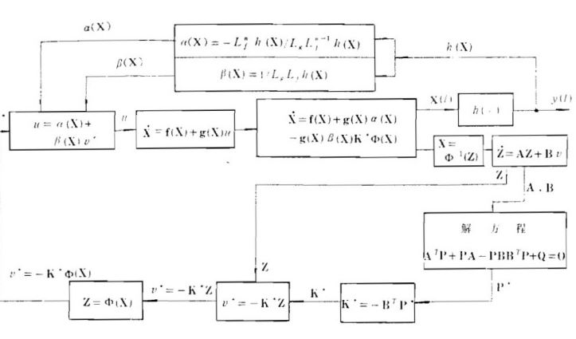
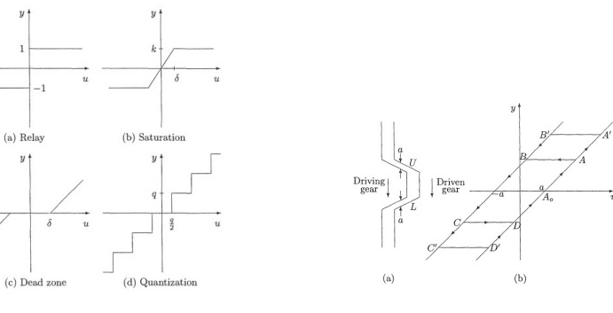

# 第九章：非线性控制基础专题

> 来源：《第9章 非线性控制专题.pdf》，42 页，标题按课件封面。页码均为 PDF 的物理页序。配套：[逐页核对索引](Chapter09_逐页核对索引.md)。

**本章解决的问题：** 当模型本身含有非线性时，能不能先用状态反馈抵消非线性，再用熟悉的极点配置或 LQR 设计？课件给出的路线是 **坐标变换 → 李导数 → 相对阶 → 反馈线性化 → 线性控制设计**。重点要会算三件事：坐标能否反解，输入在第几阶输出导数中出现，以及换回原输入后控制律在哪个区域有效。

## 一、问题的提出（第 1–7 页）

非线性既可能来自对象本身（摩擦、弹簧软化、隧道二极管），也可能是控制器有意引入的（继电器、死区）。非线性通常不满足叠加原理；改变激励幅值，可能跨过死区、进入饱和或改变运动类型。分析前先识别非线性属于哪一类：静态单值环节可写成 $`y=h(u)`$；齿隙和滞环还依赖运动方向或历史；静摩擦在零速度可在一定范围内平衡外力；纯线性时延本身仍满足叠加，但不能直接并入本章的有限维无时延光滑模型。

课件第 4 页举了两种有意使用非线性的思路：死区与微分反馈配合，按误差区间改变作用；继电器输出限幅的两端值，可构成第六章某些最短时间问题的 bang-bang 控制。后者需要由对象、约束和最优性条件决定切换，不能只凭存在继电器就断言最优。第 3、5–7 页的图与模型见附录 E01–E04。

## 二、非线性系统基本概念（第 8–27 页）

### 1. 坐标变换和微分同胚（第 9–18 页）

状态是同一个物理点，坐标是表示它的一组数。第 9–11 页用电机定子 $`abc`$ 和转子 $`dq0`$ 坐标说明这一点。第 12 页对常数可逆矩阵 $`T`$，从 $`Z=TX`$ 直接得到

```math
\dot Z=T\dot X=TAT^{-1}Z+TBU,\qquad Y=CT^{-1}Z.
```

课件第 12 页输出行若写作 $`\bar C X`$，应为 $`\bar C Z`$。如果 $`T`$ 随时间旋转，状态微分还会多出 $`\dot T T^{-1}Z`$，所以不能把电机的旋转换坐标当成单纯的常矩阵相似变换。

一般非线性变换 $`Z=\Phi(X)`$ 需要在所讨论区域内一一对应，并且 $`\Phi`$ 与 $`\Phi^{-1}`$ 光滑。这就是**微分同胚**。局部只要求在考察点的一片邻域成立。设 $`J_\Phi=\partial\Phi/\partial X`$；若 $`\det J_\Phi(X^0)\ne0`$，逆函数定理给出 $`X^0`$ 附近的光滑逆。这是把线性情形的“$`T`$ 满秩”推广到非线性情形。仅在点上验行列式不能证明整个定义域一一对应；即使逐点非零，要证明更大区域上的逆也应检验单射性与逆分支。见 E05–E08。

### 2. 仿射非线性系统、向量场与导出映射（第 19–25 页）

```math
\dot X=f(X)+g(X)u,\qquad y=h(X).
```

$`f`$ 是零输入时的漂移，$`g`$ 给出输入在该状态的作用方向，$`h`$ 把状态映射成测量输出。对某个固定 $`X`$，速度是关于 $`u`$ 的**仿射**函数，因此含 $`\sin X`$ 或 $`X^2u`$ 仍可能是输入仿射；直接含 $`u^2`$ 则不符合这个写法。多输入时用 $`\sum_i g_i(X)u_i`$。向量场像在每个状态点画一支速度箭头；它作为从状态到向量的映射不一定可逆。第 22 页末分量应按 $`n`$ 维写成 $`f_n`$。

坐标换成 $`Z=\Phi(X)`$ 后，链式法则给出

```math
\dot Z=J_\Phi(X)f(X)+J_\Phi(X)g(X)u,\qquad y=h(\Phi^{-1}(Z)),\quad X=\Phi^{-1}(Z).
```

第 24–25 页把 $`\Phi_*f(Z)=J_\Phi(\Phi^{-1}(Z))f(\Phi^{-1}(Z))`$ 称作**向量场的导出映射**。乘雅可比矩阵是为了变换箭头的分量，代入逆变换是为了把箭头放在正确的 $`Z`$ 点。它不是把 $`f(X)`$ 当作点直接计算 $`\Phi(f(X))`$。第 23 页例子见 E09。

### 3. 李导数（第 26–27 页）

若 $`\lambda(X)`$ 是标量函数，沿速度 $`f(X)`$ 走时，$`\lambda`$ 的瞬时变化率为

```math
L_f\lambda(X)=\frac{\partial\lambda}{\partial X}f(X)
=\sum_{i=1}^n\frac{\partial\lambda}{\partial x_i} f_i(X).
```

结果仍是一个标量函数。重复求导时，要先对**上一阶结果**取梯度：$`L_f^2h=L_f(L_fh)`$，$`L_gL_fh=L_g(L_fh)`$，不能把它理解成 $`(L_fh)^2`$ 或随意交换次序。沿真实轨迹的导数是 $`\dot h=L_fh+L_gh\,u`$。因此如果 $`L_gh=0`$，输入不直接出现在 $`\dot y`$ 中，下一步是对 $`L_fh`$ 再求导，不是宣布输入无法控制输出。第 27 页的手算见 E10。

## 三、SISO 仿射非线性系统设计（第 28–41 页）

第 28 页列出状态精确线性化、零动态设计、输出对干扰解耦三类方法；第 29–41 页具体推导第一类。泰勒线性化在工作点附近省略高阶项，精确线性化用反馈代数抵消非线性项。在变换有效且模型准确的区域内，后者的新方程是精确的；依然可能遇到奇异面、未知参数和输入限幅。

### 1. 相对阶与 Brunovsky 标准型（第 30–33 页）

课件称“关系度”，通常称**相对阶** $`r`$。在所讨论的开邻域，若 $`L_g L_f^i h=0`$ 对 $`i=0,\ldots,r-2`$ 恒成立，而 $`\beta(X)=L_gL_f^{r-1}h\ne0`$，则

```math
y=h,\quad \dot y=L_fh,\quad \ldots,\quad
y^{(r-1)}=L_f^{r-1}h,\quad y^{(r)}=\underbrace{L_f^r h}_{\alpha(X)}+\underbrace{L_gL_f^{r-1}h}_{\beta(X)}u.
```

这串等式来自对每个 $`L_f^i h`$ 应用链式法则，一直求到首次出现输入的那一阶。它与线性系统的 $`CB, CAB, CA^2B,\dots`$ 有直接联系：令 $`f(X)=AX,g=B,h(X)=CX`$，则 $`L_gL_f^i h=CA^iB`$，即输入通过几个积分层才影响输出。

当 $`r=n`$，取 $`z_i=L_f^{i-1}h`$，得到 $`\dot z_i=z_{i+1}`$（$`i<n`$），$`\dot z_n=\alpha+\beta u`$。满相对阶保证这组坐标局部独立。可用逆函数定理直接验雅可比；从结构上看，将这些坐标的梯度与 $`g,[f,g],\ldots,\operatorname{ad}_f^{n-1}g`$ 配对，按反序排列后出现三角矩阵，对角项为带符号的 $`\beta`$，因此满秩。选

```math
u=\frac{v-\alpha(X)}{\beta(X)},\qquad
\dot Z=A_cZ+B_cv,\quad y=z_1,
```

其中 $`A_c`$ 为超对角线全 1、其余全 0 的矩阵，$`B_c=[0,\ldots,0,1]^{\mathsf T}`$。这是 Brunovsky 标准型。能控矩阵 $`[B_c,A_cB_c,\ldots,A_c^{n-1}B_c]`$ 是反序单位矩阵，所以新输入 $`v`$ 可用第五章的极点配置。

当 $`r<n`$，上式只线性化了输入到输出的 $`r`$ 阶链。其余 $`n-r`$ 个内部状态的方程仍要分析。把 $`y,\dot y,\ldots,y^{(r-1)}`$ 设为零，并令 $`v=0`$ 保持它们为零，剩下的运动称**零动态**；零动态不稳定时，输出很好也不能推出全状态稳定。固定输出 $`h`$ 的相对阶不足，只说明这条输出链不能直接作为全状态坐标，不能据此排除另选输出的状态反馈线性化。作为补充，可对 $`\dot x_1=u,\ \dot x_2=x_2,\ y=x_1`$ 做自检：$`r=1`$，取 $`u=-x_1`$，则 $`y`$ 衰减但 $`x_2(t)=x_2(0)e^t`$，零动态不稳定。

### 2. 新坐标中的 LQR 与原坐标控制律（第 33–36 页）

使用第六章的无限时域二次型 $`J=\frac12\int_0^\infty(Z^{\mathsf T}QZ+v^{\mathsf T}Rv)\,dt`$。定义 Hamilton 函数

```math
H=\tfrac12(Z^{\mathsf T}QZ+v^{\mathsf T}Rv)+\Lambda^{\mathsf T}(A_cZ+B_cv).
```

令 $`H_v=0`$ 得 $`v=-R^{-1}B_c^{\mathsf T}\Lambda`$；由 $`\dot\Lambda=-H_Z=-QZ-A_c^{\mathsf T}\Lambda`$，代 $`\Lambda=PZ`$ 与闭环状态方程，得到

```math
A_c^{\mathsf T}P+PA_c-PB_cR^{-1}B_c^{\mathsf T}P+Q=0,
\qquad K=R^{-1}B_c^{\mathsf T}P,\quad v=-KZ.
```

这里按 $`\bar J=\int(H-\Lambda^{\mathsf T}\dot Z)dt`$ 统一乘子的尺度；课件第 34 页的重写式有重复的 $`1/2`$，且约束中的被减项应为 $`\dot Z`$。第 36、39 页的简式对应 $`R=1`$。应选稳定化解，并检查 $`R\succ0`$、$`Q\succeq0`$、可稳定性和可检测性。将 $`v`$ 代回原控制器：

```math
u(X)=-\frac{L_f^n h(X)+\sum_{i=1}^n k_i L_f^{i-1}h(X)}{L_g L_f^{n-1}h(X)}.
```

第 35 页提出的最优性边界可以直接由变量替换理解：对应的原坐标代价为 $`\frac12\int[\Phi(X)^{\mathsf T}Q\Phi(X)+(\alpha+\beta u)^{\mathsf T}R(\alpha+\beta u)]dt`$。它通常不同于直接惩罚 $`X,u`$ 的二次型。只有对这个拉回的指标、在能一一对应的可行轨迹与输入范围内，才能把最优性传回原问题。接近 $`\beta=0`$ 时输入可能会很大；有约束时，线性化后的无约束 LQR 不自动解决原约束问题。



*课件第 36 页：先用状态反馈实现 $`\dot z_n=v`$，再用 LQR 计算新输入 $`v`$。*

### 3. 设计方法总结（第 37–41 页）

例题从 $`y=x_3`$ 出发，输入到第三次求导才出现；坐标雅可比和输入系数都在 $`x_2=-1/2`$ 处失效。不要仅抄写“$`r=3`$”，要写出**对哪个区域成立**。若在原点附近设计，选 $`x_2>-1/2`$ 的逆分支，并约束初始状态与控制量使轨迹留在有效域。详见 E11。整体上，反馈负责抵消和重新缩放，坐标变换负责把方程排成积分链。第八章的等效滑模控制也是先解一个输入代数式，但其目标是让切换函数保持为零；本章用新输入指定整条输出链的最高阶导数。

## 四、参考文献（第 42 页）

课件列有卢强、孙元章《电力系统非线性控制》；Hassan K. Khalil《Nonlinear Systems》中译本；Riccardo Marino、Patrizio Tomei《Nonlinear Control Design》。第 42 页的英文姓名拼写略有出入。

## 附录：课件全部例题与示例演算

### E01｜典型非线性元件及设计应用（第 3–4 页）

课件依次画出继电器、饱和、死区、量化以及齿轮间隙。继电器在阈值两侧切换，饱和在中央线性而外侧限幅，死区在中央无输出而外侧才响应，量化在输入越过档位边界时跳变，间隙要先走完反向空程才能再次传力。比如单位继电器 $`F(u)=\operatorname{sgn}(u)`$，有 $`F(2)=1\ne2F(1)`$；单位饱和 $`F(u)=\min(1,\max(-1,u))`$ 同样不满足齐次性。死区宽度由阈值 $`\delta`$ 决定；单位斜率时可写为 $`F(u)=\operatorname{sgn}(u)\max(|u|-\delta,0)`$，$`u=\delta/2`$ 时输出为零，$`u=2\delta`$ 时输出为 $`\delta`$。课件未指定这两种控制应用的对象和参数，不能计算通用的性能改善量。



### E02｜含隧道二极管的电路（第 5 页）

以图示电感电流 $`i_L`$ 向右、电容电压 $`v`$ 向下为正，二极管电流为 $`h(v)`$。回路与节点方程分别是

```math
L\dot i_L=E-Ri_L-v,\qquad C\dot v=i_L-h(v).
```

平衡要求 $`i_L=h(v)`$ 且 $`h(v)=(E-v)/R`$。因此读曲线时，在 $`v-i`$ 平面画负斜率负载线找交点；有局部负微分电导时可能有多个交点，个数仍取决于 $`E,R`$。在某个交点线性化，得到 $`A=[-R/L,-1/L;1/C,-h'(v_*)/C]`$（分号分行），负的 $`h'`$ 会削弱阻尼，稳定性还要由矩阵判断。课件只有示意曲线，未给足以求唯一交点的元件参数。

### E03｜弹簧在大位移下的软化（第 6 页）

位移为 $`y`$，弹簧回复力取 $`-g(y)`$，则 $`m\ddot y=F-F_f-g(y)`$。课件给出 $`g(y)=k(1-\alpha^2y^2)y=ky-k\alpha^2y^3`$，适用区间 $`|\alpha y|<1`$。小位移时三次项相对线性项的比例为 $`\alpha^2y^2`$，因此原点线性化斜率为 $`k`$；有限位移的切线刚度却是 $`k(1-3\alpha^2y^2)`$。例如 $`\alpha y=1/2`$ 时，实际回复力幅值是线性模型的 $`3/4`$，切线刚度只有 $`k/4`$。储能可由 $`\int_0^y g(\eta)d\eta=ky^2/2-k\alpha^2y^4/4`$ 得到；这里不能把模型外推到任意位移。

### E04｜四种摩擦模型读图（第 7 页）

图中纵轴取惯用的**反抗力标量** $`F_f`$，受力方程中用 $`-F_f`$。第一图非零速度时 $`F_f=F_c\operatorname{sgn}v`$；第二图再加 $`b v`$；第三图在 $`v=0`$ 有静摩擦区间 $`[-F_s,F_s]`$；第四图增加低速时摩擦幅值随速度增大而先下降的 Stribeck 效应，之后黏性项重新占优。若零速度时除摩擦外合力为 $`F_0`$，且 $`|F_0|\le F_s`$，取 $`F_f=F_0`$ 即得 $`\dot v=0`$；只取 $`\operatorname{sgn}(0)=0`$ 无法描述这种黏住现象。

### E05｜电机 abc 与 dq0 坐标（第 9–12 页）

令 $`\theta=(\gamma,\gamma-2\pi/3,\gamma+2\pi/3)`$，$`c_\theta=(\cos\theta_j)_j`$、$`s_\theta=(\sin\theta_j)_j`$、$`\mathbf1=(1,1,1)^{\mathsf T}`$ 都为列向量。课件的矩阵为

```math
T=\frac23\begin{bmatrix}c_\theta^{\mathsf T}\\-s_\theta^{\mathsf T}\\\mathbf1^{\mathsf T}/2\end{bmatrix},
\qquad T^{-1}=[c_\theta\ \ -s_\theta\ \ \mathbf1].
```

三列两两正交，平方范数分别为 $`3/2,3/2,3`$（三相对称的正弦余弦求和）。矩阵相乘，非对角项为零，对角项为 $`(2/3)(3/2,3/2,3/2)=(1,1,1)`$，故两矩阵互逆。对三相平衡输入 $`I_{abc}=I c_\theta`$，得 $`i_d=I,i_q=i_0=0`$，说明随转子角度变化的三相量，在随其旋转的坐标中可以写成常数。

### E06｜全局微分同胚（第 14–15 页）

课件 $`z_1=x_3,z_2=x_2,z_3=1+x_1-e^{x_2}`$。顺着头两个式子先得到 $`x_3=z_1,x_2=z_2`$，第三式再得到 $`x_1=z_3-1+e^{z_2}`$。代回两方向都是恒等，且各式在整个 $`\mathbb R^3`$ 光滑；雅可比 $`J_\Phi=[0,0,1;0,1,0;1,-e^{x_2},0]`$ 的行列式为 $`-1`$，与构造出的全局逆一致。

### E07｜带奇异线的局部微分同胚（第 16 页）

$`z_1=x_1,z_2=x_2-1/(x_1+1)`$；于是 $`x_1=z_1,x_2=z_2+1/(z_1+1)`$。$`J_\Phi=[1,0;1/(x_1+1)^2,1]`$ 的行列式为 $`1`$，在 $`x_1=-1`$ 上矩阵和映射都没有定义。课件取 $`U=\{x_1>-1\}`$，它和 $`\{z_1>-1\}`$ 一一对应；左侧半平面也可单独处理，不能跨过未定义的直线使用同一个整平面变换。

### E08｜用雅可比判断可逆（第 17–18 页）

$`z_1=x_1+x_2,z_2=\sin x_2`$，所以 $`J_\Phi=[1,1;0,\cos x_2]`$、$`\det J_\Phi=\cos x_2`$。原点行列式为 $`1`$、秩为 2，故有局部光滑逆。在 $`|x_2|<\pi/2`$ 可显式写 $`x_2=\arcsin z_2,x_1=z_1-\arcsin z_2`$。举反例：$`(0,0)`$ 和 $`(-2\pi,2\pi)`$ 都映为 $`(0,0)`$，所以原点可逆不能推广到整个平面。

### E09｜向量场取值与导出映射（第 23–25 页）

课件给出 $`\Phi(X)=[x_3(1+x_2),x_1,x_2(1+x_1)]^{\mathsf T}`$、$`\Psi(X)=[0,1+x_2,-x_3]^{\mathsf T}`$。在原点两个值分别为 $`(0,0,0)`$ 与 $`(0,1,0)`$，而由各分量求偏导有

```math
J_\Phi=\begin{bmatrix}0&x_3&1+x_2\\1&0&0\\x_2&1+x_1&0\end{bmatrix},\qquad
\det J_\Phi=(1+x_1)(1+x_2).
```

作补充演算：用第一式作坐标时，可在 $`x_1\ne-1,x_2\ne-1`$ 上反解 $`x_1=z_2,x_2=z_3/(1+z_2),x_3=z_1/(1+x_2)`$。乘 $`J_\Phi\Psi`$ 得 $`[0,0,(1+x_1)(1+x_2)]^{\mathsf T}`$，代入逆变换成为 $`[0,0,1+z_2+z_3]^{\mathsf T}`$。这也解释为什么一个向量场虽然可以看成映射，却要另验雅可比才有资格当坐标变换。

### E10｜李导数的第一步（第 27 页）

记 $`D=x_1+x_2^2`$，$`f=[0,D,x_1-x_2]^{\mathsf T}`$、$`g=[e^{x_2},e^{x_2},0]^{\mathsf T}`$、$`h=x_3`$。因为 $`\partial h/\partial X=[0,0,1]`$，它与 $`g`$ 相乘选中第三分量 $`0`$，与 $`f`$ 相乘选中 $`x_1-x_2`$。于是 $`L_gh=0,L_fh=x_1-x_2`$。输入同时推动 $`x_1,x_2`$ 且系数相同，所以在下一阶的差 $`x_1-x_2`$ 中还会抵消。

### E11｜三阶状态精确线性化与 LQR（第 37–40 页）

**第一步：连续求导。** 延续 E10，对 $`x_1-x_2`$ 求梯度得到 $`[1,-1,0]`$，故 $`L_gL_fh=0,L_f^2 h=-D`$。再对 $`-D`$ 求梯度，得 $`[-1,-2x_2,0]`$，所以

```math
L_gL_f^2h=-(1+2x_2)e^{x_2},\qquad L_f^3 h=-2x_2D.
```

**第二步：确定区域与逆。** 取 $`Z=(x_3,x_1-x_2,-D)^{\mathsf T}`$，则

```math
J_\Phi=\begin{bmatrix}0&0&1\\1&-1&0\\-1&-2x_2&0\end{bmatrix},\quad
\det J_\Phi=-(1+2x_2),\qquad
x_2=\frac{-1\pm\sqrt{1-4(z_2+z_3)}}2,\quad x_1=z_2+x_2,\quad x_3=z_1.
```

选择原点所在分支的正号。平面 $`x_2=-1/2`$ 对应 $`z_2+z_3=1/4`$，两支在这里合并，且 $`\beta=0`$，所以此处不能用本反馈要求任意 $`v`$。第 38 页写的 $`r=n=3`$ 适用于平面之外各分支，不能说系统处处为满相对阶。

**第三步：代入反馈验证。** 取 $`u=-(2x_2D+v)/[(1+2x_2)e^{x_2}]`$，代回 $`\dot z_3=-2x_2D-(1+2x_2)e^{x_2}u`$ 得到 $`\dot z_3=v`$；同时 $`\dot z_1=z_2,\dot z_2=z_3`$。第 39 页的第一行中 $`1/L_gL_f^2h`$ 一项应乘 $`v`$，该页末式已经包含 $`v`$。

**第四步：独立解 Riccati 方程。** 取 $`Q=\mathrm{diag}(1,1,0)`$、$`R=1`$；$`y_Q=Q^{1/2}Z`$ 可观，因为 $`z_1`$ 与其导数能观测积分链。设 $`P=(p_{ij})=P^{\mathsf T}`$，按 $`(1,1),(1,2),(1,3),(2,2),(2,3),(3,3)`$ 的顺序比较六个方程：

```math
1-p_{13}^2=0,\quad p_{11}-p_{13}p_{23}=0,\quad p_{12}-p_{13}p_{33}=0,
\quad 2p_{12}+1-p_{23}^2=0,\quad p_{22}+p_{13}-p_{23}p_{33}=0,\quad 2p_{23}-p_{33}^2=0.
```

稳定化解取 $`p_{13}=1`$。令 $`b=p_{33}`$，则 $`a=p_{23}=b^2/2`$，$`b^4-8b-4=0`$。正根 $`b\approx2.14470`$，$`a\approx2.29987`$，$`p_{22}=ab-1\approx3.93253`$；课件给出较粗的近似 $`(a,b,p_{22})=(2.29,2.14,3.9)`$。精算与课件同一结构：

```math
P=\begin{bmatrix}a&b&1\\ b&ab-1&a\\1&a&b\end{bmatrix},\quad K=[1,a,b],\quad
\det(\lambda I-A_c+B_cK)=\lambda^3+b\lambda^2+a\lambda+1.
```

系数均正，且 $`ab>1`$，三阶 Routh 条件成立。原控制律为

```math
u=-\frac{2x_2D+bD-a(x_1-x_2)-x_3}{(1+2x_2)e^{x_2}}.
```

例如代 $`x_1=x_2=0,x_3=1`$，得 $`Z=(1,0,0)^{\mathsf T}`$、$`v=-1,u=1`$，由实际的 $`\dot z_3=-u`$ 验得 $`\dot z_3=-1`$。对原点分支，线性系统的稳定性可用于原点附近：取足够小的闭环 Lyapunov 子水平集，使它包含于 $`z_2+z_3<1/4`$，则不会穿过奇异边界；不能从线性闭环稳定直接推出整个原状态空间可行。
